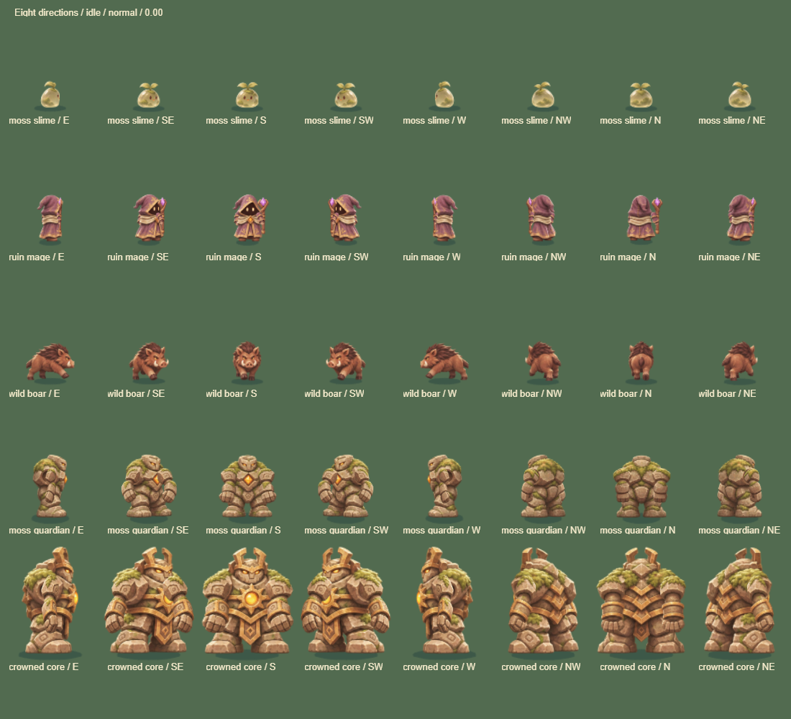
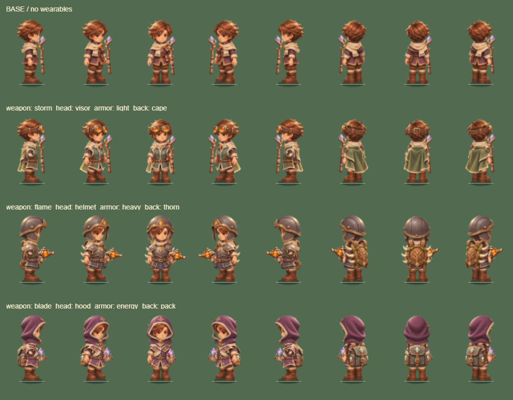
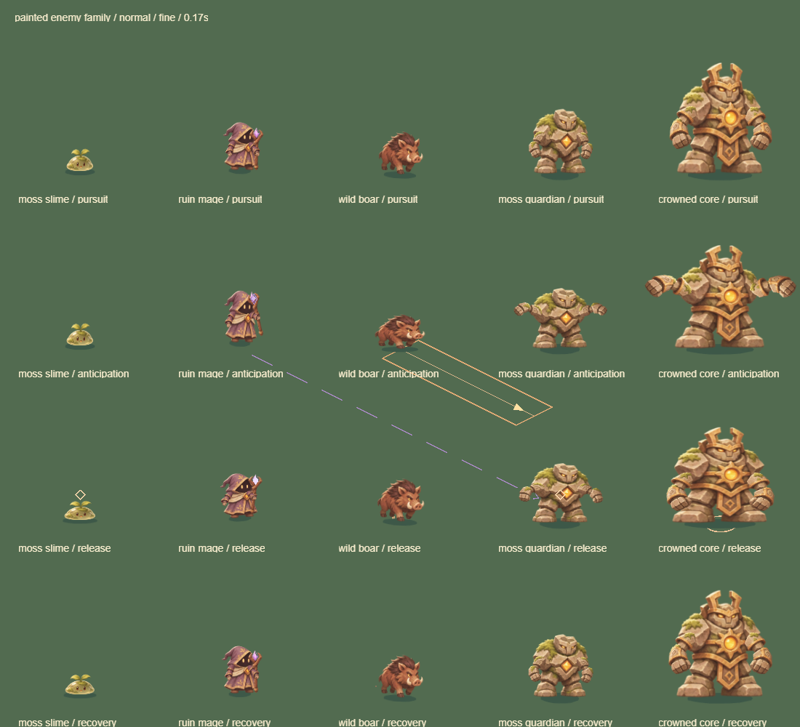

# 遗迹回响 · Relic Echo

LayaAir + TypeScript 开发的 2.5D 肉鸽生存原型，当前版本 **`0.15.19`**。采用手绘幻想风格：玩家、可穿戴装备、怪物与元素特效使用仓库内的透明图片和共享图集，场景、伤害边界与 UI 结合程序绘图，由 LayaAir 显示节点统一渲染。

当前优化计划、优先级和真机验收状态见[优化清单](docs/优化清单.md)。

玩法改造已开始：[Buff 构筑改造方案](docs/buff-build-design.md)中的共同成长底座，以及冲刺布场、冰冻碎裂、雷印引爆的跨槽反应和成长分支均已实装；整局平衡仍需人工试玩。

[自由组合扩展总设计](docs/buff-combination-system.md)进一步规划 8 种触发、8 种行为、6 类元素/状态和 12 种候选改造，三片即可发动，两个槽通过状态与位置联动；按四批验证后开放，目录数量不代表已实装。

[在线试玩](https://huckhuck12.github.io/relic-echo/) · [视觉制作进度](docs/art/visual-production-backlog.md) · [微信小游戏接入](docs/微信小游戏接入.md)

## 本地运行与 GitHub Pages

使用 Node.js 22+（推荐 24）：`npm ci` 后运行 `npm run dev`，访问 `http://localhost:8080/`。

项目已包含 [GitHub Pages 工作流](.github/workflows/pages.yml)。上传到自己的 GitHub 仓库，在 **Settings → Pages → Source** 选择 **GitHub Actions**；向 main/master 推送或手动运行工作流，构建和测试通过后自动发布。所有资源使用相对路径，支持 `https://用户名.github.io/仓库名/` 和账号主页站点。

本地生成发布包：`npm run build:pages`。模拟仓库子路径：`npm run preview:pages -- --port 8081`，访问 `http://localhost:8081/relic-echo/`。详见[开发与发布说明](docs/开发与发布.md)。仓库为 `huckhuck12/relic-echo`，本地修改需推送后等待 GitHub Actions 部署成功才会更新线上站点。

## 0.15.19 冰系分支与控制诊断

碎冰改为两次冰环真实接触即可碎裂，标记同步为两格；寒牢随储层将减速从 35% 加深至 55%，Boss 上限仍为 15%。单组冰环的相位、接触冷却和反应预算保留。自动样本新增减速覆盖/加权敌秒，不把控制只算作伤害。

单种子三武器两分支配对普通/保命共 24 局，普通环刃碎冰存活 379.9 → 467.7 秒，普通通关 0/6 → 1/6；但炎炮碎冰仍未兑现，部分寒牢结果未改善。雷系暂不因引爆次数多而削弱，详见[规则、数据与边界](docs/frost-branches-01519.md)。

## 0.15.18 雷系构筑结构调整

命中触发改为冷却后必定触发；三武器实际命中可为已有雷印充能，单目标间隔 0.5 秒、全局间隔 0.12 秒，不凭空种印或刷新蓄雷窗口。传印死亡后向附近 3/5 敌继承，蓄雷起手索敌与死亡继承优先精英/Boss；同槽冰环续接保留相位和接触冷却，不再堆叠多个环。

两种子三武器两分支的普通 12 局配对样本，引爆总次数 1 → 150，普通通关仍为 1/12；保命 12 局引爆 26 → 429。分支分工已有实际兑现，但炎炮传印优势、冰环收益与生存压力仍待平衡。382 项测试通过，规则和逐局数据见[结构调整记录](docs/thunder-core-01518.md)。

## 0.15.17 雷印击杀余电

致死雷丸或带印目标死亡后，向 180 内最近一敌继承印记，每印放电 40%；继承不能直接引爆、刷新窗口或连续传播。每步最多 16 次搜索，沿用目标上限、伤害快照和有效扣血排行。配方说明与反馈同步。

两种子三武器两分支共 24 局，普通每局出现 47–115 次继承；种子 1104 六组雷电来源有效伤害均增加，但总占比与存活并非全部改善，原有叠印引爆仍稀少。376 项测试通过；详见[规则与对照](docs/thunder-remnant-01517.md)。

## 0.15.16 冰环接敌与雷印积累

环绕真实轨道半径由 90 增至 150，图集/矢量绘制及自动试玩同步；保留双轨道接触和中心空区。碎冰现在对主目标也造成 70% 伤害。雷弹速度增至 900，其他元素弹丸仍为 480；蓄雷每次直击叠两印，传印向邻居传两印，传播仍不能直接引爆或刷新窗口。

三武器四分支同种子保命样本中，环刃碎冰 Buff 占比 3.8% → 12.1%，炎炮碎冰 2.7% → 8.6%；12 局普通样本中雷杖寒牢一局通关，其余未通关。雷系普通清怪阶段仍未引爆，印记随目标死亡丢失仍待优化；对照包含自动试玩接敌距离变化，不作为真人难度结论。见[规则与完整对照](docs/buff-contact-01516.md)。

## 0.15.15 Buff 实战收益首轮调整

Buff 满级基础伤害成长由 +20% 提升至 +70%，火径每场 45% → 85%（重叠不叠伤），环绕基础伤害 12 → 20。雷弹原目标死亡后可在剩余寿命内重新索敌一次，沿用弹速、转向与数量限制。面板说明与伤害快照同步。

三武器 × 六分支同种子对照中，保命雷杖火径 Buff 伤害占比 6.5% → 12.4%，环刃火径 28.3% → 32.5%；部分雷系组合未提升，冰环仍受接敌不足影响。18 局保命全部完成 Boss，18 局普通均未通关，不能视为平衡完成。完整规则、退步样本和下一步见[实战收益记录](docs/buff-payoff-01515.md)。

## 0.15.14 地图事件与分阶段怪潮

12 分钟「标准探索」的四处封印分别改为累计守护、圈内清剿、三点巡回与指定守卫挑战，HUD、地面目标及自动试玩同步识别。怪潮按阶段采用单侧来袭、两翼夹击、远程混编和三路突围，沿用每波数量预算、整备窗口与完成奖励；6 分钟「快速探索」保留原规则。364 项测试通过，三武器保命样本完成 Boss 流程，正常样本仍未到 Boss。见[规则、样张与验证边界](docs/map-encounters-01514.md)。

## 0.15.13 敌方弹道辨识

法师使用细长魔针，精英使用厚晶锤，Boss 环形弹幕使用分叉冠刃；保留共用危险红边，并区别于玩家圆润暖芯火弹。精英/Boss 的释放标记对应晶体/王冠，弹头出手短回弹、寿命末段轻退亮度。沿用原共享图集、伤害、碰撞和时序；356 项测试通过，微信模拟固定场景改前后均 28 DC。见[样张与验证](docs/art/enemy-projectiles-01513.md)。

## 0.15.12 Buff 状态与联动辨识

雷印和冰层分为上下两排，区分闪电符/冰晶、三层/五层及爆发锁定；减速纹路放在脚边，灼烧放在身体一侧。炉心增加向内纹路，回炉、碎冰、传印分别显示收拢/飞散/传播方向，蓄雷使用紧凑纵向爆发。复用原图集与反馈预算，不改变战斗规则；354 项测试通过，微信模拟固定场景前后均为 28 DC。见[制作、样张与边界](docs/art/buff-vfx-01512.md)。

## 0.15.11 玩家弹道与命中反馈

雷杖从短亮芯放电收成细余弧，连锁路径不再重复叠加命中光斑；炎炮采用圆润暖芯与分离尾焰，爆破亮芯先退、余烬后散；御刃改为轨道短弧尾迹和收尖切痕。复用共享图集，保留伤害、范围、攻击时序和装饰预算。349 项测试通过，武器展示板仍为 7 DC；真机观感与长局性能待确认。见[样张与验证](docs/art/player-vfx-01511.md)。

## 0.15.10 指定自动试玩、弹窗动效与蓄雷续存

主菜单或暂停页进入「自动试玩设置」，可固定六分支之一、固定武器或全部轮换，并选择 6/12 分钟及正常/保命新局；结算后保持选择，仍通过实际奖励成长。弹窗新增 180ms 淡入、轻微上浮与收拢，出现时即可点击，设置刷新不重播。

雷丸有限追踪选中目标，蓄雷直接命中续存九秒。相同样本中，保命蓄雷引爆从 0/3→3/3；正常样本两条雷电路线仍未引爆，尚未完成普通怪阶段的平衡。见[规则、入口、对照与验证](docs/thunder-autoplay-01510.md)。

## 0.15.9 冰霜联动与冲刺落点

跨槽冲击可从一层冰层开始碎裂，主目标仍按层数结算；三层自然碎裂与寒牢高层奖励保留。自动试玩会选择安全且覆盖目标的冲刺落点。相同 54 局标准模式样本中，正常碎冰触发从 1/6 增至 4/6，寒牢从 0/6 增至 4/6；仍需真人验证。见[定位、对照与复现](docs/frost-contact-0159.md)。

## 0.15.8 构筑平衡统计

自动试玩增加伤害来源、成型里程碑、受击与实际 Boss 击杀耗时，微信「复制运行诊断」可导出。完成 36 局正常与 18 局保命标准探索基线；冰霜和雷电的进化兑现率是下一优先项，本版未调整伤害数值。见[结果、口径与复现](docs/build-baseline-0158.md)。

## 0.15.7 战斗实时伤害排行

伤害排行默认常驻战斗 HUD，显示主要来源、有效伤害和占比，最多每 0.25 秒更新一次；窄屏自动减少行数。点击可暂停查看完整排行，保留原暂停/结算入口。文字更新不重建按钮或摇杆。见[实现与验证](docs/art/live-damage-0157.md)。

## 0.15.6 伤害排行

暂停菜单与结算页点击「伤害排行」，查看本局各武器、Buff 行为/元素组合及装备反伤的有效伤害、占比和排名，支持手机横竖屏分页。灼烧、连锁与进化伤害归入原始来源；换装/换配方保留历史，新局清零。排行排除溢出伤害，原结算「总伤害」仍含溢出，因此两者可能不同。见[统计口径与样张](docs/art/damage-ranking-0156.md)。

## 0.15.5 碎片选择与替换预览

选片卡显示用途、当前装入状态、替换后新增/失去的两槽联动与进化名称。未解锁碎片点击后在面板内说明解锁方式；已解锁卡仍单次点击装入，冷却保留。预览只代表静态配方搭配，不表示战斗效果已经触发。见[选片样张与验证](docs/art/fragment-picker-0155.md)。

## 0.15.4 Buff 构筑信息分层

碎片面板拆成「配方编辑 / 两槽联动 / 成长路线」：保留整卡选片，两槽联动按实际完整配方提示已搭配或缺失条件，成长页显示真实碎片进度、分支与专精。支持手机横竖屏，切页不改配方与冷却。见[编辑页样张与验证](docs/art/buff-editor-0154.md)。

## 0.15.3 菜单与奖励界面统一

主菜单、强化、装备对比、背包、暂停与结算使用深苔绿标题区和暖纸内容区；操作按钮统一绿色，奖励选项保留浅纸底，武器选择有独立选中边线。中文标题统一为系统字体，背包装备增加图标底座。保留整卡点击与奖励事务规则，无新增图片或字体下载。见[界面样张与验证](docs/art/dialogs-0153.md)。

## 0.15.2 局内 HUD 统一

- 手机状态条收紧为 52 像素，采用深苔绿底、浅色正文与旧金重点；局内四类操作键、提示和性能面板统一配色，奖励弹窗保留暖纸色。
- 封印/Boss、连杀与短提示分行，横屏提示使用右上独立区域；不重建正在操作的按钮。见[布局样张与验证](docs/art/battle-hud-0152.md)。

## 0.15.1 地图分区表现

- 四处封印新增贴地地标：苔庭叶纹、断柱柱基、泉庭波纹镶嵌、古门门槛；踏石连接中央岔路。减小地表色差并修补瓦片滤波暗缝。
- 静态绘制，不增加碰撞体或贴图页。319 项测试通过；地图分区仍是首版，UI 统一尚未实装。见[制作与验收](docs/art/map-regions-0151.md)。

## 0.15.0 战斗表现第一批

- 飞刃改为独立刀刃与切痕，冲刺采用定向收尖尾迹；火球轮廓更紧凑，爆破上层焰冠缩小，命中亮芯更快淡出，通用粒子改为尖角碎屑。
- 密集战斗限制重复命中和残影装饰，保留实际伤害范围、连锁路径及危险预警；317 项测试通过。地图分区美术、Buff 全量深化和 UI 统一继续推进。见[制作与验证](docs/art/combat-vfx-0150.md)。

## 0.14.3 自动试玩导航

- 飞刃按实际射程接近敌人，冲刺检查沿途障碍与弹道，封印目标考虑生命、期限和敌群压力；寻药按最大生命比例判断。
- 314 项测试通过。相同种子与构筑的 36 局普通样本平均存活由 448 增至 483 秒，3 局到达 Boss、无通关；封印完成数减少，尚不能代表真人平衡。见[本轮对照](docs/auto-navigation-0143.md)。

## 0.14.2 标准压力与封印补给

- 标准探索单独降低中后期刷怪和弹幕压力，限制怪潮额外补充精英，修正整备后积压怪潮连续补发；快速模式保持原规则。
- 完成封印后最多 20 秒新怪减缓；奖励改为 15% 生命＋碎片选择，或 45% 治疗。已有敌人继续攻击，Boss 照常登场。
- 310 项测试通过，包含三武器与六分支的普通/保护逻辑对照；具体样本结果和限制见[本轮记录](docs/standard-pressure-0142.md)。

## 0.14.1 中局成长与配方专精

- 标准模式强化配方逐级累计 1/2/3/4 枚匹配重复碎片，经验需求随等级温和加速；快速模式保留原成长。
- 4/7 分钟后，达到三级的两种配方分别可选一次专精：凝聚（伤害 +30%、触发冷却 +25%）或疾奏（伤害 -20%、触发冷却 -20%）。绑定行为＋元素，换槽保留、重开清除。
- Buff 面板、碎片反馈和自动试玩均已接入。305 项测试通过，12 局保护运行完成 Boss；普通样本仍在约 6–7 分钟死亡，尚未完成整局平衡。见[本轮规则与对照](docs/standard-growth-0141.md)。

## 0.14.0 标准探索与封印事件

- 开始界面默认标准探索：最长 12 分钟，10:00 核心登场；保留最长 6 分钟、5:00 核心登场的快速探索。
- 标准模式有阶段提示、周期整备间隙和四个可跳过的地图封印。靠近启动，45 秒内在圈内累计守护 18 秒，选择碎片或恢复最多 30% 生命；离圈只暂停进度。
- 自动试玩会尝试前往封印并领取奖励；普通试玩仍会死亡，保命压测只验证长局流程。当前为关卡节奏与地图目标首版，后续仍需解决中后期成长过早封顶。
- 详情、验证及尚未实装的特效/地图/UI 改造见[本轮记录](docs/standard-expedition-0140.md)。

## 0.13.5 角色图集清晰度

- 玩家合成图集由 1 倍提高到 1.4 倍采样，怪物由 0.8 倍提高到 1.25 倍；屏幕显示大小、UI 和微信 DPR 保持不变，减少角色经过中间图集时丢失的细节。
- 使用紧凑装箱，玩家当前装备与全怪物共享页各不超过 8 MiB；换装释放旧页，怪物仍只用一页，动作不重复上传。静态装备预览上限调整为 256 KiB。
- 289 项测试通过，修改前后 25/100/200/400 只混排怪物场景均为 18 DC。用户此前确认 iPhone Air 稳定 60 帧、本轮未遇到闪退；高清图集版本仍需真机确认。见[清晰度验证记录](docs/art/actor-clarity-0135.md)。

## 0.13.4 冰环扫掠与雷丸选敌

- 冰环沿旋转和玩家移动路径检测，补齐采样间漏碰撞；每次释放对同一敌人仍有 0.35 秒接触冷却，两个环绕物共享冷却。
- 雷丸优先瞄准范围内已有有效雷印且未锁定的目标，同优先级选择最近目标；所有弹丸按弹道最先接触的敌人结算。
- 287 项测试通过；同种子 18 局保命压测中，冰霜碎裂合计 3 → 44，雷爆 7 → 18。另补六局普通试玩，雷电普通局仍可能无法兑现爆发；未完成整局平衡或真机性能验收。见[验证记录](docs/build-playtest-release-0134.md)。

## 0.13.3 构筑试玩与持续接触修正

- 火场和冰环的持续接触不再附带普通物理击退，保留元素状态、冲击元素、回炉及爆发位移，避免把目标推出有效范围。
- 自动试玩按六分支 × 三武器轮换 18 局，使用当前实际配方走位和冲刺；仍走正常奖励与输入，普通模式会死亡，保命模式用于覆盖 Boss。
- 诊断保留最近 18 局，区分计划路线与实际等级/分支。新增 npm run check:balance，完成 36 局前后对照及 6 局普通样本；冰霜/雷电反应兑现仍偏少，未宣称整局平衡完成。见[试玩与数据记录](docs/build-playtest-release-0133.md)。

## 0.13.2 雷电导冷与分支

- 导冷：另一槽冰霜 Buff 的有效减速让雷丸直击额外加一印，每目标一秒一次；普通武器减速、雷电传导不加印。
- 传印：三印爆发降为 120%，用向附近三敌传印替代旧溅射；Lv.5 最多五敌，传播不能自行引爆。
- 蓄雷：改为五印单体爆发 300%，Lv.5 为 350%，取消引爆溅射；基础元素传导仍保留。
- 基础/传印从第一印起计时九秒；自 0.15.10 起，蓄雷雷丸直击续存九秒。爆发后一秒锁定，每逻辑步最多十六次雷爆，预算不足不消耗印记。蓄雷显示五格进度，爆发锁定期间显示短计时线。
- 火、冰、雷三套首批构筑均已实装，完整 8×8×6 扩展目录仍待后续开发。验证与边界见[雷电实装记录](docs/thunder-build-release-0132.md)。

## 0.13.1 冰霜跨槽联动与分支

- 冰环叠至少一层后，另一槽冲击可提前消耗冰层碎裂：主目标每层 40% 冰环伤害，附近最多 4 敌各 40%，每目标锁 1 秒。
- **碎冰：**三层自动碎裂改为向附近 3 敌射出各 70% 伤害的冰片，不伤主目标；Lv.5 最多 5 敌。跨槽冲击仍可提前引爆。
- **寒牢：**直伤 ×0.8、最多储存 5 层、首层起 4 秒窗口，不再自动引爆；Lv.5 消费至少 4 层时，主目标爆发 ×1.25。碎裂依据未削弱的冰环伤害快照。
- Boss 由 Buff 造成的减速最多 15%，仍可叠层和受碎裂伤害。每步冰霜爆发最多 16 次，超过时保留冰层；不递归传层。
- 火焰与冰霜各自排队选择分支；横屏编辑页使用简版说明。261 项测试通过，H5/微信模拟检查见[实装记录](docs/frost-build-release-0131.md)。本地 _wechat 同步到 0.13.1；真机热机和闪退复验继续保留。

## 0.13.0 首批 Buff 构筑

- 首次升级（最晚约 20 秒）选择冲刺布场、冰冻碎裂、雷印引爆，直接解锁并装好两槽；选择自由组合则保留配方并领取常规强化。
- 等级按“行为＋元素”共享，换触发保留培养；Lv.2/4 各增加 10% 伤害，总计最高 20%，最高 Lv.5。重复碎片掉落兼顾新解锁和已装备配方成长。
- **回炉：**另一槽的冲击命中火场内、由火焰槽灼烧的存活目标时，替换向外击退为回拉，每目标 1 秒一次。Boss 不被回拉，精英保留抗性。
- **火焰区域 Lv.3 二选一：**火径沿实际冲刺路径生成 3 个 45% 伤害火场，重叠不重复伤害；炉心半径缩至 70、伤害 ×1.35、同处刷新。Lv.5 分别延长持续时间 / 回炉追加受限热爆。
- 新选卡复用奖励身份与队列，自动试玩可领取，持续按住的浮动摇杆可在选卡后接续。火场仍最多 8 个；容量不足时火径回退为单个终点火场。
- 250 项自动测试与 H5 卡片点击检查通过；微信包约 3.92 MB。冰霜/雷电的新机制与分支、更多碎片目录、iPhone Air 真机长时间测试仍待完成。详见[本批实装与验证记录](docs/buff-build-release-0130.md)。

## 0.12.6 怪物八方向

- 五类怪物各有正面、前侧、侧面、后侧和背面五个独立视角，镜像补齐八方向；移动时转身，蓄力、冲锋和出招期间锁定朝向。
- 史莱姆/野猪保留四帧动作；法师、精英与 Boss 使用分件，修正肩部遮挡和法杖特效挂点。身体、手臂、法杖、弹道及掉落共 341 个图集帧，仍共用 **4 MiB GPU 页 + 4 MiB 解码源图**。
- 242 项自动测试通过；八方向混合怪物 25/100/200/400 只均为 18 DC，微信固定压力场景为 28 DC。H5/微信模拟及画面回归结果见[验收数据](docs/render-results-0126.json)。本地微信包为 0.12.6，约 3.91 MB；iPhone Air 长时间性能与闪退仍待真机复验。



[多视角素材与完整提示词记录](docs/art/enemy-directions-production.md) · [出招样张](docs/art/enemy-directions-release-0126.png)

## 0.12.5 主角可穿戴装备重画

- 重画三种头饰、三种护甲、三种背饰，共 9 件、45 个视角切片；五个独立视角加镜像映射八向。护甲包含实际躯干衣装，袖口与四肢沿用身体动作。
- 战斗与装备预览共用穿戴合成，修正头盔/兜帽的头发遮挡、背饰前后层级与施法锚点。素材放入原有角色源图空白处，解码源图仍为 4 MiB；三套完整穿搭各为 4 MiB GPU 缓存，静态预览最多 64 KiB。
- 238 项测试及 H5/微信模拟检查通过；混合怪物密度场景仍为 18 DC，微信固定压力场景仍为 28 DC。本地 `_wechat` 已更新至 0.12.5；独立衣袖动画和真机长时间验收仍待完成。



[装备制作记录与完整提示词路径](docs/art/equipment-production.md) · [行走样张](docs/art/equipment-walk-0125.png) · [施法样张](docs/art/equipment-cast-0125.png) · [0.12.5 验收数据](docs/render-results-0125.json)

## 0.12.4 怪物重画与跨画质共享图集

- 重画苔芽史莱姆、遗迹法师、荒野野猪、苔藓守卫与王冠核心。史莱姆/野猪使用四帧动作，法师拆分身体、袖手和法杖，精英/Boss 拆分身体与双臂，继续共用攻击和预警挂点。
- 冰冻、受击配色保留材质明暗，脚底阴影保持原色；死亡改为叶片、布屑与石片轮廓，沿用数量预算。伤害、碰撞与攻击时序不变。
- 怪物、法师姿态、石像分件、弹道、掉落与石柱共 164 个合成帧，三档画质共用一张 **4 MiB GPU 图集**；另有约 **4 MiB 共享解码源图**。加载失败保留程序素材，异步替换会刷新静止实体和场景缓存。
- 桌面真实 Laya WebGL 冻结场景：25/100/200/400 只混合怪物均为 **18 DC**；微信 SDK 模拟固定场景（235 怪、208 弹道、150 掉落）保持 **28 DC**，与 0.12.3 一致。以上不代表 iPhone 帧率或闪退已经修复。
- 234 项自动测试通过，完成手机横竖屏、桌面交互与微信构建回归。本地运行后可访问 `/bench/enemy-review.html` 查看动作/状态样张，`/bench/enemy-effects.html` 查看动态演示。



[怪物素材与生成提示词记录](docs/art/enemy-family-production.md) · [冰冻样张](docs/art/enemy-ice-0124.png) · [死亡反馈](docs/art/enemy-death-0124.png) · [验收数据](docs/render-results-0124.json)

0.12.6 已补齐怪物五视角加镜像八向，攻击通过分件变换表达；独立逐帧转身/攻击动画、玩家更清晰的步态源图、场景/UI 深化仍待完成。iPhone Air 精细画质的长时间性能、触控连续性与整进程闪退仍需真机复验。

## 0.12.3 武器、Buff 与进化特效

统一三武器、四行为 × 四元素的 16 种基础 Buff、灼烧/减速状态和三进化表现。全画质共用一张 512² 元素图集，新增 GPU 纹理 1 MiB；地面与上层分别集中绘制，真实伤害边界继续保留。16 Buff 同屏与进化样张为 6 DC，武器样张为 7 DC。

[Buff 效果样张](docs/art/buff-family-0123.png) · [武器样张](docs/art/weapon-vfx-0123.png) · [进化样张](docs/art/buff-evolutions-0123.png) · [制作记录](docs/art/element-vfx-production.md)

## 0.12.2 玩家素材、动作挂点与精英批次

接入 B「遗迹学徒」透明身体与三武器挂件，修正握把、脚底接地和移动攻击衔接；站立施法混合上身姿态，保留待机腿部。精英/Boss 身体和双臂合入普通怪共享页，避免数量增加时逐只切换纹理。

[玩家制作记录](docs/art/hero-b-production.md) · [该版渲染数据](docs/render-results-0122.json)

以下为历史版本记录，数值与实现描述适用于对应版本；当前状态以上述最新版本和制作清单为准。

## 0.12.0 手绘幻想与共享渲染

玩家、怪物、风化石柱、草地旧路、技能配色与 UI 统一为手绘幻想方向。面板使用暖纸色和墨线，大标题采用系统衬线字体。美术源、资源预算与总览见[美术规范](docs/手绘幻想美术规范.md)。

普通怪、常见敌弹、火球、石柱与掉落共用图集，保持原深度遮挡；地图改为六种可重复纹理；玩家缓存当前装备的 128 个姿势，换装释放旧纹理。血条背景和填充集中绘制。性能面板显示场景纹理内存，避免只看到怪物图集。

同一浏览器 Laya + 模拟微信 SDK 冻结场景（235 怪、208 弹、150 掉落）从 243 降到 26 DC，约减少 89%。此结果不代表 iPhone 帧率或闪退已修复，仍需真机压测。

## 0.11.7 冻结画面拆分 DrawCall

战斗中点击边角性能面板 → “拆分 DC”。战斗保持暂停，约 60 个绘制帧内依次隐藏怪物本体、弹道、Buff 特效、其他特效、血条/预警、掉落/光柱、飘字、地图/柱子、玩家和 UI，读取真实引擎整帧批次，完成后恢复全部画面并显示结果。前后完整画面基线对比可发现漂移；每项使用 2 帧预热、3 帧中位数。负差值也保留，差值不可相加，不能当作各类独占批次或 GPU 耗时。测量期间画面会短暂缺少各类内容，后台/旋转/关闭会取消并恢复；“帧统计”返回原性能详情。

最近一份完整报告存入本机 `relic-drawcall-report`，微信“复制运行诊断”一并导出。浏览器真实 Laya + 模拟微信 SDK 的密集场景测得全景 243 DC，隐藏地图/柱子减少 109、怪物本体 78、弹道 76；这些只是该冻结场景的边际差值，真机仍需在卡顿现场测量。

## 0.11.6 自动保命压测

标题页选择“自动压测·保命”，或暂停菜单选择“自动压测新局”。按正常速度从开局走到五分钟 Boss 与六分钟结算，致命伤保留 1 点生命，保留受击、反伤、Buff 与普通扣血流程；不增加伤害、不跳过怪潮、不修改刷怪预算。结算后轮换武器继续，停止后立即取消保命，测试局不计正式战绩。标题页“自动试玩”仍按正常生死规则运行。

本机自动测试报告标记压测模式，并记录每局是否到达 Boss、Boss 阶段模拟时长、最低采样窗口 FPS 与最高 P95；Boss 入场时重置性能采样窗口，避免混入前一阶段。性能小面板的“压”标识用于区分保命压测与普通 AI 试玩。保命压测用于性能覆盖，不能判断真实通关率。

## 0.11.5 主界面边角性能监控与版本标识

开启性能监控后，在战斗主界面边角直接显示版本、画质、FPS、P95、更新/指令/引擎耗时、DrawCall、实体数量和图集状态，沿用低频刷新。竖屏靠右边，横屏靠下边，避开安全区、浮动摇杆和操作按钮；点击可暂停查看完整详情。暂停菜单可关闭监控。版本从 package.json 注入 H5 与微信构建，详情标题下也会显示，便于核对真机截图对应的体验版。

## 0.11.4 真机自动试玩与精细画质图集

- 标题页点击“自动试玩 · 连续测试”，或在暂停菜单开启。自动移动、拾取、避险、冲刺和领取奖励，倒下/结算后轮换三种武器连续重开。测试局使用正常生命、伤害和怪潮，不记录正式战绩。
- 暂停或切后台时停止操作，回前台需要手动继续。暂停菜单可停止自动试玩；重新启动游戏默认关闭。每 150 ms 至多决策一次，不请求网络 AI 服务，不模拟系统触摸。
- 最近 6 局结果、24 条动作摘要与低帧率/实体峰值每 10 秒保存到本机；微信“复制运行诊断”会一并导出。发生退出后先复制诊断，再开始新一轮测试，以免覆盖上轮自动报告。这不是确定性回放，也不能替代摇杆多指实测。
- 精细画质普通怪也使用共享图集，保持精细形状与动作；首次用到时创建独立 4 MiB 纹理，与标准图集合计最多 8 MiB，跨局复用。性能详情显示画质、图集状态和内存，方便识别回退。

## 0.11.3 共享怪物图集与完整帧采样

- 流畅/标准画质下，三类普通怪的正常、冰冻、受击及远程动作共用一张 1024×1024 图集，固定 4 MiB GPU 资源；启动生成并上传一次，释放临时画布，不逐怪创建纹理。精细画质、精英/Boss 及不支持图集的平台继续使用原矢量方案。
- 相同种子下 202 怪物、206 初始弹道、103 掉落的浏览器模拟对照中，DrawCall 约 746 → 202，两次矢量/图集对照的引擎均值分别为 6.36 → 3.57 ms、6.11 → 3.33 ms。数字不代表 iPhone 真机收益。
- 性能面板新增平均模拟步数、单步耗时、引擎等 CPU 耗时及 DrawCall；通过固定版本 Laya 的公开 Stage.render 采样并扣除当帧游戏更新/绘图指令，包含其他计时任务，不冒充 GPU 时间。关闭监控时绕过计时，固定步、刷怪数量和伤害规则保持原样。

## 0.11.2 微信闪退排查与音频资源回收

- 程序音效最多同时保留 8 组振荡器/增益节点；结束、失败、切后台时断开连接，缺少 ended 回调时按音频时钟回收。此项修复资源生命周期，尚不能据此判定真机闪退根因。
- 微信启动时监听脚本错误、未处理拒绝和内存告警，每 10 秒保存一份有界运行摘要。保留本次与上次运行，暂停菜单可“复制运行诊断”，无需开启真机控制台，不自动上传。
- 微信进程被系统或原生层结束时可能没有回调；诊断只保留最近已写入的线索，Laya 记录的资源量不等于进程总内存或 GPU 总占用。

## 0.11.1 手机触控连续性与密集怪潮开销

- 奖励卡片只暂停移动，保留仍按住的摇杆触点，最后一张领取后继续；抬指、失焦、暂停、换局和旋转仍释放。忽略其他触点合成的 mouseout，避免选卡和飘字后误清移动。
- 场景及池化伤害数字不参与触控命中，选卡后测试底盘以外的浮动区域；沿用真实 SDK 触点而非仅调用按钮回调。
- 微信渲染像素比最高 2，逻辑尺寸和安全区不变；缓存静态地面向量命令，复用有界的怪物形状数据，降低绘制及怪潮分配开销。
- 增加 `node scripts/check-mobile-browser.mjs --wechat --stress`，比较 240 怪物、208 初始弹道、170 掉落的缓存开销。模拟测试不能代替 iPhone 真机性能验收。

## 0.11.0 微信小游戏最小包与双端平台接口

- 修正开发者工具只读 `window` 属性导致的启动异常；旧引擎使用独立环境对象，浏览器回归包含只读宿主全局属性。
- `npm run build:wechat` 生成独立 `_wechat`，供小游戏开发者工具导入；AppID 暂为占位，可通过 WECHAT_APPID 指定。保留 H5 构建，不向微信后台自动上传。
- 浏览器/微信分别适配屏幕、安全区与胶囊、前后台、字体、存储和程序音效；微信回前台保持暂停，关闭测试复活。
- 补齐与现有 Laya 2.0.2 同源的官方微信适配器及许可证，校验引擎版本，输出 CommonJS 模块；业务不依赖 DOM AbortController。
- 194 项自动测试；真实引擎配合模拟微信 API 验证启动、高清画布、双指、暂停和奖励流程，并屏蔽浏览器全局对象以检查微信缺失能力。仍待真实 AppID 的开发者工具与微信真机验收。详见[微信小游戏接入](docs/微信小游戏接入.md)。

## 0.10.10 奖励结算统一入口

- 升级、回血、装备穿戴/分解和精英碎片选择统一通过 claimReward(dialogId, choice) 领取；校验当前奖励身份、类型与候选后才写入，拒绝旧卡片、跨局回调和结算期间的重复进入。
- 状态写入完成后统一推进队列、通知 UI，再显示领取提示；换装分解与重复碎片产生的升级追加到队尾，保留先前奖励和独立暂停原因。
- 移除不带奖励 ID 的选择方法，正式界面、测试和战斗回归脚本使用相同入口；练习试装仍复用装备规则。
- 188 项回归测试通过；真实引擎浏览器在触控领取后再次提交已消费卡片 ID，确认不会误领下一份奖励。

## 0.10.9 引擎接口与弹窗流程重构

- 定义项目使用的 Laya 公共接口，UI 节点、按钮标题和触点事件使用明确类型；移除全局引擎 any，预览页也改用按钮 caption。测试替身通过公共节点遍历 API 工作，并加入编译期契约检查。
- RunFlow 为每份弹窗请求分配独立 ID，以 revision 显式通知内容更新。普通 HUD 刷新保留按钮节点；连续相同奖励与新一局仍有不同身份，过期卡片回调不能领取下一份奖励。
- 桌面与手机共用弹窗内容、动作和布局入口，修正装备面板转身按钮的父节点坐标。
- 181 项测试通过；真实引擎浏览器检查覆盖开局、浮动摇杆、卡片触控、同局旋转和连续回血奖励，GitHub CI 在部署前执行并保留失败截图。浏览器模拟仍需配合 iPhone Safari 真机复验。

## 0.10.8 回血奖励反馈与 Boss 预警层级

- 连续相同回血奖励以当前弹窗实例刷新，不再因 JSON 内容相同复用上一张卡；显示实际恢复量、生命已满状态和剩余待领取奖励数量。最后一张领取后恢复战斗并显示反馈。
- Boss 地面重击的填充、外圈、收缩计时圈和落点标记全部移至地面效果层，低于角色/敌人，预警半径与伤害逻辑保持一致。
- 179 项回归测试通过；真实引擎浏览器验证卡片不同位置触控，以及横竖屏连续三张满血回血卡全部领取后返回战斗。

## 0.10.7 左下浮动摇杆

- 摇杆底盘由 112px 扩为 144px，摇帽扩大至 52px，拖动行程为 44px；保留 6px 中心死区。
- 左下区域落指即重新定位中心，按下不移动，拖动后控制方向；触点移出起始区域仍可继续操控，松手停止并回到低透明度待机位置。
- 底盘显示限制在安全区内，并避开右侧冲刺；首指持有控制权，另一指按下/松开不会抢夺或取消移动。打开菜单、旋转屏幕清理旧输入。
- 自动回归覆盖浮动落点、中立按下、边缘位置、双指及暂停；真实引擎浏览器验证从固定底盘外的左下区域落指并拖动。

## 0.10.6 手机启动修复与 UI 字体整理

- 修复手机冲刺按钮使用不存在的 `Sprite.children` 导致 UI 构造中断：按钮会亮，但菜单、摇杆和数值未创建，看起来像卡死。改用真实引擎的 `getChildAt`。
- iPhone 使用系统苹方，其他平台使用系统黑体；标题/主按钮明确字重，深色面板、暖白正文与暖金强调统一替代绿底杂色，扫光改成短暂淡入反馈。
- 增加 `npm run check:mobile`：启动隐藏的 Edge，以仓库内真实 Laya/WebGL 和生产入口检查 DPR=3 手机横竖屏及桌面，触控开局、计时推进、摇杆移动并保存截图。需要本机 Edge，或用 `PERF_BROWSER` 指定兼容 Chromium 浏览器路径。
- 浏览器模拟不能代替 iPhone Safari 真机复验。原生分辨率和战斗数值保持原样；本次启动故障定位为接口异常，未据此降低画质。

## 0.10.5 UI 反馈、轻量监控与一次复活

- 性能监控改为底部 FPS 小条，点击暂停查看完整采样；手机窄屏自动缩窄，避开摇杆和冲刺。
- 加入血条受伤闪光、升级经验条扫光、冲刺就绪提示、按钮按下与弹窗边框反馈。叠层不参与输入，全局最多 12 个，尊重系统减少动态效果设置。
- 真实死亡时可选择每局一次复活，恢复 50% 最大生命、冲刺就绪、3 秒无敌；清除敌方弹道、取消敌方蓄力/冲锋并推开近身怪，保留装备、等级和 Buff。拒绝复活或再次死亡进入结算；超时与主动退出不提供复活。
- 目前是明确标注的测试复活，未接入真实广告。平台适配器支持成功、取消、失败、45 秒超时及离局取消，只有成功消耗次数。广告引起失焦后仍需明确继续战斗。
- 全套 **176 项测试通过**，包含复活生命周期、迟到回调隔离、失败重试、手机监控布局与动画预算。具体广告接入约定见[复活与广告接口](docs/复活与广告接口.md)。尚需真机体验动态表现。

## 0.10.4 手机战斗 HUD 与 UI 模块整理

- 手机独立 HUD：顶部状态条突出生命、经验、等级和时间；连杀移至上方，装备/构筑详情放入面板。横屏与平板也使用触控布局。
- 左下 112px 摇杆，右下 96×72px 冲刺按钮，Buff 编辑按钮与冲刺间隔 20px；提示在触控区上方短暂显示，打开选择面板时隐藏。
- 读取刘海/Home 指示条安全区，HUD 与弹窗在可用区域内布局；旋转/重排释放旧摇杆输入。
- 性能指标默认收起，可在暂停菜单开启；已保存的显式选择继续保留。
- GameUI 拆为编排层、BattleHUD 战斗视图、TouchStick 触点控制器；hud-layout 集中触控尺寸，safe-area 隔离浏览器安全区接口。低频刷新保留节点，不重复注册舞台事件。
- 自动验证覆盖按钮尺寸/间距、短横屏、触点重排、安全区、设置持久化及 Pages 模块资源。离线节点布局预览不代表真实 WebGL/手机验收；部署后需要复验手感与画面。
- 格式检查与全套 **170 项测试通过**；GameUI 从约 400 行缩减到 127 行，显示与触点状态分属独立模块。

## 0.10.3 手机触控操作修正

- 触摸战场不再触发桌面鼠标寻点，手机用摇杆移动，避免松手后追逐残留目标；电脑鼠标寻点保留。
- 摇杆由首个触点持有，其他手指不能抢夺或解除；中心增加 6 CSS px 死区，减少自然抖动造成的走位。
- 手机冲刺按下即触发，抬手 CLICK 不重复提交；可同时保持左手移动。
- 全套 166 项测试通过，覆盖双指仲裁、松手、中心死区、冲刺按下/抬起及触摸战场；实际手感仍需手机复验。

## 0.10.2 手机高像素比布局修复

- 修复 LayaAir 2 的 full 模式将舞台设置为物理像素、使 DPR=3 手机误用桌面布局的问题。改用 fixedwidth，设计尺寸跟随浏览器 CSS 视口；保留高清画布，不改引擎源码或全局 pixelRatio。
- 手机竖屏血量/经验改为整行状态条，字号增大；触控按钮按 CSS 尺寸保持可点击，提示条移到触控区上方，移除手机按钮中的键盘提示。
- 横竖屏切换、浏览器工具栏引起的视口变化同步设计尺寸；恢复引擎初始化时被覆盖的 viewport-fit 设置。
- 测试直接执行仓库内 Laya 的真实 setScreenSize 方法，覆盖 DPR 1/2/3、旋转和高度变化，避免仅用节点替身遗漏高像素比问题。自动检查不代替手机实机画面验收。
- 格式检查及全套 **164 项测试通过**，发布包根/子路径的资源依赖检查通过；手机实际画面需部署后复验。

## 0.10.1 目录分层与 Game 拆分

- `src` 按 game/input/combat/enemies/buffs/progression/rendering/ui/platform/shared 分目录，根目录只保留 `main.ts`。
- Game 抽出输入、固定步主循环、成长事务和反馈四个控制器；Game 保留本局状态、系统组装、单步更新顺序和实体回收。
- 控制器使用明确类型的窄接口和回调，重开时读取最新角色、装备及效果数组；UI 继续通过 Game 公共动作操作。
- 同步迁移测试、性能脚本与开发预览的导入路径；格式检查和 Pages 打包递归处理子目录，保留完整相对模块路径。
- 目录职责、状态归属及调用顺序见[代码结构与维护说明](docs/代码结构与维护说明.md)。
- 全套 **162 项测试通过**，三武器整局 **112 个状态样本及终局**与拆分前一致；Pages 根/子路径与开发预览依赖检查通过。未在真实浏览器重新验收画面/FPS，也未执行线上部署。

## 0.10.0 代码整理与静态发布

- Buff 按配置/类型/配方查询/效果碰撞/元素状态/反馈/渲染拆分，保留原导出接口。
- 弹窗从 HUD 拆出；本地存储和程序音效独立；固定步、世界、按键、存储键与 Buff 参数集中管理。
- 补齐中文职责/生命周期/顺序注释，统一源码格式；新增 `format`、`format:check`。
- 锁定本地 TypeScript 依赖、清理旧构建产物，生成纯静态 `_site`，支持 GitHub Actions Pages 部署。
- 全套 **159 项测试通过**；三武器整局 **112 个样本及终局**与重构前一致。发布包已通过根路径/仓库子路径下完整模块依赖与大小写的 HTTP 验证；尚未运行目标仓库的 GitHub Actions 或真实浏览器验收。

## 0.9.4 Buff 等级表现

Lv.1—2 保留基础造型；Lv.3—4 增加亮芯、明亮轨迹和局部四角符纹；Lv.5 使用冠状轨迹/八角符纹，部分技能释放前 140ms 有短促闪纹。四种行为与四种元素都支持三档，元素轮廓和颜色仍可区分。雷印/冰裂爆发、火种和火线也读取来源等级。

外观和伤害一起在释放时快照，升级后场上旧弹丸/区域不会突然变形；火种刷新可提升自身外观，已创建火线保留创建时两端较低等级的外观。伤害范围、轨道、数量、冷却均沿用现有规则。低画质简化附加纹样，保留三档识别；每个主效果高画质最多多 4 条绘图命令，不创建额外节点/计时器，不扩充 FX 数量上限。这些是图元预算约束，不是浏览器 FPS 实测结论。

对比入口：[Buff 等级动态预览](http://localhost:8080/bench/buff-levels.html)，支持切换四元素、低/高细节和暂停；它直接调用正式绘图函数，以快照演示造型，爆炸动画放慢，不执行伤害。另有[正式图元离线检查图](artifacts/buff-level-preview.png)，不代替浏览器画面验收。

构建及全套 **157 项测试通过**，覆盖 16 种行为/元素组合的三档区别、绘制纯函数/无 RNG、命令预算与符纹范围、来源等级快照及低画质机制一致。离线图已检查，真实浏览器画面与性能待实测。

## 0.9.3 重复碎片强化 Buff

重复拾取已解锁碎片时，若它匹配当前任一完整配方的触发/行为/元素，该组合升一级。**Lv.1 起步，最高 Lv.5，每级伤害 +20%，满级共 +80%**，与通用/元素伤害乘算；进化、灼烧和传导继承生成时的伤害。面板按 **B** 打开，可看配方等级、加成与实际基础伤害。

- 一片只强化一种组合：优先当前最低等级，同级优先配方 1；同样的组合装在双槽时共享等级。
- 等级绑定完整三片组合，换走/清空再装回会保留；不同组合从 Lv.1 开始，重开全部重置。
- 未解锁碎片仍先解锁；没有匹配完整配方或匹配组合均满级时，转为 5 经验。首精英选择与地面拾取使用相同规则，全解锁后的候选优先提供可强化碎片。
- 升级不重置冷却，不改变触发概率、攻击范围、效果数量或进化叠层要求；已经释放的弹丸/区域保留旧伤害。

构建及全套 **152 项测试通过**，包括两个奖励入口、等级上限/经验兜底、两槽分配、换装保留与重开、四种行为伤害快照、真实雷弹进化加成及手机面板说明。浏览器实战平衡与画面仍待体验。

## 0.9.2 局内性能指标

默认显示局内性能面板，按 **P** 或在 **暂停 → 性能指标** 中开关，设置保存在本机。面板不拦截移动输入，支持横竖屏重排。

- FPS、平均帧间隔、P95 帧间隔（单位 ms）；最近最多 300 个前台战斗帧，P95 越大说明慢帧越明显。60 FPS 对应约 16.7ms，30 FPS 对应约 33.3ms。
- 更新 / 绘图：每个显示帧内全部固定步模拟的平均 CPU 耗时，以及 Game.render 同步场景、生成绘图指令的平均 CPU 耗时。它们不是完整引擎渲染耗时或 GPU 时间，也不包含之后刷新 HUD 的耗时。
- 怪物、敌我弹道、地面掉落、逻辑效果数量（普通 FX＋区域＋Buff 主效果）；包含离屏实体，效果数不是粒子数或 DrawCall。

暂停保留最后数据，继续首帧重新采样；切后台、重开、窗口变化和开关面板会隔离/重置采样。帧间隔不使用游戏模拟的 100ms 截断值，真实慢帧会被保留。关闭面板停止采样。该功能用于浏览器实际体验时观察，自动测试不提供本次真实 FPS 结论。

构建及全套 145 项测试通过，包括统计均值/P95、300 帧窗口淘汰、暂停/后台/重开采样边界，以及六种窗口尺寸的开关与面板边界检查。

## 0.9.1 首精英碎片选择

每局首次击杀精英时，原随机碎片掉落改为暂停三选一，精英装备照常掉落。候选优先补齐进化，其次推进路线；卡片提示“可组合”或仍缺哪枚碎片。领取后按 **B / Buff 组合** 装入配方，不自动覆盖当前构筑。后续精英和普通击杀的碎片规则保留。

候选在奖励实际显示时生成，避免排队期间拾取碎片造成过时选项。未解锁不足三种时只显示剩余种类；全部解锁后重复碎片转为 5 经验。选择与升级、装备共用 FIFO 暂停队列，重开重置首次标记。

构建及全套 141 项测试通过，覆盖首精英单次发奖、候选刷新、重复兑换、奖励衔接、重开和六种屏幕尺寸的节点交互/边界检查。浏览器画面与手动操作仍待体验验收。

体验建议：观察前 1—2 分钟能否成型、三条进化是否有不同打法，以及成型后是否仍需要走位。本次改变奖励与随机数调用，旧整局哈希基线不再用于声称新版本完全一致；回归脚本已加入正式碎片选卡入口。

实战验收入口：[浏览器验收页](http://localhost:8080/bench/acceptance.html)。支持三种武器、240/600/1000 怪压力场景、选卡暂停/恢复检查、最近 300 帧统计和 JSON 报告导出；[操作与验证边界](docs/实战验收说明.md)。当前环境仍无法启动或连接浏览器，尚无本次真实画面与 FPS 验证结果。

## 0.9.0 Buff 专属进化

不增加第四个槽位或新碎片。按 **B** 打开组合面板，集齐并装入对应行为/元素后自动启用，四种触发碎片都可搭配；触发概率、冷却和普通元素效果继续生效。面板显示进化名称和触发说明，练习模式可在面板解锁全部碎片。

| 组合 | 进化 | 行为 |
|---|---|---|
| 弹丸＋雷电 | 雷印引爆 | 同一敌人从第一层起 9 秒内叠满 3 印，额外引爆 160%，传导附近最多 3 敌各 80% |
| 区域＋火焰 | 火种连线 | 留下 6 秒火种，自动连接 260 范围内最近两颗火种；宽 48 的燃烧带每 0.5 秒伤害 65%，交叉只结算最高一次 |
| 环绕＋冰霜 | 冰层碎裂 | 同一敌人从第一层起 3 秒内叠满 3 层，碎裂波及 110 范围内最多 8 敌，伤害 120% 并减速 35% 持续 2 秒 |

百分比均基于本次 Buff 的生成伤害快照。雷印/冰层爆发后有 1 秒叠层锁定；扩散伤害不再次叠层，也不触发其他 Buff。火种最多 6 颗、燃烧带最多 8 条，两配方共享同类叠层。修改配方不重置冷却，已生成效果保留原类型/伤害，重开或清场统一清理。

- [动态进化预览](http://localhost:8080/bench/evolutions.html) · [离线图元检查](artifacts/evolution-preview.png)。预览使用真实运行时和正式冷却，模拟命中固定成功、靶子不死亡，不能代替正常局概率与平衡验收。
- 136 项测试通过，包含三个进化的实际接触、叠层时限/锁定、慢触发可达性、范围与交叉去重、目标上限、低画质伤害一致、暂停/重开和手机面板说明。
- 三武器 240/600/1000 怪双进化组合 Node 压力记录见 [原始数据](artifacts/evolutions-performance-node.json)。记录只测模拟和空 Graphics 指令生成，不是浏览器 FPS；真实渲染可用 [进化压力页](http://localhost:8080/bench/index.html?evolutions)。

## 0.8.13 经验与敌方弹道辨识

- 经验改成低矮的绿色菱片，取消竖直亮芯，贴地轻微浮动；吸取时横向放大、略压扁。治疗改为带绿色十字的补给包，Buff 碎片改为金边菱纹符牌，减少奖励之间及奖励与子弹之间的混淆。
- 敌方弹道统一使用暗尾迹、深色外缘、红色尖头和来源色内芯；取消白色小方块。方向取实际投影速度，法师/石像颜色仍在内芯保留。造型和尾迹发射时缓存，仍为四个图形，不新增节点、滤镜或闪烁。
- [动态辨识预览](http://localhost:8080/bench/readability.html) 可暂停、慢放及分别隐藏奖励/弹道；[旧版/新版离线对照](artifacts/readability-preview.png) 用正式图元重放。动态预览是无伤害、无拾取的隔离沙盒，不能代替实战性能验收。
- 126 项测试通过，覆盖危险轮廓、反向与零速度、奖励造型区分、贴地浮动、缓存及原弹道坐标/伤害。三武器各 360 秒固定种子对照的 111 个状态样本与终局仍和第四轮重构前基线一致，见 [本版回归记录](artifacts/readability-regression.json)；浏览器画面和 FPS 仍待实测。

## 0.8.12 第四轮重构：伤害规则与表现分离

- `combat-system.ts` 独立处理敌人/玩家伤害、暴击、物理击退、无敌/训练免伤与死亡/Buff 派发顺序；`combat-feedback.ts` 负责白闪、武器反应、命中图形、暴击停顿和数字预算。两者均不导入 Game。
- 命中入口从多个布尔位置参数改为 `DamageOptions`，武器、灼烧、火焰区域、Buff 和反伤统一使用具名选项。Game 保留击杀奖励与对局流程编排，回调始终读取当前玩家、装备和数组。
- 补全中文职责、调用顺序、递归防护与预算注释；[维护说明](docs/代码结构与维护说明.md) 记录接口约定及复查命令。
- 三种武器各运行 360 秒固定种子训练局，每 10 秒及终局抽样，共 111 个战斗/反馈样本和最终结算均与重构前一致，见 [对照摘要](artifacts/refactor4-comparison.json)。这属于 Node 模拟回归，不包含浏览器画面或帧率验证。
- 123 项测试通过，新增 7 项独立规则/表现测试，覆盖暴击抽样、持续伤害、死亡递归、Boss 终局、反伤时序、无敌/训练免伤与数字预算。

## 0.8.11 武器命中反馈

- 雷杖命中叠加短促抽动和身体两侧局部电弧；炎炮命中增加短亮芯、向外余烬与身体倾斜回弹；环刃命中增加沿轨道切线的短切痕及少量碎屑。精英/Boss 身体反应减弱，保留重量感。
- 反馈来自实际命中来源：连锁电弧记录上一目标，炎炮记录爆心与来弹方向，环刃记录轨道切线。途中换武器不改变已发射火球的反馈。持续燃烧与 Buff 不冒用当前武器反馈。
- 每次武器反馈替换原通用命中粒子，共用流畅/标准/精细档 20/36/60 个 FX 上限，每次最多六条图形；不添加节点、滤镜或随机数。身体反应只改显示变换，伤害、击退、眩晕与出手规则保持原值，暂停定格。
- [动态预览](http://localhost:8080/bench/skill-effects.html) · [命中离线检查图](artifacts/hit-preview.png)。生成方式：`node scripts/hit-preview.mjs`，再执行 `powershell -File scripts/render-skill-preview.ps1 -PreviewName hit-preview`。
- Node 三武器 240/600/1000 怪压力记录见 [原始数据](artifacts/hit-feedback-performance-node.json)。这是逻辑与空 Graphics 指令生成测试，不含真实浏览器/GPU 耗时，不能据此认定浏览器 FPS 或性能改善。
- 116 项测试通过，包含固定种子三武器开启/关闭反馈的战斗状态对照，以及随机数消耗、物理击退、途中换装、暂停恢复、过期与 FX 上限检查。真实浏览器表现仍待验收。

## 0.8.10 怪物出手与收招

- 紫色法师抬臂举杖、释放时前送法杖再收回；杖头聚能与弹头出手位置共用动作挂载点。敌方出膛偏移在 0.12 秒内归入原地面弹道，不改变原碰撞规则。
- 橙色怪逐渐压身蓄力，起冲抻身、扬尘，冲刺结束后刹停回稳；地面预警中心线减淡，边界与箭头临起冲变亮，保留原来的锁定方向和 0.75 秒预警。
- 精英弹幕释放时展臂发力再收回；Boss 抬臂蓄力、砸地压身、落点出现短冲击圈。保留原攻击间隔、预警时长、伤害时机与半径，收招表现不阻塞移动或下一次攻击。
- `enemy-actions.ts` 保存表现事件与 8 段局部姿态；法杖和手臂按部件变形，普通追击和冲锋仍复用图元并只改变节点变换。每只最多 40 个造型图元，单次出手额外绘图最多 3 个，不新增显示节点、计时器或随机数。
- 111 项测试通过，包含 AI 出手/刹停事件、动作造型预算、阶段缓存与暂停、法杖挂载点和敌方弹道地面碰撞。[六阶段造型图](artifacts/enemy-preview.png) · [动态预览](http://localhost:8080/bench/enemy-effects.html)。PNG 是正式图元离线重放；真实浏览器画面与 FPS 尚未验证。
- 240/600/1000 怪与三武器均完成 Node 基准，见 [怪物动作性能记录](artifacts/enemy-actions-performance-node.json)。此记录只测模拟和空 Graphics 的指令生成，不包含浏览器 GPU/绘制耗时，不能换算 FPS。

## 0.8.9 抬手御刃

- 环刃玩家不再持剑挥砍，改为小型掌托御刃器和悬浮菱晶，八向抬掌引导后收手；品质标记与释放符纹跟随御刃器。
- 待机时飞刃收在 68% 范围轨道，释放瞬间外扩至真实攻击半径、加速并带短尾迹，随后回收；保留累计旋转相位，连续攻击不会让飞刃跳回。大片实心挥砍面改为三段断开的环形轨迹，随玩家移动。
- 仍按原间隔即时攻击范围内目标，伤害、范围升级和接触冷却沿用原规则；飞刃图形不产生额外命中。轨道中心半径始终不超过攻击范围，刀身有自身尺寸。最多 7 枚飞刃，每枚最多 4 个图元，不新增节点或独立计时器。
- 107 项测试通过，新增轨道收放范围、连续施放相位、旋转暂停/重置、命中冷却与轨迹图元预算检查。[御刃动作图](artifacts/cast-preview.png) · [技能轨迹图](artifacts/skill-preview.png)。图片是离线重放，真实浏览器动画与 FPS 尚未验证。

## 0.8.8 玩家施放动作

- 后续表现修正：紫色法师取消重复实线和大圆圈，改为一条地面瞄准虚线（固定 8 段），随蓄力由暗紫转亮；杖头菱形跟随实际浮动/缩放/旋转收束，临发射增加局部亮芯。蓄力结束立即清除，锁定方向、时长和弹道规则保持原规则。[离线检查图](artifacts/ranged-warning-preview.png)。104 项测试通过；真实浏览器画面尚未验证。

- 雷杖抬手举杖后下压收招；炎炮双手举枪、后坐与复位；环刃挥臂横扫后收回。手臂从肩膀连接到动画后的实际握把，八向与背部装备遮挡继续生效。
- 动作由固定模拟步推进，支持移动中施放，暂停定格。重新攻击重启动作，换武器取消旧姿态，重开清空。技能即时命中规则、攻击间隔和地面碰撞范围保持原规则；没有额外蓄力等待。
- 武器、握把、品质标记和释放挂载点共用离散动作曲线；12 个动作阶段进入角色缓存键，只有走路、朝向、装备或动作阶段变化时重画，不添加节点/计时器。施放瞬间的电弧、枪口闪光与弹头起点包含动作和后坐力。
- [动态预览](http://localhost:8080/bench/skill-effects.html) · [施放动作离线检查图](artifacts/cast-preview.png)。离线图复用正式角色图元，不能作为浏览器实测画面或 FPS 证据。
- 102 项测试通过，包含八向动作握把连接、图元预算、释放挂载点、静止施放缓存、暂停、换武器、重开与原有完整对局测试。

## 0.8.7 八向、挂载点与掉落辨识

- 玩家改为屏幕八向，移动及攻击更新朝向，停步保留；正面/侧面/背面五官、身体宽度、背部装备遮挡和持械姿势同步变化。攻击转向不改变无输入冲刺向量。
- `player-pose.ts` 统一武器几何变换与挂载点。雷杖第一段电弧、施放闪光从杖头/枪口快照起步，包含角色后坐力；炎炮出膛画面在 0.12 秒内平滑归入原地面弹道，避免将角色高度错误写入碰撞坐标。电弧快照保留 0.17 秒，不跟随之后的角色移动；环刃范围仍以玩家为中心。
- 怪物弹道增加暗缘与亮芯；法师蓄力增加收束菱形，野猪预警按世界坐标画出冲锋走廊宽度，Boss 落点增加收拢标记。伤害和 AI 时机保持原规则。
- 经验/治疗改为带亮面的晶体，吸取时放大；宝箱增加锁扣、包角、品质顶盖与呼吸，特殊掉落使用菱形指示。掉落造型缓存、逐帧仅改变换；装饰光柱最多 24 组，真实掉落继续保留 170 上限。
- [八向与掉落离线检查图](artifacts/pose-loot-preview.png)（红十字表示挂载点），重建命令：`node scripts/pose-loot-preview.mjs` 后运行 `powershell -File scripts/render-skill-preview.ps1 -PreviewName pose-loot-preview`。此图是正式图元离线重放，真实浏览器画面与 FPS 尚未验证。
- 98 项测试通过，新增八向扇区、冲刺向量隔离、三武器装备姿态、后坐力挂载点、出膛地面碰撞、怪物预警有限图元、170 掉落缓存与暂停、24 组标记预算检查。
- 三武器分别跑过 240/600/1000 怪 Node 基准；600 怪平均逻辑耗时 2.01–2.69 ms、绘图指令生成 0.40–0.90 ms，存在 GC/调度尖峰。原始数据见 [本版基准](artifacts/pose-loot-performance-node.json)。Graphics 是空实现，数字不包含真实 Laya/WebGL 绘制，不能换算浏览器 FPS，也没有同环境修改前对照。

## 0.8.6 技能表现

- 雷杖改为带暗缘、主色、白芯的跳跃电弧，保留一次短分叉与目标闪光；距离再远也最多 10 段。
- 炎炮改为按飞行方向绘制的热芯火球与尾焰，发射时缓存；命中出现焰冠、短促亮芯与地面冲击圈，燃烧区域增加低亮火舌。
- 环刃改为有刃身、背刃和亮刃脊的旋刃，攻击使用渐薄扫切面，取代十字与单根弧线。三武器补充短促施放闪光。
- Buff 的火焰焰冠、冰晶簇、辐射电弧、冲击气浪有独立轮廓；区域低亮底纹与边界分层，环绕物使用连续尾迹。伤害、范围、释放和触发规则不变。
- [三武器动态预览](http://localhost:8080/bench/skill-effects.html) · [Buff 组合预览](http://localhost:8080/bench/buff-effects.html) · [离线效果检查图](artifacts/skill-preview.png)。预览复用正式绘图；PNG 是离线图元重放，不是浏览器截图。
- 91 项测试通过，包含图形上限、真实连线端点、扫切范围、弹头方向、元素差异与不消费战斗随机数检查；三武器完整对局的抽样世界状态及结算与修改前一致，见 `artifacts/skill-world-comparison.json`。真实浏览器画面与 FPS 尚未验证。

## 0.8.5 怪物表现

- 史莱姆弹跳伸缩、法师漂浮聚能、野猪压身蓄力与冲锋、精英/Boss 石像小幅重踏；动作使用节点变换，普通移动不逐帧重建形状。暂停定格，冰霜改变动作节拍，命中回弹叠加。
- 补充苔藓、法袍、獠牙/鼻口与石像裂缝等轮廓细节；普通怪保留简化绘制，精细档每只最多 40 个图形。
- 蓄力增加法杖亮芯、沿真实冲锋方向前进的箭头，以及 Boss 落点收束圈与十字。预警保持在最上层，战斗范围和释放时机不变。
- 击杀改为对应怪物颜色的方块抛散下坠；复用原 FX 池和画质预算，不保留尸体或添加节点。
- [动态预览](http://localhost:8080/bench/enemy-effects.html) 可暂停、重播、切画质；[离线造型检查图](artifacts/enemy-preview.png) 来自正式形状和姿态代码，不是浏览器截图。
- 86 项测试通过；三武器固定种子完整对局的抽样世界状态和结算与修改前一致，见 `artifacts/enemy-art-world-comparison.json`。未获得真实浏览器动态画面与 FPS 验证。

## 0.8.4 敌人系统重构

- `enemy-spawner.ts` 负责普通波次、怪潮、定时精英、容量替换、Boss 登场与援军；`enemy-ai.ts` 负责追击、远程蓄力、冲锋、Boss 落点攻击及弹幕。
- Game 保留固定步调度、统一伤害、成长与结算。两个新模块均不依赖 Game，通过当前局状态和有限回调协作；补充中文状态、调用顺序、随机数、碰撞和回收约束注释。
- 81 项测试通过，新增 7 项独立模块测试；三武器完整对局每 10 秒抽样的敌人、弹道、掉落、装备、刷怪计时与最终结算和重构前完全一致，见 `artifacts/refactor3-comparison.json`。
- 已尝试真实浏览器性能回归，但环境拒绝启动 Edge（`spawn EPERM`），没有新的浏览器 FPS 数据。维护边界见 [代码结构与维护说明](docs/代码结构与维护说明.md)。

## 0.8.3 第二轮结构重构

- `weapon-combat.ts` 拆出三武器攻击、弹道碰撞、爆炸与火焰区域；`loot-system.ts` 拆出掉落生成、容量管理、吸取与拾取分流；`node-pool.ts` 独立管理图形/文字节点复用。
- `ui-controls.ts` 统一原生控件与事件隔离，`buff-panel.ts` 独立负责响应式配方编辑。UI 长语句展开，补充中文职责、状态写回、生命周期和输入约束注释。
- Game 保留输入、固定步编排、敌人 AI、统一伤害和成长结算。新模块通过显式状态与回调协作，不持有 Game，不缓存上一局玩家。
- 三武器完整对局的抽样状态与结算结果保持一致，见 `artifacts/refactor2-comparison.json`；原有 74 项测试通过，包含九种视口、选卡点击、Buff、重开和完整对局检查。尚未验证真实浏览器画面和 FPS。

## 0.8.2 第一轮结构重构

- `run-flow.ts` 集中管理模式、弹窗、奖励队列和暂停，关闭后续奖励只通知一次最终状态；UI 改用返回标题等语义入口。
- `scene-renderer.ts` 管理相机、实体显示、效果层序、状态染色和预警；`world-map.ts` 一次性建图；`entities.ts` 定义共享类型。Game 保留战斗与模块编排。
- 新模块及关键战斗路径补充中文职责、调用顺序、生命周期和性能约束注释。查看 [代码结构与维护说明](docs/代码结构与维护说明.md)。
- 74 项测试通过；三武器固定种子对局抽样状态与最终结果、各 240 帧绘图命令均与重构前一致。此验证不包含真实浏览器画面及 FPS。

## 0.8.1 Buff 战斗效果

- 火焰有焰尖、火星、灼烧附着与短暂焦痕；冰霜有冰晶、碎冰，减速目标变蓝，到期恢复。
- 雷电按实际传导起止点绘制折线电弧及终点闪光；冲击有扩张波纹、沿击退方向散开的方块碎片。
- 弹丸有拖尾，爆炸快速向外扩张，持续区域显示范围边界与脉动，双环绕物有轨迹和尾迹，并在伤害 tick 之间继续跟随玩家。
- 持续区域和焦痕位于角色下方，敌人危险预警保持置顶。屏幕外装饰不画；反馈聚合且受流畅／标准／精细的 10 / 24 / 48 条预算限制。持续命中减少重复白闪与数字，保留实际伤害及击退。
- [16 种组合动态预览](http://localhost:8080/bench/buff-effects.html) 复用正式 Buff 运行时和 Laya Graphics，可暂停、切画质。静态绘图检查图为 [buff-preview.png](artifacts/buff-preview.png)，由相同绘图命令离线生成，不是浏览器截图。
- 新增组合绘图、实际传导目标、预算与伤害独立、状态到期、冰霜染色与重画次数、环绕跟随、持续命中击退及清理检查。真实浏览器动态画面与 FPS 尚未验证。

## 0.8 六分钟快节奏

- 选卡输入修复：奖励提示条不再参与鼠标／触摸命中，避免其显示的 3.2 秒内遮挡升级卡或装备确认按钮。62 项检查通过，新增四种视口下提示条与按钮重叠时的输入及暂停恢复检查；尚未完成真实浏览器回归。

- 5 分钟出现 Boss，6 分钟封印；精英改为 45 / 105 / 165 / 225 秒。难度与怪物种类按五分钟进程成长，玩家基础移速、攻击动画与蓄力预警时长保持原速。
- 首次怪潮提前到 12 秒，常规补怪间隔缩短；同屏仍限制 240 只，避免以堆数量换节奏。
- 开局自动装好「命中 × 爆炸 × 火焰」，可随时按 B 编辑或清空。第 5 杀首次掉碎片，之后每 18 杀且 8 秒冷却结束时掉落，精英保证掉落。
- 20 秒仍未升级时，只补足首次升级缺少的经验并暂停供选择；以后按拾取经验升级。升级需求改为 `10 + 4 × (等级 - 1)`，高品质装备概率提升节点提前至 200 秒。
- 同种且品质不高于身上装备的掉落自动分解；不同装备和更高品质仍可比较，不自动替换构筑。碎片拾取直接解锁。
- 标题、目标、事件提示、进度条与练习跳 Boss 同步为六分钟规则。压力测试场景的后期时间点改为 270 秒。
- `npm test`：61 项通过，覆盖开局三武器与 Buff、20 秒补经验及暂停、四次精英、300 秒 Boss、360 秒结算、重复装备分解和六分钟完整模拟。真实浏览器手感与帧率仍需试玩验证。

## 0.7.1 画面清晰度与负载调整

- 正常对局上限改为 **240 只**，保留每批补怪、周期怪潮及后期数值成长。下文 0.5—0.7 的 600 只记录属于历史版本，压力工具仍可构造 600 / 1000 只场景。
- 默认标准画质：普通怪简化方块结构，绿史莱姆、紫法师、橙野猪保持不同轮廓；精英、Boss 和穿戴装备保留细节。
- 暂停菜单可切换流畅／标准／精细，自动保存；分别限制装饰特效 20 / 36 / 60、伤害数字 8 / 16 / 30、普通血条 12 / 24 / 48。密集怪群进一步收敛普通伤害数字；伤害、碰撞和敌人预警不因画质改变。
- 地面降低亮度、纹理块由每格 3 个减少到 1 个；玩家脚下有定位圈。持续区域放在角色下方，危险预警最后绘制；深度顺序按 8 世界单位分档，减少频繁排序。
- `npm test`：56 项通过，包含画质保存、显示预算、效果层级、九种尺寸布局、十分钟模拟和后期站桩死亡。浏览器连接认证失败，备用 Edge 启动返回 `EPERM`，尚未完成真实 WebGL 画面及 FPS 验证。

## 运行

当前机器已具备 Node.js 24 和全局 TypeScript 5.0.2，无需 `npm install`。

```powershell
cd E:\devtools\xxgame
npm run dev
```

浏览器打开 <http://localhost:8080>。关闭服务使用 Ctrl+C。

更换端口：

```powershell
$env:PORT='8081'
npm start
```

修改 TypeScript 后执行 `npm run build`，再刷新浏览器。`npm start` 仅启动服务，不编译。请通过 HTTP 地址访问，直接双击 HTML 会被浏览器的模块加载限制阻止。

## 当前可玩内容

- 斜视投影地面、相机跟随、障碍碰撞、脚底深度排序。
- 鼠标左键点击地面移动，按住持续跟随；WASD / 方向键也可移动。空格或界面按钮冲刺，自动攻击；手机摇杆与触控冲刺。
- 雷杖高速连锁、炎炮范围爆炸与燃烧地面、近身环刃横扫三个流派。
- 三类普通怪、每分钟精英、5 分钟 Boss、6 分钟超时、胜负结算和重开。
- 经验与升级三选一，通用强化和武器专属强化。
- 武器 / 头饰 / 护甲 / 背饰四槽、12 件装备、三个品质。
- 装备掉落、穿戴对比、旧装备分解、同种低品或同品重复件自动分解。
- 分层角色四向表现，换装改变身体对应部件；前后预览复用同一几何外观定义。
- 暂停、切后台自动暂停、音效与震动开关、浏览器本地设置和最近战绩。

标题页的 **“试装与练习”** 可以立即查看装备效果。进入后角色不会受伤，按 **E** 打开角色面板，可逐槽切换装备、切换品质、查看背面，以及跳到 Boss。练习结果不保存为正式战绩。

## 文件结构

| 文件 | 内容 |
|---|---|
| `src/buffs/buffs.ts` | 碎片配方、触发冷却、元素效果与独立运行时 |
| `src/buffs/buff-visuals.ts` | 元素轮廓、地面环形波与传导电弧 |
| `src/progression/config.ts` | 装备、品质、武器与强化配置 |
| `src/game/pace.ts` | 六分钟时间轴、成长进程与早期奖励节点 |
| `src/shared/model.ts` | 属性重算、换装、投影、空间网格与暂停门控 |
| `src/ui/layout.ts` | 响应式断点、界面密度、弹窗尺寸与相机缩放 |
| `src/rendering/voxel.ts` | 方块三面明暗、像素部件与怪物造型 |
| `src/rendering/appearance.ts` | 分层几何角色、装备外观与共享 LayaAir 预览 |
| `src/game/game.ts` | 本局状态、系统组装、单步顺序与实体生命周期 |
| `src/input/input-controller.ts` | 键鼠/摇杆状态、UI 输入过滤与世界方向转换 |
| `src/game/game-loop.ts` | 固定步调度、FPS、低频 UI 刷新与 CPU 采样 |
| `src/progression/run-progression.ts` | 经验升级、碎片领取、装备穿戴/分解与奖励事务 |
| `src/combat/feedback-controller.ts` | 震屏、顿帧与有预算的装饰效果 |
| `src/enemies/enemy-spawner.ts` / `src/enemies/enemy-ai.ts` | 波次、敌人生成、Boss 登场、追击、蓄力与敌方攻击 |
| `src/rendering/enemy-presentation.ts` | 不修改战斗的姿态计算、蓄力进度和死亡碎块绘制 |
| `src/rendering/skill-visuals.ts` / `src/buffs/buff-visuals.ts` | 武器与 Buff 的纯绘图函数、层次、轨迹与元素材质 |
| `src/combat/weapon-combat.ts` | 三武器攻击、弹道、爆炸与火焰区域 |
| `src/progression/loot-system.ts` | 掉落生成、容量、吸取、拾取分流 |
| `src/shared/node-pool.ts` | 图形/文字节点借出、归还与缓存上限 |
| `src/ui/ui-controls.ts` / `src/ui/buff-panel.ts` | 原生公共控件、事件隔离与 Buff 编辑面板 |
| `src/game/run-flow.ts` | 模式、暂停原因、当前弹窗与 FIFO 奖励队列 |
| `src/rendering/scene-renderer.ts` | 相机、实体显示、状态染色与分层效果绘制 |
| `src/rendering/world-map.ts` | 一次性生成静态地图和柱子显示节点 |
| `src/shared/entities.ts` | 玩家、敌人、弹道、掉落和表现数据契约 |
| `src/ui/ui.ts` | UI 组装、安全区重排、模态缓存、诊断与短提示 |
| `src/ui/battle-hud.ts` | 桌面/手机战斗 HUD 与装备显示 |
| `src/ui/touch-stick.ts` / `src/ui/hud-layout.ts` | 摇杆触点控制、触控尺寸与纯布局计算 |
| `src/platform/safe-area.ts` | 刘海和 Home 指示条安全区读取 |
| `src/main.ts` | 创建游戏与 LayaAir UI 的启动入口 |
| `scripts/serve.mjs` | 无第三方依赖的本地静态服务器 |
| `tests/` | 核心逻辑与模拟运行测试 |
| `docs/第一版游戏完整方案.md` | 目标版本设计 |

所有游戏界面使用 `Laya.Sprite`、`Laya.Text`、`Graphics` 和 Laya 事件实现，包括角色预览、弹窗、设置、摇杆与鼠标移动；已移除 HTML/CSS 游戏界面及 SVG 预览。`index.html` 只负责加载引擎与入口，少量页面样式用于全屏画布。浏览器音频、窗口生命周期和本地存档仍使用对应浏览器 API；后续适配微信小游戏时需要替换这些平台接口。

鼠标目的地会显示地面标记。点击后松开，角色到达目标附近即停；按住时跟随鼠标在屏幕中的方向持续移动。键盘和摇杆会取消鼠标目标，打开弹窗、切后台和重开也会清理旧目标。当前采用直线移动和障碍碰撞，尚不自动绕柱寻路。

## 0.7 自定义 Buff 碎片组合

点击屏幕右下方 **Buff** 按钮或按 **B**，暂停战斗并编辑两条配方。每条配方各选一个「触发 × 行为 × 元素」，完整后立即启用。

- 四种触发：武器命中（30% 概率）、冲刺结束、击杀敌人、实际受伤且存活。
- 四种行为：发射弹丸、范围爆炸、持续区域、双环绕物。
- 四种元素：火焰灼烧、冰霜减速、雷电传导、冲击击退；合计 64 种配方。
- 新局自带命中 / 爆炸 / 火焰碎片，0.8 起自动装好第一条基础配方，可打开面板修改。第 5 次击杀掉落一个碎片，之后每 18 杀且 8 秒冷却结束时继续掉落，精英保证掉落碎片。
- 金边符牌碎片靠近后吸取，解锁后可在两条配方复用；重复碎片分解为 5 经验。修改或清空配方不会消耗碎片。所有配方和碎片在新局重置。
- 配方拥有独立冷却，编辑不能绕过冷却；Buff 伤害、灼烧及传导不会触发其他 Buff，避免无限连锁。
- 练习模式的 Buff 面板有「解锁全部碎片」按钮，适合快速试验组合。普通模式需要从掉落中获取。
- [完整规则与测试说明](docs/Buff碎片系统.md)。组合面板全部使用原生 Laya UI，并检查九种视口的按钮尺寸、重叠和边界。

示例：「冲刺 × 区域 × 火焰」在冲刺终点留下燃烧区；「击杀 × 爆炸 × 冰霜」在敌人死亡处冰爆；「受击 × 环绕 × 冲击」生成绕身石块并击退敌人。

## 0.6 程序方块美术

- 使用 LayaAir Graphics 绘制带顶面、正面与暗侧面的方块，所有游戏美术仍无需外部图片、模型或纹理资源。
- 方块头、躯干、四肢与走路摆动，四向角色和装备预览共用一套绘图数据；三种武器、头饰、护甲和背饰均有可见外观，品质使用像素标记。
- 史莱姆、骷髅施法者、冲锋野兽、精英石像与核心巨像采用不同高度、颜色和轮廓，保留命中闪白与原有预警。
- 草地、石路、地面色块、方石柱、中心祭坛与泥土边缘均为确定性程序绘图；场景只创建一次。
- 经验方块、装备箱与品质指引、方块弹道、阶梯闪电、像素碎屑及十字飞刃统一风格。
- 保留原有鼠标/键盘/触控输入、响应式 UI、600 只怪物上限及战斗规则。这一版是方块外观，没有加入挖掘、建造或可破坏地形。
- 查看 [方块风格说明与静态预览](docs/方块风格说明.md)。角色预览已作静态检查，WebGL 运行画面与真实 FPS 尚未验证。
- 复测 600 只怪的战斗计算平均 0.99—1.18 ms/步，图形命令生成平均 0.16—0.21 ms/步；这是 Node 替身测量，不含真实方块面片的 GPU 绘制开销，不能据此承诺实际帧率。

## 0.5 怪潮扩容与性能

- 场上怪物上限提升到 **600**，约第 8 分钟达到该容量；后期每批补入 10 只，大怪潮最多补入 80 只。
- 保留三种武器群攻与连杀狂热，优化邻居查询、最近目标选择、对象复用和屏幕外绘制；普通怪血条最多显示 48 条，精英血条和攻击预警继续保留。
- 已完成 240 / 600 / 1000 只 × 三种武器的 Node 逻辑压测。600 只的战斗计算平均 0.93—1.27 ms/步，1000 只平均 1.71—2.03 ms/步。这不是 WebGL 帧耗时或实际 FPS。
- 查看 [性能测试报告](docs/性能测试报告.md) 与 [原始数据](docs/performance-results.json)。正常对局以 600 为上限，1000 只只用于压力档。
- `npm run perf` 可复现逻辑压测；运行服务后访问 <http://localhost:8080/bench/index.html> 可启动真实 WebGL + HUD 压测并下载 JSON。自动化命令 `npm run perf:browser` 需要本地终端允许启动 Edge。
- 当前托管环境启动 Edge 遭遇 `spawn EPERM`，真实浏览器 FPS 和手机性能尚未测得。

## 0.4.1 怪潮密度与后期压力（旧版数值，最新上限见 0.5）

普通怪以数量形成包围，远程、冲锋和精英提供需要走位处理的威胁。难度按对局时间增长，不读取玩家装备或伤害来暗中补偿。

| 时间 | 每批补怪 | 怪潮规模 | 怪物伤害倍率 | 场上怪物上限 |
|---|---:|---:|---:|---:|
| 开局 | 1 | 8 | 1.00 | 120 |
| 3 分钟 | 3 | 20 | 1.46 | 137 |
| 5 分钟 | 4 | 28 | 2.37 | 171 |
| 8 分钟 | 5 | 40 | 3.74 | 222 |
| 9 分钟 | Boss 阶段增援 | 每 5 秒 3 只 | 4.20 | 240 |

- 后期怪潮间隔从 24 秒逐步缩短到 14 秒；4 分钟后怪潮混入精英，7 分钟后每波两只。固定精英事件继续保留。
- 小怪血量温和增长，后期增强速度与抗击退，避免被高攻速永久挡在射程外；玩家的群攻、装备和狂热加成保留。
- 远程怪发射前有 0.45 秒瞄准线预警，4 分钟后改为三发散射；后期弹速增加，冲锋保留蓄力预警。
- 治疗掉落增加 6—20 秒冷却，避免杀怪越多回血越密。防具减伤和生命加成未削弱。
- Boss 生命提高至 8400，强化弹幕并持续召来远程与冲锋增援，结束时间仍是 10 分钟。
- 该版敌人全局上限 240（0.5 已提升到 600）、弹道上限 240，并为玩家弹道预留 32 个名额；掉落与特效仍分别限制为 170 / 60。
- 新增正常模式下三种武器满强化、稀有头盔/重甲/荆棘的后期站桩模拟，确认可以持续清怪但仍会受到致命威胁；这只能验证压力存在，不代表已验证走位策略、真实帧率或最终难度平衡。试装模式仍按设计免伤。

## 0.4 战斗手感调整（初版数值，后续调整见上文）

- 开局生成 7 只近处敌人，三种武器静止时均在首秒接敌；普通刷怪间隔缩短，22 秒首次怪潮，之后每 24 秒增援。
- 精英在 45 / 165 / 285 / 405 秒出现，击败保证掉落装备；Boss 仍在 9 分钟出现。
- 雷杖基础命中 3 个目标，分叉每级再加 2 个；超导扩大连锁距离并减少衰减。
- 炎炮命中、到期或撞柱时爆炸，同一炮对范围内每个敌人只结算一次爆炸，再附加灼烧和燃烧区域；弹道发射时保存伤害、灼烧和范围，途中换装不会改写它们。
- 环刃基础半径 150，切割间隔 0.23 秒；增殖增加可见飞刃与伤害，延展增加范围并减少冲刺冷却。
- 命中闪白、短暂形变、击退、冲击碎片、弹道拖尾、横扫弧光和爆炸扩散；暴击与精英击杀提供短暂停顿，相机震动可在设置关闭。
- 3.5 秒内连续击杀累计 8 次，触发 5 秒狂热：攻速 +60%、伤害 +25%、移动速度 +12%；狂热中的击杀延长 0.18 秒（最多回到 5 秒）。HUD 显示连杀与狂热进度，弹窗暂停期间计时冻结。
- 冲刺基础冷却 2.2 秒，移动距离 180，附带拖影；每次击杀减少剩余冷却 0.08 秒。
- 基础经验吸取半径增加至 145，进入吸取后持续追踪且避免越过玩家；普通敌人经验增加至 3，冲锋敌人至 4。
- 掉落满额时为装备腾位并合并经验；最新怪物与弹道上限见 0.5。

这些数值已通过逻辑模拟，实际画面和难度平衡仍需浏览器试玩验证。

## 屏幕自适应

- 舞台随窗口铺满；UI 按实际可用宽高重新排布，不再整体缩小固定 1280 × 720 界面。
- 逻辑宽度不足 1100 或高度不足 650 时使用精简 HUD：保留生命、经验、时间、击杀和操作入口，收起装备侧栏与目标说明。装备仍可通过顶部按钮查看。
- 窄屏的武器与升级卡片改为纵向排列，矮屏改用紧凑的预览与信息布局；所有弹窗居中并覆盖可用区域。
- 手机横屏和竖屏都可操作，取消强制横屏提示。触控菜单按钮至少 44 个舞台像素高，摇杆和冲刺按钮锚定底部两侧。
- 大屏适当提高 UI 密度比例，画面使用独立的 0.8—1.6 倍相机缩放；鼠标坐标按相机实际变换还原，避免缩放后点选偏移。
- 调整窗口或旋转设备会清理按住状态和旧移动目标，保留对局时间、升级、装备和当前弹窗。

已通过布局数据检查的尺寸：320×568、390×844、768×1024、844×390、568×320、1024×768、1280×720、1920×1080、2560×1080。每种尺寸均覆盖标题、升级、装备对比、角色面板、暂停和结算六类弹窗，检查按钮是否越界、重叠以及触控尺寸；这不替代浏览器实际文字排版和真机视觉验收。

## 引擎与工具说明

设计方案原定 LayaAir 3.x。开发时网络不可用，本机仅有 LayaAir 2.0.2，因此本原型实际使用 **LayaAir 2.0.2**；不是 LayaAir 3.x IDE 工程。

`vendor/laya.core.js` 和 `vendor/laya.webgl.js` 来自本机已有 LayaAir IDE：

```text
E:\devtools\layaairide\resources\app\out\vs\layaEditor\laya\libs\2.0.2\js\libs
```

保留引擎源文件原始声明；未通过不明来源下载引擎。以后迁移 3.x 时，需单独验证初始化、绘图、舞台适配与对象生命周期。业务配置和属性模型不依赖 LayaAir API。

TypeScript 由项目锁定并通过 `npm ci` 安装，无需全局 `tsc`。推荐 Node.js 24；测试使用 `--test-isolation=none`，以兼容当前环境对子进程创建的限制。

## 验证

```powershell
npm run format:check
npm test
npm run check:mobile
npm run check:wechat
```

当前 238 项自动测试通过，覆盖战斗规则、升级与装备、触控和弹窗隔离、屏幕布局、自动试玩、资源预算、图集回退与生命周期等。浏览器检查使用真实 Laya WebGL，覆盖手机横竖屏、桌面交互和微信 SDK 模拟环境；运行浏览器检查需要本机安装受支持的 Chromium/Edge。

怪物与密度专项检查可在构建后运行：

```powershell
node scripts/check-mobile-browser.mjs --enemy-audit --render-audit
```

最新装备样张、密度对照和微信模拟结果见 [0.12.5 验收数据](docs/render-results-0125.json)。自动测试、浏览器和 SDK 模拟结果不能替代真机验收：iPhone Air 精细画质下的长时间帧率、摇杆多指连续操作及微信整进程退出仍需复验，当前不能认定闪退根因已修复。

## 当前原型与目标方案的差异

- 环刃使用定时近身范围命中，环绕飞刃是视觉表现；增殖额外提高伤害。尚未实现每把飞刃独立碰撞。
- 玩家已接入 B「遗迹学徒」与武器挂点；更清晰的步态源图和完整死亡动作仍待完善。
- 五类怪物已换用手绘素材，但源图仍为单一三分之四朝向；完整八向转身与更多独立动作尚未制作。
- 候选装备可查看穿戴前后外观，尚无单独的“脱下并保留”操作；换下物品直接分解。
- 场景与 UI 已统一基础配色和材质方向，后续细化内容见[视觉制作进度](docs/art/visual-production-backlog.md)。
- 微信小游戏已有独立构建和自动压测入口；真机长时间性能、触控与退出问题仍是验收重点，详见[优化清单](docs/优化清单.md)。当前仍使用 LayaAir 2.0.2，未迁移到 3.x。
