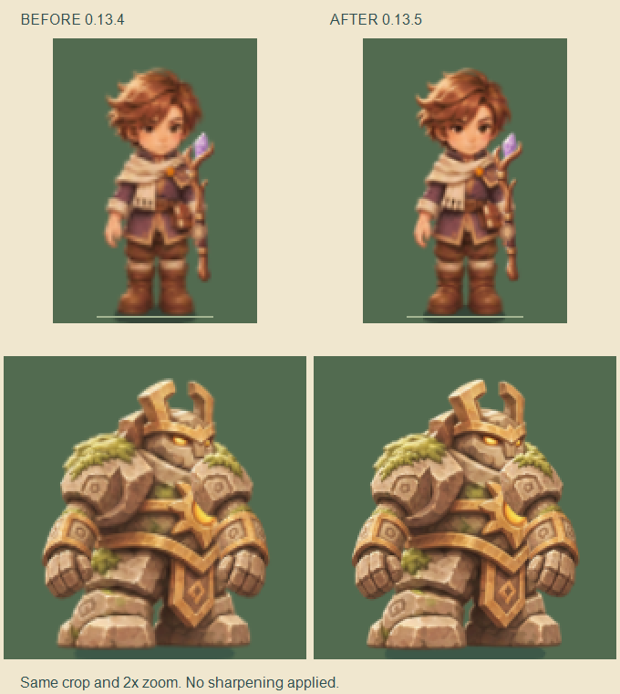

# 0.13.5 玩家与怪物图集清晰度

用户确认 iPhone Air 当前稳定 60 FPS、本轮未再遇到闪退，但玩家和怪物偏模糊，UI 清晰。本轮优先修正中间图集采样，不修改微信 DPR、显示大小、碰撞体或战斗数值。此次真机反馈未附具体版本、画质和连续时长，不能据此推断新版高清图集已通过真机验收。

## 调整

- 玩家合成图集由 1 倍提高至 1.4 倍采样。96×128 的身体源切片仍以 64×85.33 世界单位显示，新图集中的身体约为 90×120 像素，减少先缩小、再放大的细节损失。使用 1.4 倍以让全部装备组合保持 8 MiB 上限。
- 怪物由 0.8 倍提高至 1.25 倍，单维采样增加 56.25%；五类怪物、方向、状态调色、动作部件、柱子和常用弹道仍共用一页。标准与精细画质共享该页，未增加每怪纹理。
- 新增不旋转矩形的 MaxRects 紧凑装箱，仅用于手绘角色合成。341 个共享切片放入 2048×1024 单页，避免普通逐行排列把图集推至 16 MiB。装备或源图变化时才重建，动作切帧不重新上传，换装销毁旧页，上传后释放临时画布。
- 静态预览保持一个方向、一帧；高清合成后单个上限由 64 KiB 调整至 256 KiB，销毁预览时释放。

## 对照

左为 0.13.4，右为 0.13.5；同位置裁剪、统一放大两倍，无额外锐化。画面为桌面真实 Laya WebGL 审核板，不能代替 iPhone 的最终观感。当前绘画源本身仍有柔和笔触，提高图集采样不会凭空增加源图细节。

| 指标 | 修改前 | 修改后 |
|---|---|---|
| 玩家 GPU 页，默认及三套完整穿搭 | 4 MiB | 8 MiB |
| 五类怪物共享 GPU 页 | 4 MiB | 8 MiB |
| 两张角色 GPU 页合计 | 8 MiB | 16 MiB |
| 角色源图片解码 | 两张 1024×1024 图片 | 不变 |
| 25/100/200/400 混排怪物 DC | 18/18/18/18 | 18/18/18/18 |
| 微信固定密度场景 DC | 28 | 28 |

增加的是运行时纹理像素；没有新增美术源图。上表不是微信进程总内存，重建期间还会有临时画布和旧纹理的短暂重叠。更高采样对 GPU 的实际影响仍需真机复测。

## 验证

- 289 项自动测试通过：覆盖 81 种完整装备组合预算、全部装备预览、延迟加载、上传失败回退、换装释放、动作无重复上传、装箱越界/重叠/确定性。
- 真实浏览器角色八向、行走/施法衔接、装备遮挡、怪物五类多向与冰冻/受击调色审核通过；25–400 只密度混排没有增加 DrawCall。完整对照见[采样数据](../data/actor-clarity-0135.json)。
- 微信真实引擎配合模拟 SDK 回归通过：341 个共享切片、两档共享单页、三套装备、触控/奖励/自动试玩，以及 235 怪、208 弹、150 掉落的固定场景。
- 本地 _wechat 为 0.13.5，保留本地 AppID，包体 3,939,952 字节，低于 4 MiB。
- 待真机确认：同场景人物面部/装备边缘及怪物轮廓是否更清楚，是否仍稳定 60 FPS，以及切换装备、连续多局的稳定性。
