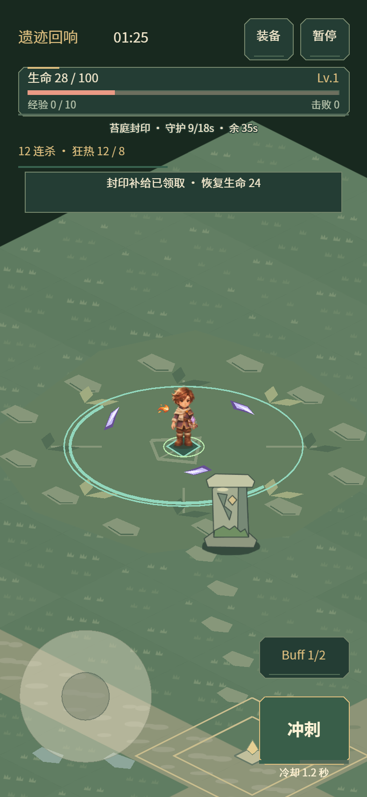
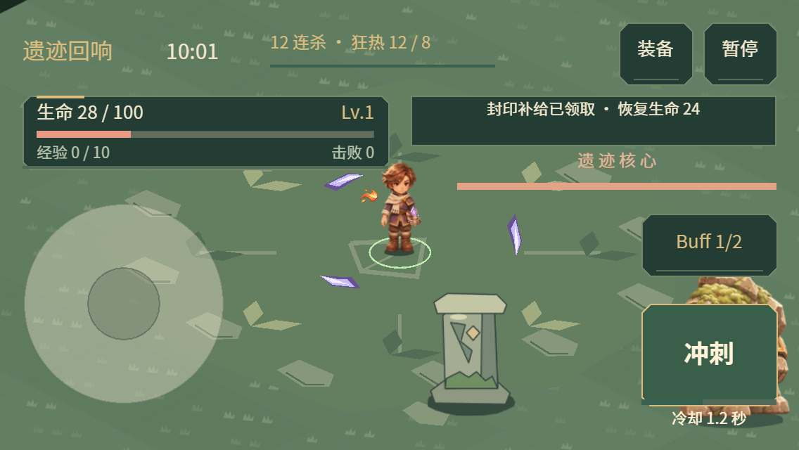

# 0.15.2 战斗 HUD 统一首版

使用 game-ui-ux skill，将战斗状态栏、装备/暂停/冲刺/Buff 按钮、短提示与性能面板统一为深苔绿、旧金边线和浅色文字。沿用系统字体，没有新增字体下载、图片资源或纹理页。

## 布局与操作

- 手机状态栏高度由 64 缩至 52，生命、等级、经验和击败数分层排列。
- 封印进度、连击、Boss 信息与短提示各占独立位置，修复此前提示条与事件信息重叠的问题。
- 竖屏提示高 44；横屏提示高 36、允许两行并靠右，避免原居中提示遮挡角色。保持安全区内布局。
- 状态栏和短提示不接收触摸；更新数值时复用原按钮，不重绑触控事件。浮动摇杆、卡片选择与战斗规则沿用现有行为。
- 本轮集中于战斗 HUD；奖励卡片、背包、主菜单和桌面侧栏的完整视觉统一仍待后续推进。

## 实际画面

以下为真实 Laya WebGL 浏览器的手机触控模式截图，分别为 393×852 封印事件和 568×320 Boss 场景；使用冻结低血量、连击和补给提示组合检查布局。截图中的数值是测试夹具，不代表实际成长上限。

## 验证

- 321 项测试通过，包含安全区、旋转、奖励期间持有摇杆、重复点击卡片与 HUD 更新不重建按钮。
- HUD 浏览器检查覆盖 320×568、393×852、568×320、852×393，各包含封印/Boss 两种状态，验证提示与状态、事件、连击、按钮及 Boss 信息不重叠。
- H5 手机横竖屏和桌面、真实触摸摇杆/卡片，以及微信真实引擎配合模拟 SDK 回归通过。
- 冻结 25/100/200/400 个混排怪物均为 22 DC；相对 0.15.1 的 18 DC 增加 4，来自本轮 HUD 绘制，批次不随怪物数增加。含部分攻击前摇的样本为 23 DC。微信固定 235 怪物、208 弹道、150 掉落样本为 28 DC，与上一版相同。详见[检查数据](../data/battle-hud-audit-0152.json)。
- `_wechat` 更新至 0.15.2，文件合计 3,974,995 字节，本地 AppID 保留。以上为浏览器验证，不是本版本的 iPhone 真机帧率验收。
