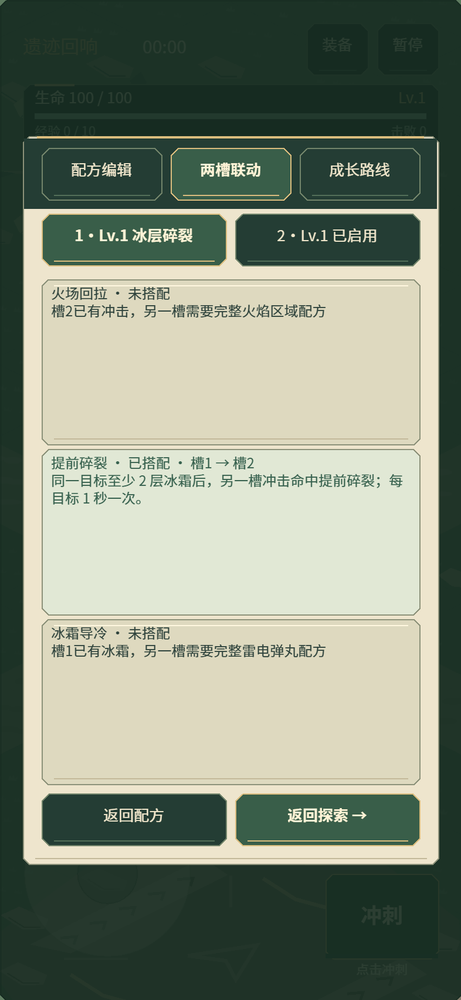
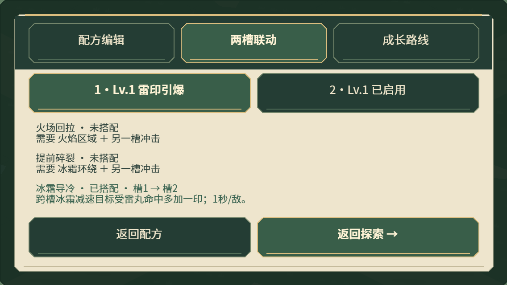
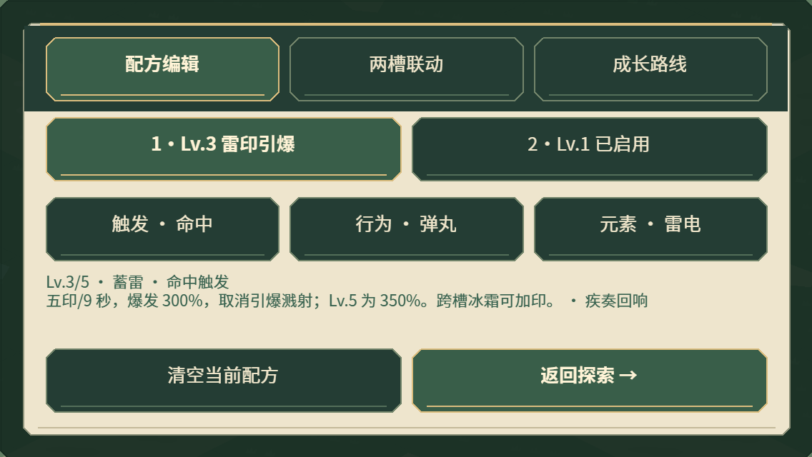
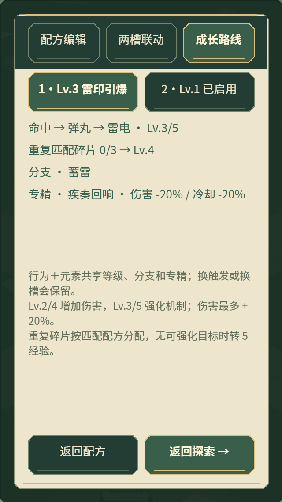

# 0.15.4 Buff 构筑信息分层

使用 game-ui-ux skill，将原来一段拥挤的配方说明分为三个页面，沿用苔绿按钮、暖纸底和系统字体。没有新增战斗机制、图片、字体下载或逐帧构筑查询。

## 三个页面

- **配方编辑**：选槽后依次选择触发、行为和元素；保留当前等级、进化/分支摘要和专精。短横屏使用摘要，较高屏幕显示更完整效果说明。清空仍走原有安装入口。
- **两槽联动**：检查完整配方在不同槽中的搭配，列出火场回拉、提前碎裂、冰霜导冷。已搭配显示来源槽与搭档槽；未搭配会指出缺少的完整配方。提示同时保留命中、状态层数、位置与反应间隔等条件。
- **成长路线**：读取实际等级、标准探索的重复碎片进度、可选/已选分支与已选专精；说明行为＋元素共享成长，换触发或换槽会保留投入。

「已搭配」只代表静态配方满足组合要求；战斗中仍须满足实际状态、命中与位置条件，不表示联动正在触发。切页不安装碎片、不领取奖励，也不重置冷却。

## 实际样张

以下为正式 Laya WebGL 浏览器与模拟手机视口的检查截图，不是真机照片。

## 验证与边界

- 323 项测试通过。新增检查覆盖完整/不完整配方、交换槽位、同槽不能充当跨槽搭档，以及切页后配方/冷却/暂停状态保留；成长页显示实际碎片累计值。最后的短横屏专精摘要调整另通过针对性回归。
- `--buff-editor-audit` 在 320×568、393×852、568×320、852×393 中，通过真实触摸事件切页/打开选片/返回，共检查 40 个状态。涵盖三种起始路线、未解锁碎片、蓄雷分支与疾奏专精组合；检查按钮至少 44 高、边界和相互重叠，命名说明文本不侵入底部按钮，冷却始终保留。
- H5 横竖屏/桌面卡片、回血与浮动摇杆回归，以及微信真实引擎配合模拟 SDK 的检查通过。微信固定压力样本记录为 28 DC；不代表真机帧率或本轮降低了渲染耗时。
- `_wechat` 更新至 0.15.4，共 3,982,512 字节，本地 AppID 保留。

原始结果见[检查记录](../data/buff-editor-audit-0154.json)。本轮是信息与布局优化；完整图标、插画和短横屏完整数值详情仍可继续细化。浏览器检查不能替代真机文字清晰度和触摸手感验收。
