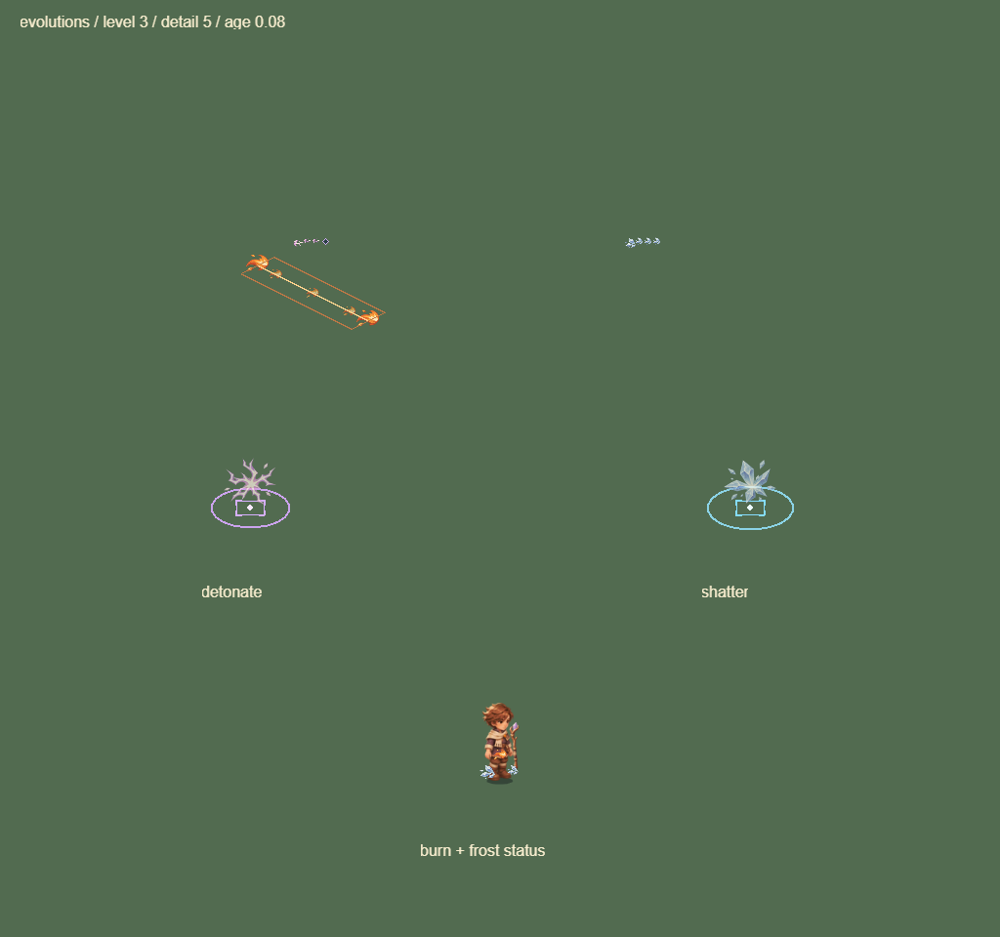
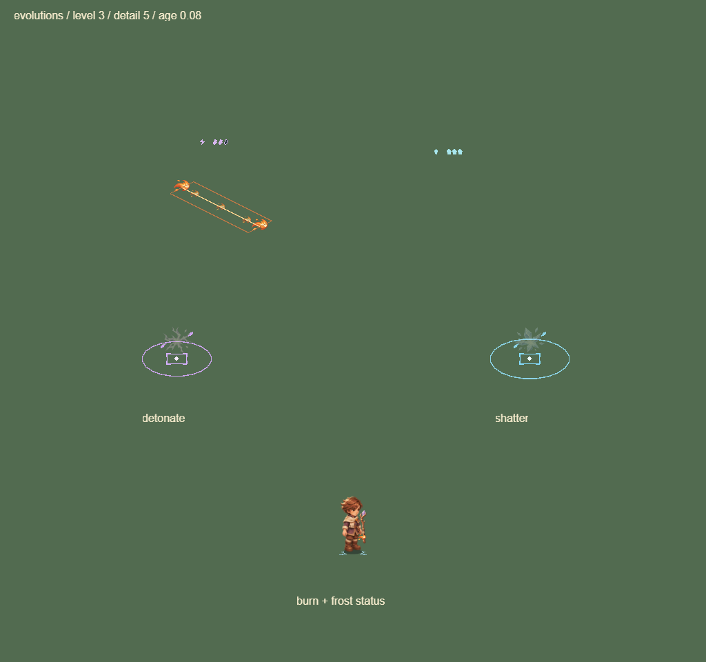
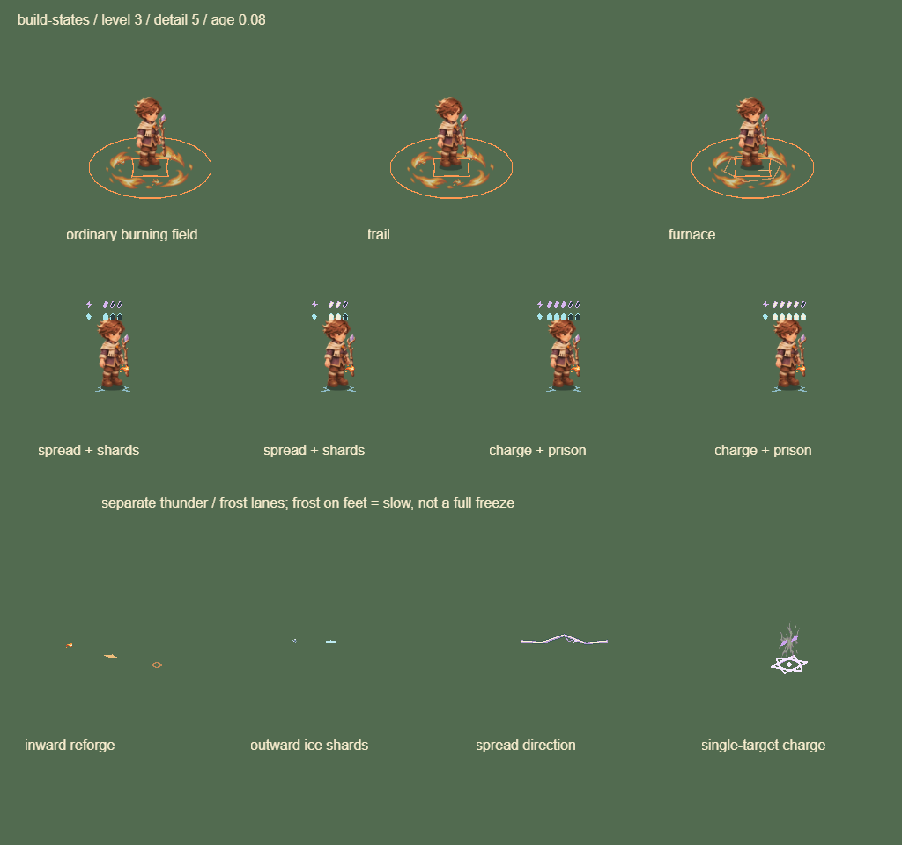

# 0.15.12 Buff 状态与联动辨识

沿用 game-feel skill，重点是让已经存在的状态与跨槽反应可以看懂。复用原元素图集和程序轮廓，没有新增位图源、GPU 页、粒子实体、滤镜或计时器。伤害、命中、减速、击退、成长与分支规则保持原样。

## 已实现

- 雷印、冰层分别占上下两排，用闪电符和冰晶区分，保留真实三层/五层空槽、当前积层和爆发锁定条。接近门槛的实心标记用浅色强调；寒牢五层是储存状态，不表示完全冻结。两排位于普通怪/精英血条上方。密集场景每种状态最多显示 `detail` 个目标，总标记目标上限仍为原来的 `detail × 2`；避免雷电表占满后冰霜完全不显示。
- 减速以脚边两条霜纹表示，灼烧以身体侧边小火焰表示，空出头顶积层区域。游戏目前没有独立完全冻结状态，不绘制冰封躯体。
- 火场持续范围保持原半径，火径保留低矮火舌，炉心用六角炉膛和向内折纹替换三组装饰。火径的三段铺场由原模拟位置决定，没有另造装饰轨迹。普通火场与火径单个场的火舌沿用同类材质，区别主要来自实际铺场布局。
- 回炉不再借用普通冲击命中：实际触发时保存目标与火场中心，显示向内的短梭和中心纹。Boss 仍沿用原击退免疫；该反馈表示回炉反应发生，不承诺 Boss 移动。
- 碎冰保存原点与命中点，短冰片沿实际来源朝命中点飞散；传印用短箭形光屑标出传播方向。二者都是伤害结算后的表现，不给即时伤害增加弹道飞行延迟。普通雷电连锁不再重复画端点符纹。
- 蓄雷爆发使用窄纵向亮芯与紧凑地面纹，传印/默认雷爆保留扩散轮廓。爆发亮芯在前 55% 寿命内平方淡出，后段只留有限碎屑；这些小纹路是爆发反馈，不作为真实伤害边界。

为区分来源，原有反馈队列增加 `reforge`、`shard` 语义和可选分支快照；近点合并也检查分支。所有反馈仍受原 0–48 条总预算约束，超量沿用原淘汰规则，不建立新数组。进化反馈只新增分支元数据，不改变规则。换配方后旧特效按触发快照显示。

## 样张

相同 age 0.08、level 3、detail 5 的进化板，改前：

改后：

分支、同时积层和跨槽反应展示（使用主角作比例参照，正式积层标记附着于敌人）：

## 验证与边界

- 354 项测试及格式检查通过，覆盖三/五槽、双状态分排、血条避让、密集标记预算、火场纹路半径、真实回炉/碎冰/传印来源、只读/确定性绘制和过期清空；原进化、伤害与零视觉预算回归继续通过。
- 真实 Laya WebGL：Buff 板改前后均 6 DC，进化板均 6 DC，武器板均 7 DC；新增分支状态板在标准/低细节均为 6 DC。元素页仍为 1 MiB。
- 微信包真实引擎＋模拟 SDK：同种子、精细、235 怪/208 弹/150 掉落、393×760 的固定场景改前后均 28 DC，新版拆分采样起止基线也均 28 DC。该场景不是全技能同时爆发压力测试，批次数不代表 CPU 或透明覆盖成本为零。
- H5 手机横竖屏/桌面、微信包触控/奖励/诊断回归通过。本机 `_wechat` 更新至 0.15.12，4,017,881 字节，保留本机 AppID。

原始记录见[审计 JSON](../data/buff-vfx-audit-01512.json)。尚无本版 iPhone Air 真机结果：需验证头顶标记小尺寸、密集叠层、两槽联动和长局 60 帧。任意配方的全量材质、敌方弹道以及地图事件玩法继续留在后续清单。
