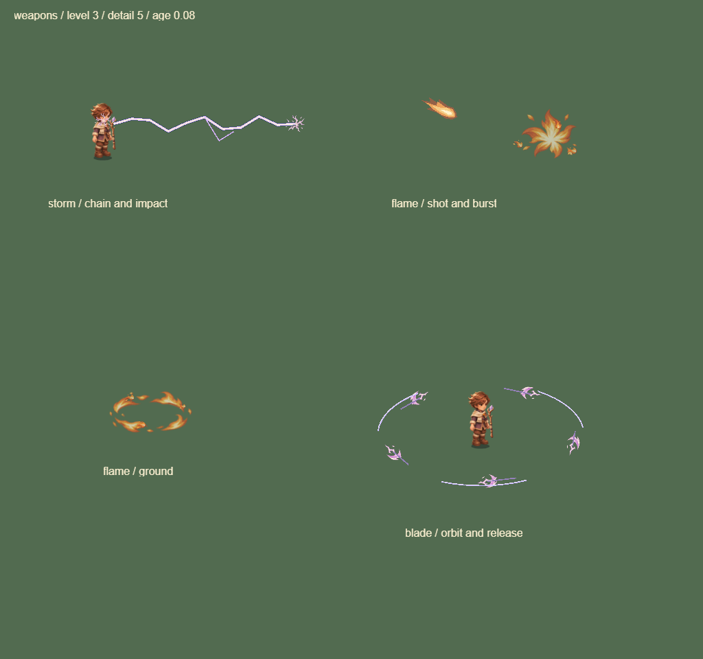
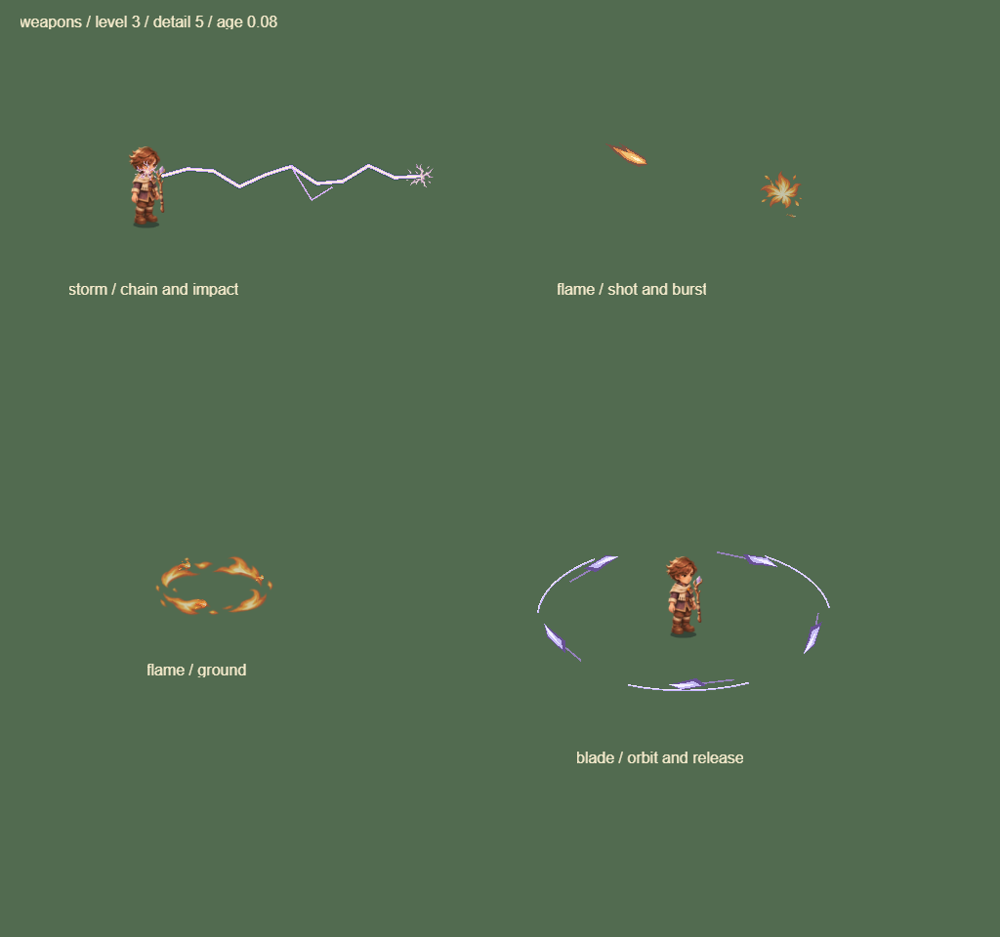
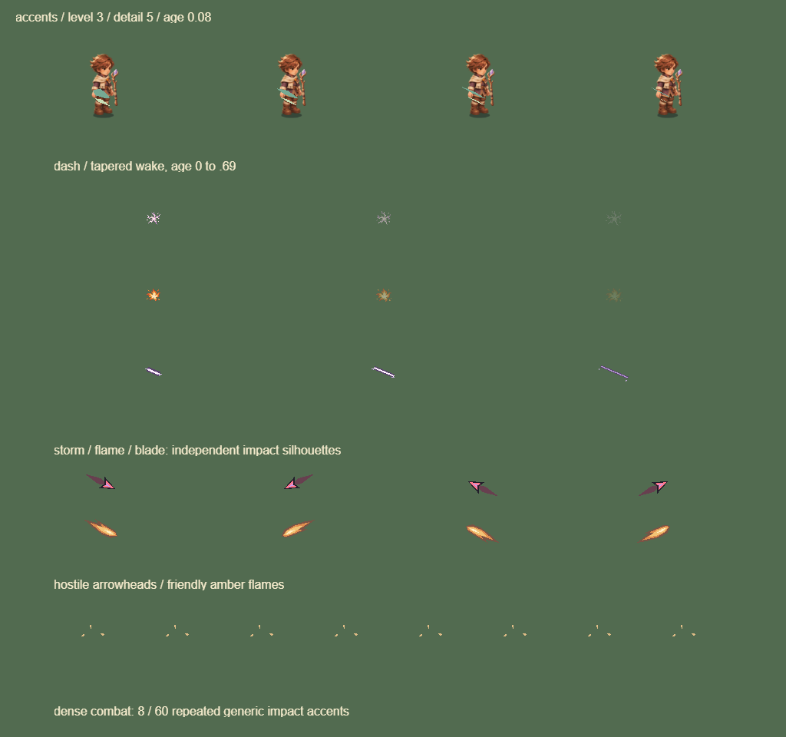

# 0.15.0 战斗表现第一批

本轮使用 game-feel skill，沿用 B「遗迹学徒」的手绘幻想方向，先处理武器、命中和冲刺中残留的通用几何占位感。复用 0.12.3 元素源图及现有共享实体图集，没有新增位图源或 GPU 页。新增轮廓为仓库内程序绘图，火球仍烘焙进共享实体页；未调用新的图片生成服务。

## 已落地

- **飞刃：**不再借用雷电 focus 图标作为绕行本体或受击点；改为有暗背、淡紫刃面与亮刃脊的细长刀刃，命中使用沿实际切线展开的短切痕。保留真实轨道和范围，材质与尾迹颜色一致。
- **冲刺：**移除上下两块矩形人形框，替换为两条沿冲刺方向收尖的墨绿/浅金尾迹。方向从触发当步快照读取，后续转身不会旋转旧尾迹；宽度按平方曲线消退，不创建节点、计时器或滤镜。
- **火球与爆破：**四层轮廓压窄并缩短长尾；上层焰冠缩小，侧向火屑从三组减为两组。地面冲击圈和持续燃烧的真实边界保持完整，避免把光斑大小误当攻击判定。
- **命中与碎屑：**雷电/火焰亮芯缩小、平方淡出；飞刃保持锐利切痕；通用方块粒子改为尖角碎屑，向外缓出并带短上抛弧线。敌弹仍沿用深边红色尖头，与琥珀色火球保持颜色和形状双重区分。

## 密集战斗的装饰预算

每次绘制重置预算，优先显示较新的反馈。24 个效果或 60 发弹道起，死亡/爆破/通用碎屑细节最多 3；命中点装饰最多 9 个（稀疏时随画质最多 18 个）、冲刺尾迹最多 4 组，通用 impact/burst 共用最多 8 组。超过预算只省略这几种装饰，不删除模拟实体或伤害事件；怪物身体受击反馈仍按原规则运行。

连锁路径、施法、飞刃攻击轨迹、爆破本体、死亡、地面伤害边界、Buff 状态及危险预警不消耗上述装饰名额。既有总 FX 容量仍生效。本轮没有新增统一伤害数字合并，也没有重画全部 Buff/进化。

## 样张

相同工具与参数的武器板：age 0.08、level 3、detail 5。它们是实际 Laya WebGL 绘制，展示轮廓差异，不代表手机战斗帧率。

改前：

改后：

冲刺淡出、三类受击、敌我弹道与密集装饰预算：

## 验证与边界

- 317 项测试通过，包括三武器有/无受击表现的战斗状态与随机序列一致、真实冲刺方向快照、装饰预算重置、过期/有限数值和只读渲染。
- 特效板新增冲刺/受击/弹道/预算样张和后段爆破阶段。武器板改前后均为 7 DC，Buff/进化板 6 DC，新细节板 4 DC；继续共享 1 MiB 元素页。
- 冻结的 25/100/200/400 只混排怪物场景仍全部 18 DC；该场景没有弹道、掉落和模拟更新，不能外推完整战斗帧率。
- H5 手机横竖屏、桌面触控/奖励回归，微信真实引擎＋模拟 SDK 与渲染审计通过。首次浏览器检查与测试重建目录冲突，中断后在完整产物上重跑通过。
- `_wechat` 更新至 0.15.0，合计 3,967,231 字节，保留本地 AppID。未新增真机验收结论。

原始绘制数据见[审计记录](../data/combat-vfx-audit-0150.json)。地图分区美术、场景地标、Buff/进化全量深化、UI 信息层级与风格统一继续留在后续；本轮不能标记整个表现改造完成。
