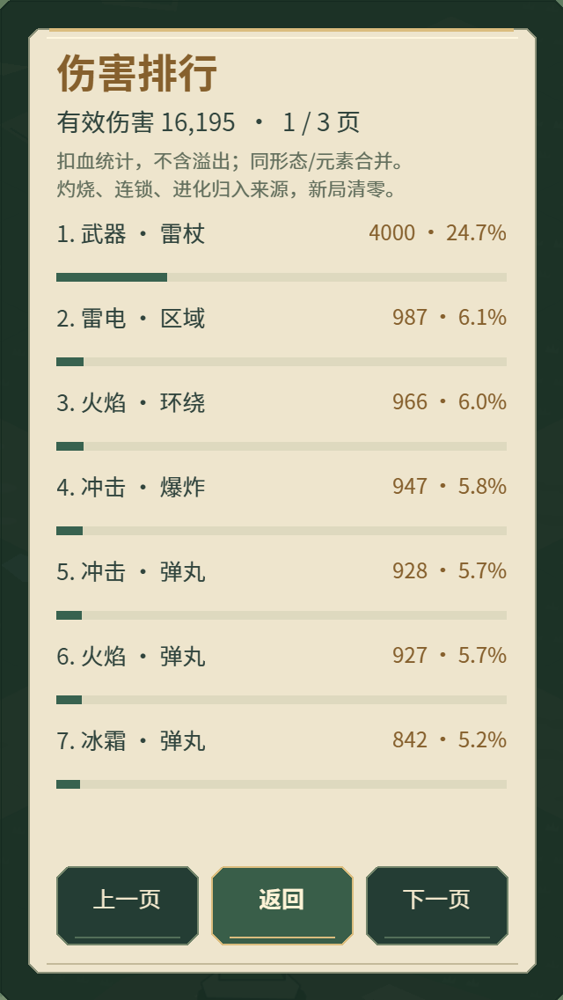
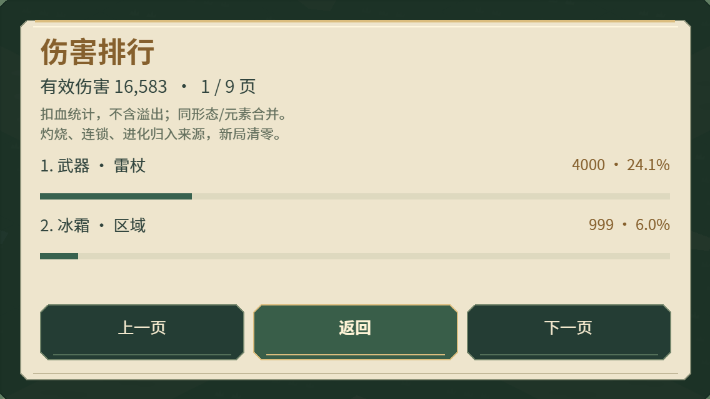

# 0.15.6 伤害排行

暂停菜单与结算页提供「伤害排行」。显示本局累计有效伤害、来源排名、占比和占比条；按可用高度分页，返回时保持原弹窗、结算信息与待领奖励。新局清零，复活与换装保留。

## 统计口径

- 武器分别统计雷杖、炎炮、环刃，包含对应的连锁、地面火焰和灼烧。延迟伤害按释放来源归属，不查询当前装备。
- Buff 按行为 × 元素合并，同配方的两个槽合并累计；直接命中、灼烧、传导、进化及熔炉追加伤害归入对应来源。灼烧按实际保留的最高伤害来源统计。跨槽进化归入造成最终伤害的来源，辅助槽不重复记账。
- 装备反伤独立统计；来源缺失时落入「其他伤害」。
- 在唯一扣血入口记录实际移除的敌人生命值，暴击计入、溢出不计、死亡敌人不重复计。原结算「总伤害」沿用含溢出值，因此可能高于排行总额。
- 仅累计固定目录数值，不保存逐次伤害日志；只在打开或翻页时排序和创建 UI，不新增战斗显示节点、计时器或资源。

## 实际样张

正式 Laya 引擎在浏览器模拟手机视口截图。排名数据为人为注入的布局样本，不表示真实构筑强度或真机性能。

## 验证

- 329 项测试通过；最终布局改动后，70 项伤害/游戏流程测试再次通过。覆盖有效伤害与暴击、溢出、死亡目标、持续伤害来源、换配方快照、排行分页、新局重置、暂停/结算返回与奖励队列保留。
- 浏览器检查覆盖 320×568、393×852、568×320、852×393、1280×720 共 60 个菜单状态；检查触控尺寸、边界、重叠，伤害页通过真实触摸/鼠标事件验证前后翻页和返回。见[原始记录](../data/damage-ranking-audit-0156.json)。
- 微信真实引擎结合模拟 SDK 启动检查通过。`_wechat` 为 0.15.6，3,992,024 字节，本地 AppID 保留。
- H5 393×852、852×393 触摸及 1280×720 鼠标入口回归通过，包含浮动摇杆、卡片与奖励点击。
- iPhone 微信真机阅读、触摸和长期运行待验收；上述测试不代替真机结果。
