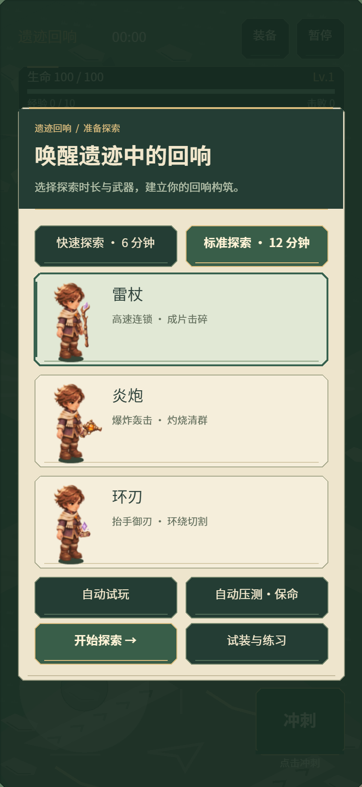
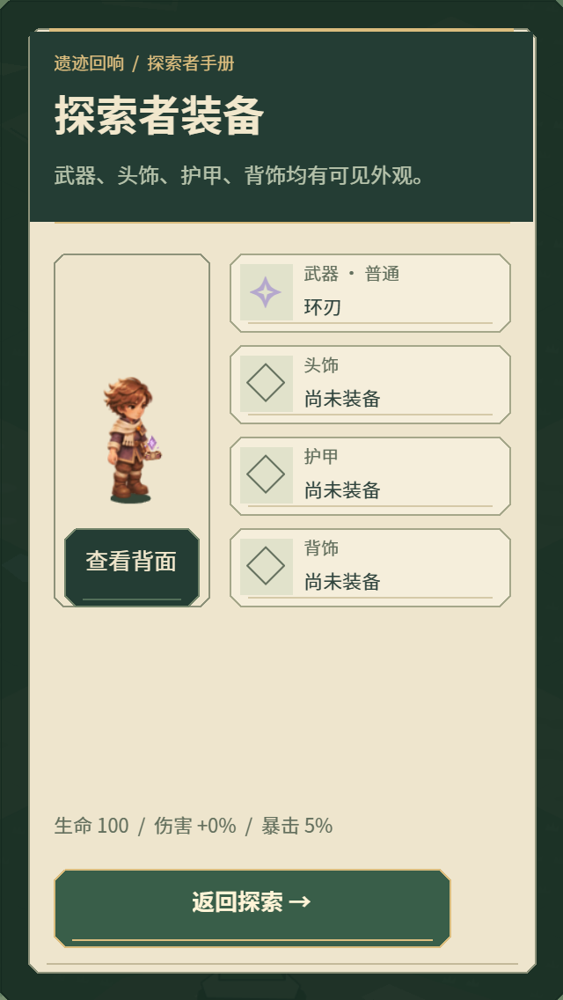
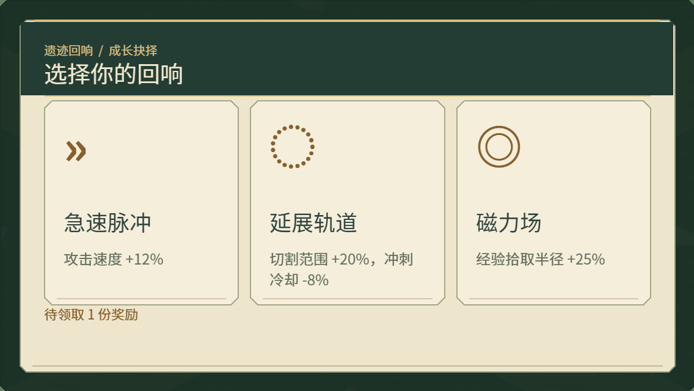
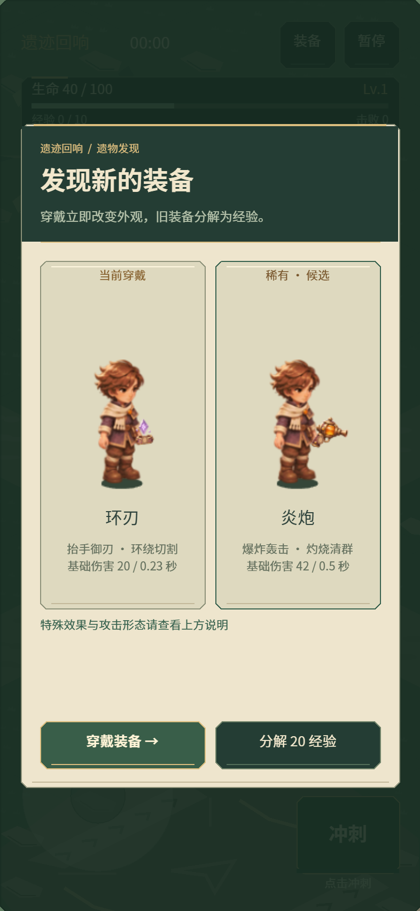

# 0.15.3 菜单、奖励与装备界面统一

沿用 B「遗迹学徒」的手绘幻想配色，使用 game-ui-ux skill 整理共同控件。本轮为程序绘图与排版调整，没有新增图片、字体文件或下载请求。

## 共同样式

- 主菜单、强化、装备对比、背包、暂停与结算采用深苔绿标题区，浅字标题、旧金栏目和分隔线。短横屏单独收紧标题位置，避免文字压住分隔线。
- 操作按钮统一深绿，主要操作使用更亮的绿色与金线；奖励卡片保留浅纸底，正文继续用深色。碎片、起始构筑、分支、专精和封印补给复用纸卡样式。
- 武器选中卡使用绿边、浅绿底与侧边标记；装备槽图标增加底座，装备品质改用适合纸底的深色文字，继续保留品质名称。
- 标题与正文统一系统字体，iPhone 使用苹方；没有新增远程字体。背包预览仍支持正反面切换，试装和装备比较规则沿用已有实现。

## 样张

以下是正式 Laya WebGL 渲染器配合手机视口的截图，使用冻结的检查状态，不是真机照片。

## 输入与范围

控件沿用原有整卡点击、事件隔离和奖励 token 检查；没有新增覆盖卡片的可点击装饰，也不改变摇杆触点生命周期。弹窗仍按内容版本更新，战斗 HUD 不会因为数值刷新而重新创建按钮。

本轮是共同样式统一。Buff 编辑页沿用原信息布局，共享按钮样式；独立图标重画、编辑页的配方关系展示和完整插画式菜单仍待后续制作。

## 验证记录

- 321 项测试通过，覆盖奖励事务、卡片重复点击、满血领取、旋转与持有摇杆期间的弹窗切换。
- H5 横竖屏与桌面生产入口检查通过，包括真实触摸事件驱动的整卡点击、回血卡领取和浮动摇杆移动。
- 新增 `--dialog-audit`：320×568、393×852、568×320、852×393、1280×720 五种视口，各检查菜单、强化、满级回血卡、背包、装备比较、起始组合、封印补给、碎片、暂停与结算，合计 50 状态；按钮均在视口内、互不重叠、高度至少 44。
- 微信真实引擎配合模拟 SDK 的检查通过。冻结 25/100/200/400 个混排怪物均为 18 DC；微信固定 235 怪物、208 弹道、150 掉落并显示诊断界面的样本为 34 DC，上版同类记录为 28 DC。不同页面的图形/文字切换会影响批次，本轮不宣称降低真机耗时。见[检查数据](../data/dialog-audit-0153.json)。
- `_wechat` 为 0.15.3，文件合计 3,976,279 字节，本地 AppID 保留。

检查使用桌面浏览器及模拟微信 SDK，不能替代 iPhone 真机对字体、可读性和触摸手感的验收。
