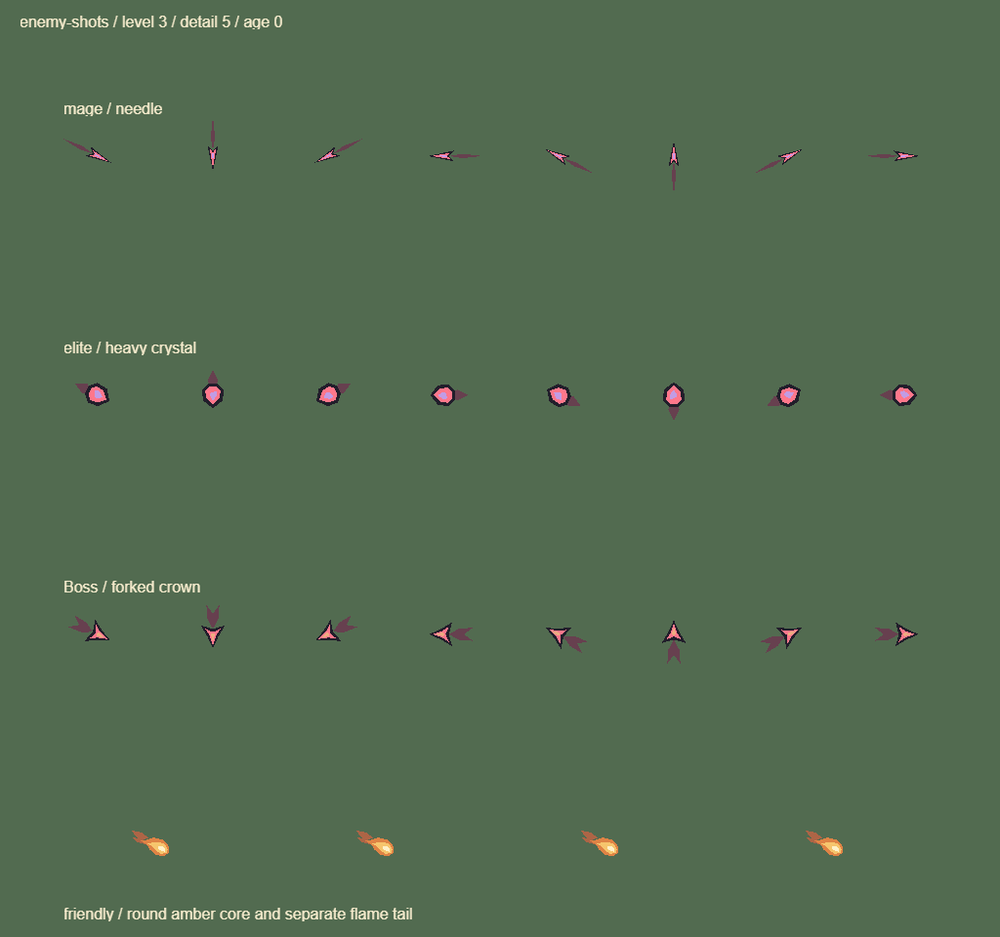

# 0.15.13 敌方弹道辨识

沿用 game-feel skill，改善已有发射事件的反馈，不推进或延迟伤害。没有新增位图源、粒子实体、滤镜、图集页或攻击模式。

## 本轮实现

- 法师：细长魔针与长窄尾迹；精英：厚实多面晶锤与短尾；Boss：分叉冠刃与分开的双尾。三种弹头均保留深边、危险红及来源色内芯，形状也能区分，玩家火弹保留圆润琥珀芯与独立尾焰。
- 使用 AI 已有的三种颜色快照选择轮廓，与原图集键一致。所有方向仍量化到原来的 16 格，只影响视觉；实际速度、锁定方向、散射、环射数量与碰撞轨迹完全沿用。未知来源颜色回退到细针轮廓。
- 精英一轮环射显示一个晶体释放标记，Boss 一轮显示一个冠形标记，沿用同一 action 计时和单图元预算，不为每颗子弹新增释放特效。
- 弹头出手 100ms 从 1.12 倍平方回落至原尺寸，寿命末 120ms 从全亮退到最低 90% 不透明度，危险轮廓保持可见；只改节点变换，不逐帧重画。命中或碰撞仍立即回收，没有额外的死亡粒子。本轮消退只指寿命末段，不代表受击消散材质已完成。
- 法师 450ms 瞄准、Boss 850ms 地面落点预警与真实 145 世界单位伤害范围保持原样，预警仍在角色下方。Boss 当前是环形弹幕和落点攻击，本轮没有添加扇形弹幕。

## 样张

八个世界方向、出手瞬间；下排为玩家火弹对照（展示板直接绘制四个轮廓图元，正式游戏通过敌人共享图集缓存）：

## 验证

- 356 项测试、格式检查通过；覆盖无 RNG 的确定性绘制、不同来源的几何区别、四图元预算、回弹与最低可见度、释放结束清空；既有真实弹道轨迹、伤害、扫掠碰撞和 32 发玩家保留名额回归通过。
- 真实 Laya WebGL 弹道展示板 2 DC，原 accents 板改前后 4 DC，武器板均 7 DC。展示板不等于真机战斗性能。
- 微信包真实引擎＋模拟 SDK：精细、同种子、235 怪/208 弹/150 掉落、393×760 固定场景，改前后均为 28 DC；本轮起止采样均 28，状态稳定。敌人图集仍是 341 格、8 MiB，元素页仍为 1 MiB。
- `_wechat` 更新为 0.15.13，4,019,346 字节，保留本机 AppID。微信触控、奖励与诊断回归通过。
- H5 手机横竖屏与桌面浏览器回归通过。

原始渲染数据见[审计记录](../data/enemy-projectiles-audit-01513.json)。iPhone Air 本轮尚未验收；需要确认细针小尺寸、密集环射的躲避可读性、摇杆持续操作与长局 60 帧。下一步优先地图事件目标与怪潮节奏的玩法差异。
