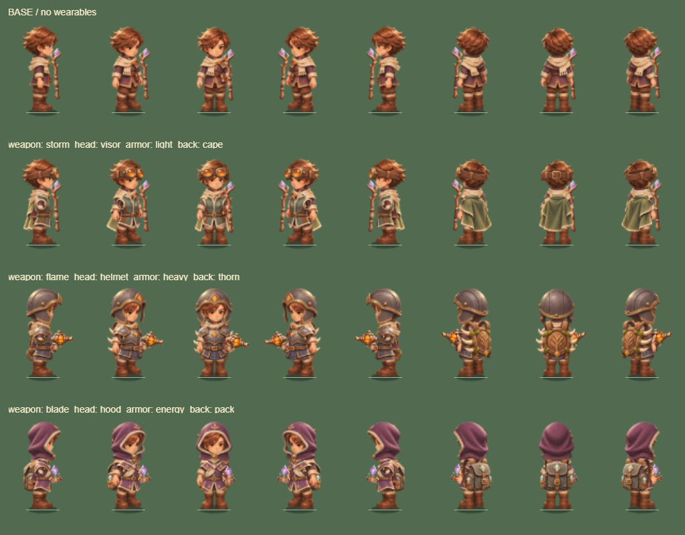

# 遗迹学徒：可穿戴装备制作记录

0.12.5 将头饰、护甲与背饰从旧程序面片替换为与 B「遗迹学徒」一致的手绘素材，战斗和装备预览共用同一套合成逻辑。

| 类型 | 装备 | 材质与轮廓 |
|---|---|---|
| 头饰 | 战术目镜、术士兜帽、守卫头盔 | 琥珀镜片与皮带、紫色织物与米色内衬、风化钢与黄铜包边 |
| 护甲 | 轻型战衣、重型胸甲、能量外衣 | 苔绿短战衣、钢制胸甲与腰裙、紫色刺绣短外衣；均包含完整躯干衣装 |
| 背饰 | 疾行披风、聚能背包、荆棘背架 | 苔绿布料、蓝灰皮革与晶芯、木质背板与短弯角 |

每件有正面、右前斜面、右侧面、右后斜面、背面五个独立视角，镜像补齐左侧方向，共 45 个切片。不是八个方向各自独立绘制。袖口、手、腿和靴子继续使用身体动作；护甲作为躯干衣装合成，并非每套衣服重新制作全身逐帧动画。

[行走样张](equipment-walk-0125.png) · [施法样张](equipment-cast-0125.png) · [微信模拟入口截图](equipment-mobile-0125.png)

## 来源与提示词

沿用用户此前授权的 imagegen 附带 CLI edit 路径，模型 `gpt-image-2`、high、请求 1536×1024。唯一参考图为已选定 B 的 `output/imagegen/hero-b-ruin-apprentice-v2.png`，用于锁定比例、笔触和材料；没有引入第三方美术或新字体。

| 家族 | 完整提示词（仓库根目录起） | 生成源图 |
|---|---|---|
| 头饰 | `output/imagegen/hero-equipment-head-prompt.txt` | `output/imagegen/hero-equipment-head-source.png` |
| 护甲 | `output/imagegen/hero-equipment-armor-prompt.txt` | `output/imagegen/hero-equipment-armor-source.png` |
| 背饰 | `output/imagegen/hero-equipment-back-prompt.txt` | `output/imagegen/hero-equipment-back-source.png` |

三张实际输出均为 1619×971。输出带透明通道，但存在红/黄/洋红残片；不能直接作为生产素材。离线脚本按已目检的布局切片，去除背景杂色与小碎片，对荆棘越过名义格线的尖端保留额外边距。黄色只移除背景连通部分及低 alpha 边缘，避免误删封闭的琥珀高光。

## 资源与挂载

`scripts/build-equipment-art.ps1` 调用 `EquipmentAtlasBuilder.cs`，将 45 个切片放入现有 `assets/hero/ruin-apprentice.png` 底部 64² 空格，避开 56 个身体帧与三武器。生成 `assets/hero/equipment.json` 和 `src/rendering/equipment-art-frames.ts`；完整重建身体时，`build-hero-art.ps1` 也会重新合入装备。

源图维持 1024²、RGBA，约 4 MiB 共享解码像素；没有新增解码图片或独立 GPU 装备纹理。每个当前穿搭继续离线合成 128 姿态：八向 × 四行走/十二施法，换装销毁旧页；不是预生成所有装备组合。三套样张各为 4 MiB，最大预算仍为 8 MiB，单个静态预览最多 64 KiB。

披风在移动姿态中轻摆；背饰随朝向绘制在身体前后，护甲和头饰在武器之前合成。头盔/兜帽裁去旧身体伸出帽缘的头发，保留脸部。施法时插值跟随身体锚点，继续沿用手部与武器挂点，脚底阴影和伤害规则不变。

## 验收与限制

238 项测试通过，覆盖切片不重叠、武器/身体保留、全部混搭与三武器的缓存预算、三品质静态预览、换装释放和加载失败回退。真实 Laya WebGL 样张覆盖八向、行走、站立施法和移动攻击；H5 手机横竖屏/桌面交互及微信包的真实引擎与模拟 SDK 检查通过。微信模拟入口也分别穿戴三套装备并检查缓存创建成功。

同一冻结密度场景 25/100/200/400 怪均为 18 DC；微信模拟固定场景（235 怪、208 弹道、150 掉落）仍为 28 DC，与 0.12.4 一致。微信包为 3,814,890 字节。数据见 [0.12.5 验收记录](../render-results-0125.json)。

这批只完成可穿戴素材与现有动作的合成。独立袖子动作、布料物理、各品质独立美术和更清晰的玩家左右脚步态仍未制作。iPhone Air 的长时间性能、触控连续性与整进程闪退依然需要真机验收。

复查命令：构建后运行 `node scripts/check-mobile-browser.mjs --equipment-audit`；本地 `/bench/equipment-review.html` 提供三套穿搭、各类单件和八向动作检查。
