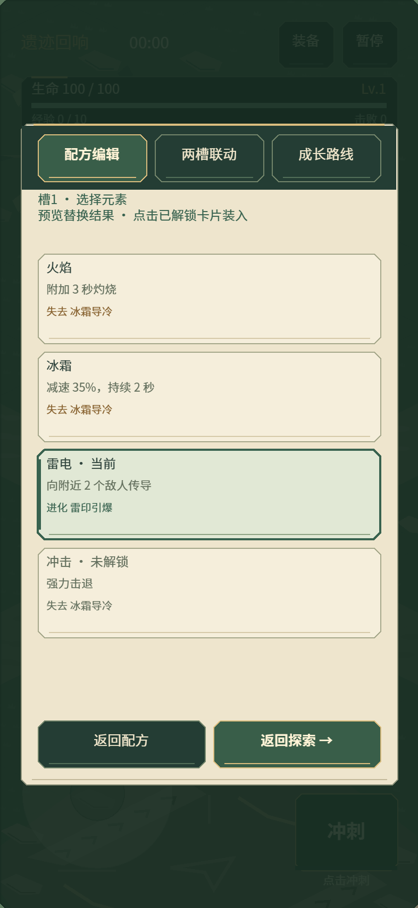
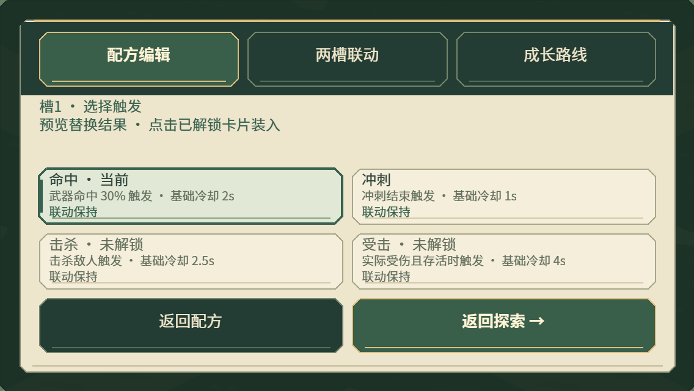
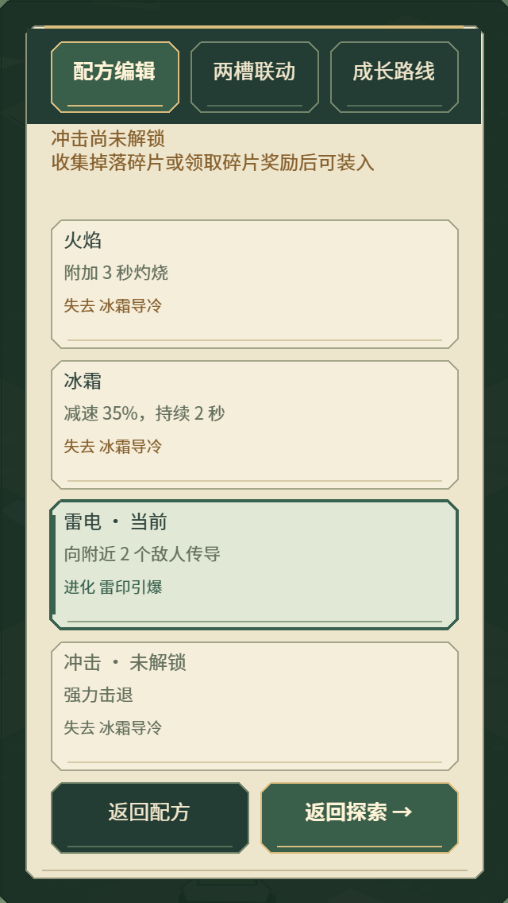

# 0.15.5 碎片用途与替换预览

使用 game-ui-ux skill，继续完善 Buff 编辑页的实际选择过程。沿用暖纸卡、苔绿选中框、系统字体，没有新增图片或字体下载。

## 选片时能看见什么

- 每张卡显示碎片名称、当前装入/未解锁状态和用途。触发类同时显示基础冷却，实际冷却仍受已有专精调整。
- 对选定槽位做一次只读替换预览，显示新增或失去的两槽联动，以及候选完整配方的进化名称；失去联动使用旧金色文字强调。
- 不完整配方提示尚未完整；这些预览只判断完整配方搭配，战斗反应仍须满足命中、层数、位置和间隔条件。这里不预测新配方的等级、伤害或实战强弱。
- 点击锁定碎片会在选片页上方显示名称与解锁方式，解决此前短提示因弹窗存在而不可见的问题。配方、冷却均保留。
- 已解锁卡保持单次点击装入并返回配方页；装饰文字不参与命中。选片期间标题区显示当前槽，返回配方后可切换槽位。

## 实际样张

正式 Laya WebGL 浏览器与模拟手机视口截图，不是真机照片。

## 验证

- 325 项测试通过，新增用例覆盖联动增减预览、无效候选、不完整配方、预览不修改原配方，以及锁定点击/单次装入后保留冷却。
- 扩展 `--buff-editor-audit`，四种手机尺寸共检查 56 状态，新增锁定反馈、单次装入、触发选片、行为选片；用真实触摸事件操作。检查按钮边界与重叠、卡片正文/预览相互间距及文字不超出卡片。
- H5 横竖屏/桌面生产入口、回血/奖励整卡点击与浮动摇杆回归，以及微信真实引擎配合模拟 SDK 检查通过。微信固定压力样本记录为 33 DC，上一版记录为 28 DC；本轮不宣称降低渲染耗时，仍需真机确认文字与操作体验。
- `_wechat` 更新为 0.15.5，共 3,985,671 字节，本地 AppID 保留。见[原始检查记录](../data/fragment-picker-audit-0155.json)。
