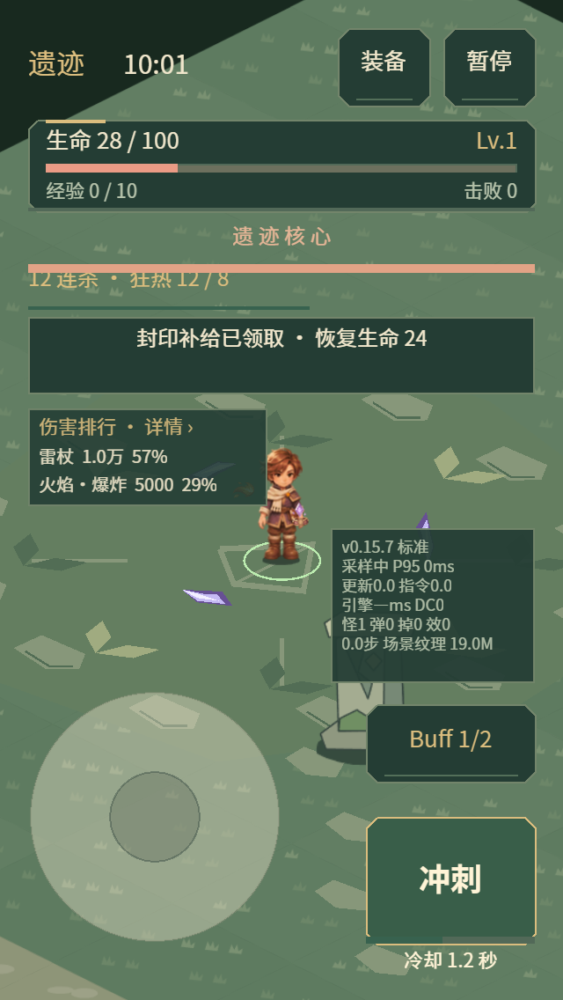
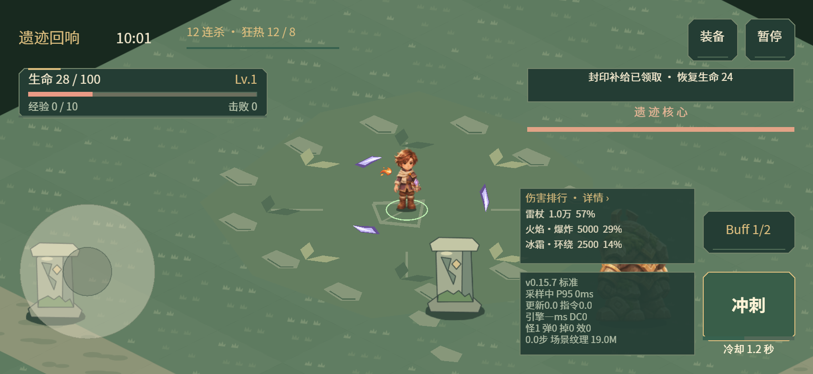

# 0.15.7 常驻伤害排行

战斗主界面默认显示伤害排行：当前主要来源、有效伤害和占比。普通手机显示前三名，最窄竖屏按可用高度显示前两名；完整数据仍可从小面板、暂停菜单或结算页查看。

布局沿用 safe area：竖屏放在左侧摇杆区域上方，避开状态、封印/Boss、连杀与提示条；横屏放在性能面板上方，桌面再为提示条留出间距。小面板点击才暂停并打开完整排行，查看实时数值无需暂停。完整排行返回后恢复战斗；奖励弹窗期间隐藏小面板。

统计口径沿用[0.15.6](damage-ranking-0156.md)。伤害数据变化后最多每 250ms 更新一次文字；未变化时不排序，更新时保留原按钮与文字节点。新面板不会每帧创建显示节点，不改触摸摇杆状态。

## 实际样张

Laya 正式引擎在模拟手机视口渲染；伤害为布局样本数据，不代表构筑强度或真机性能。

## 验证

- 331 项测试通过，覆盖刷新限频、不变数据跳过排序、节点保持、重开清零、模态切换，以及六种尺寸下与触控区/提示/性能面板互不重叠。
- 320×568、393×852、568×320、852×393 两类场景共 8 个状态通过真实浏览器检查；按住摇杆期间注入新伤害并改变排名，触点持有者与排行节点保持不变。小面板真实触摸可打开完整排行；微信包真实引擎配合模拟 SDK 启动检查通过。见[布局记录](../data/live-damage-audit-0157.json)。
- `_wechat` 更新为 0.15.7，3,996,520 字节，本地 AppID 保留。
- H5 手机横竖屏与桌面三种入口回归通过，包含实际摇杆移动、奖励选卡及持有触点操作。
- 浏览器模拟视口不能代替 iPhone 微信真机的文字阅读、触摸与长期性能验收。
