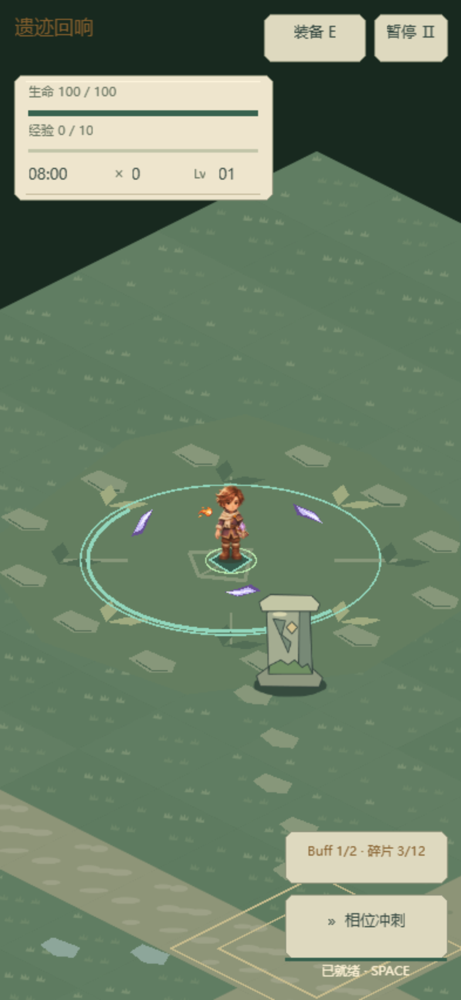
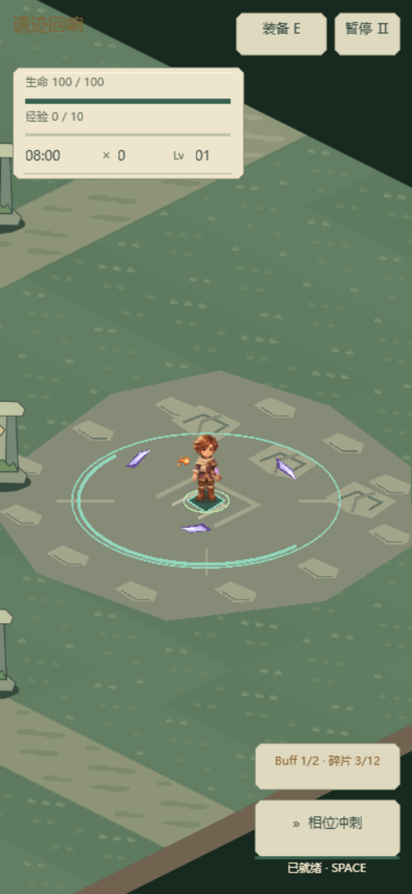
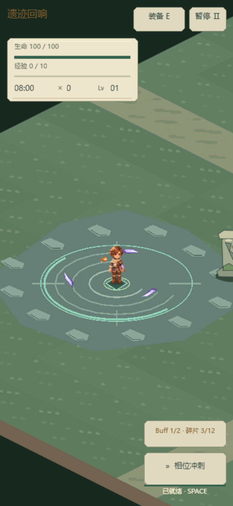
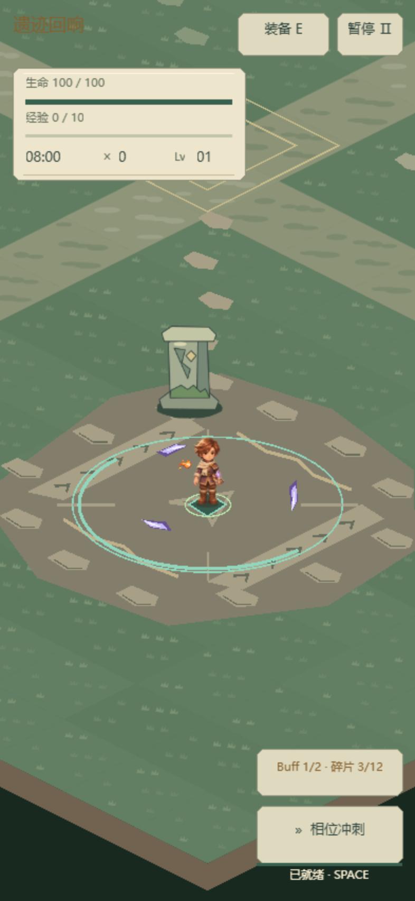

# 0.15.1 地图分区表现首版

使用 level-design 与 create-game-assets skills，在已经可玩的四处封印位置进行静态场景装饰。沿用 B「遗迹学徒」手绘幻想的苔绿、风化石与旧金配色，本轮全部为仓库内程序绘图，没有新增生成图片或外部素材。

## 四处地标

| 封印区域 | 地面辨识特征 |
| --- | --- |
| 苔庭 | 苔绿色底、叶片镶嵌与外围蕨叶扇形 |
| 断柱庭院 | 灰绿石面、三组开裂柱基印迹与断开的庭院纹样 |
| 回响泉庭 | 冷灰青地面、干燥波纹镶嵌与水滴纹章；没有水体机制或持续治疗 |
| 古门前庭 | 暖灰石面、两条平整门槛、箭羽纹与对称门纹 |

四区都用不规则低对比底色、破碎边石和少量踏石连接中心岔路。原地表变体色差减小，草纹略做变化，瓦片基底增加 0.6 世界单位出血，缓解透明菱形边缘滤波产生的暗缝。不是新增地图或四套完整生物群系。

## 空间与显示约束

- 四处封印位置、160 单位守护圈、触发范围、完成时间和怪物生成规则不变；地图仍只有原来的 8 根柱子参与碰撞。
- 装饰均贴地，没有新增墙体、门洞或看似阻挡路径的立体建筑。泉庭为干纹镶嵌，避免暗示可游泳/可治疗的地形。
- 色调偏灰，鲜亮薄荷/金色留给事件圈，红色留给危险。场景地标位于静态 ground，低于地面特效、角色、弹道和预警。
- 所有绘制命令在建图时记录一次，不新增显示节点或逐帧地标更新；复用原来 6 块小地表图集，没有世界大小的缓存，也没有新增 GPU 页。

## 窄屏样张

以下为真实 Laya WebGL 的 393×852 视口，冻结在对应封印中央并叠加一半完成的事件圈；不是真机照片或操作验收，测试页保留桌面输入模式。

## 验证

- 319 项测试通过，包括静态地标的有限边界、确定性、不消耗战斗随机数，以及柱子位置/数量不变。已有绘制层级和预警回归继续通过。
- 新增 `--map-audit`，覆盖四处地标在未激活/半完成封印下的桌面画面与窄屏画面，共 12 个样本；地图检查限制场景纹理预算并记录实际 DC：18–19 DC，场景纹理 19 MiB；actorNodes=9 表示玩家＋原有 8 根柱子。
- H5 手机横竖屏、奖励与浮动摇杆回归，以及微信真实引擎配合模拟 SDK 检查通过。冻结 25/100/200/400 怪物混排的批次记录见[原始数据](../data/map-regions-audit-0151.json)，不代表真机 FPS。
- `_wechat` 更新至 0.15.1，文件合计 3,973,012 字节，本地 AppID 保留。无新增真机验收结论。

本轮是静态分区和地标首版；完整场景素材重画、植被层次、地图边界美化与 UI 信息层级/风格统一仍待推进。
