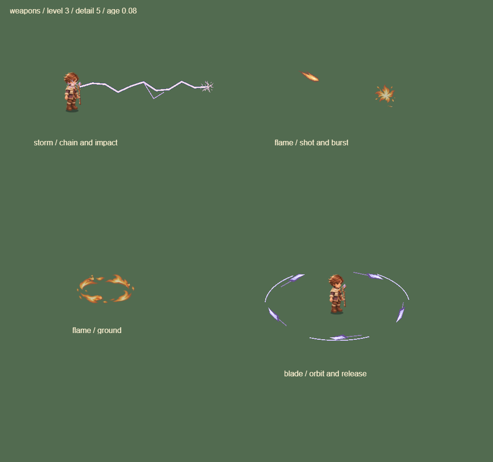
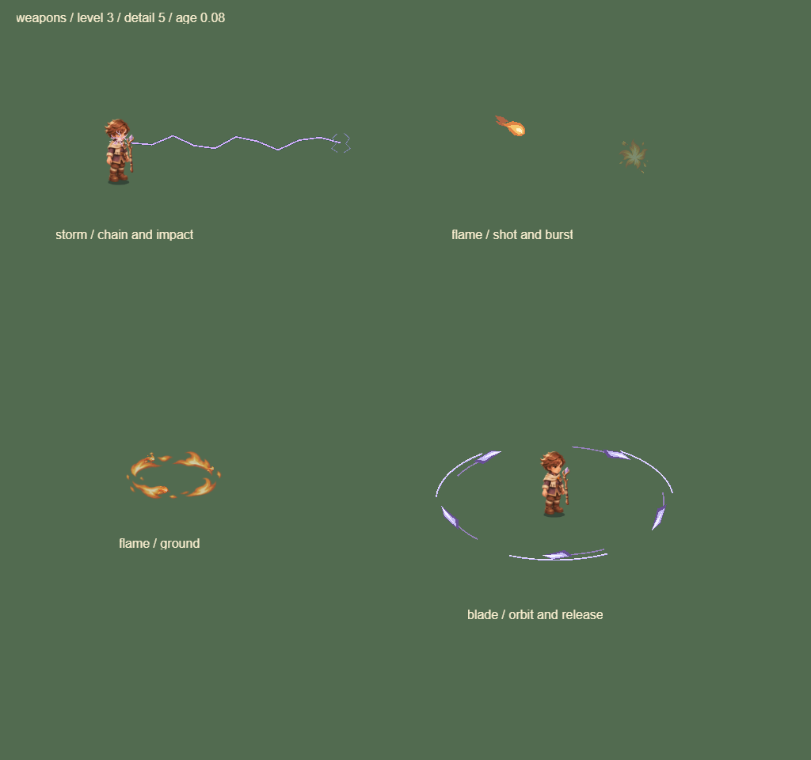
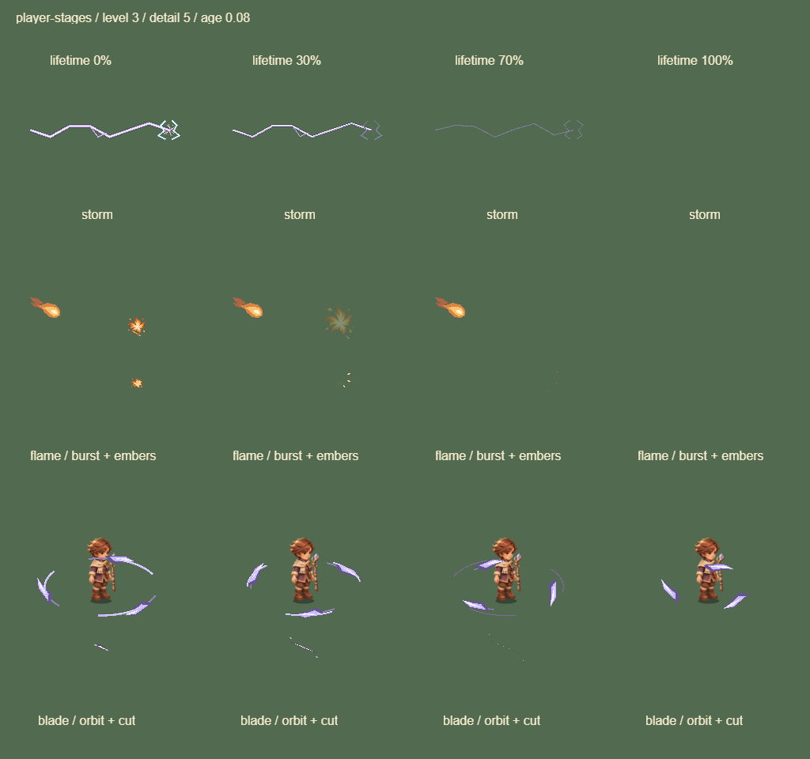

# 0.15.11 玩家弹道与命中反馈

沿用 game-feel skill 的事件反馈与受限装饰原则，细化三种玩家武器。复用现有元素位图和程序轮廓；没有生成新的位图源、滤镜、粒子节点、计时器或 GPU 图集页。伤害、碰撞、攻击范围、击退与攻击时序保持原规则。

## 已接入

- 雷杖：放电初段保留暗边、主色与亮芯，随后逐步移除亮芯/外缘，收成一条细余弧；分叉侧向长度有上限，远距离连锁不长出巨大侧枝。武器连锁路径关闭自身端点光斑，统一由实际命中的 `weaponHit` 快照画一次亮芯及两侧短余弧。共享电弧工具也会影响 Buff 的连线衰减，Buff 仍保留自己的端点反馈，未重做整套 Buff。
- 炎炮：四个缓存面片组成分离的叉状尾焰、圆润橙色弹头、金色内芯与小亮点，与敌方红色箭头区分。继续烘焙为 16 向共享实体图集，飞行时不逐帧重画。爆破焰冠在寿命前 65% 内平方淡出，后段仅留两片缩小上抛余烬；贴地冲击圈与燃烧区域保持真实范围。命中点在短亮芯消退后仍有最多三片定向余烬。
- 御刃：原来连接刀刃的直拖线改为五点轨道短弧，每枚仍只用一条尾迹；飞刃数量上限七枚。命中切痕改为两层收尖面片，沿已保存的屏幕切线缓出展开，另留两片短屑；不再用等宽线段模拟切口。

密集战斗仍优先显示较新的命中快照，沿用现有 `CombatAccentBudget`：24 个效果或 60 发弹道起降低装饰细节，命中点最多九组，通用碎屑最多八组。每个命中最多六条绘图命令；没有新增特效实体或提高总量上限。过期电弧、爆破和释放轨迹不再画残留图形。御刃待机时保留刀刃本体，不能把它当作过期粒子。

## 样张

相同展示布局、age 0.08、level 3、detail 5。新版展示板把雷电从固定 0.9 强度改为实际 0.17 秒寿命，并独立画命中快照，所以下图同时展示造型和时序修正，不是固定亮度下的单一材质对照。

改前：

改后：

寿命 0% / 30% / 70% / 100% 阶段，末列保留的是御刃待机本体：

## 验证

- 349 项测试和 TypeScript 格式检查通过。新增覆盖电弧亮层递减/端点去重/过期清空、轨道短弧不越过伤害半径、位图亮芯退场后的余弧与余烬；已有三武器战斗对照验证表现不改变伤害、随机序列和实体状态。
- 真实 Laya WebGL 展示板：武器前后均 7 DC，命中细节板均 4 DC，Buff/进化板均 6 DC；新增阶段板为 4 DC。元素页仍为 1 MiB。DC 是整张展示板的批次，不表示单个技能的独占成本。
- 冻结的 25/100/200/400 只混排怪物前后均 18 DC。该场景没有弹道、掉落或模拟更新，只用来检查原有合批回归。
- 微信包真实引擎＋模拟 SDK：精细、235 怪/208 弹/150 掉落、393×760 的固定场景前后基线均 28 DC，指同一次拆分采样的前后基线；不能据此声称比旧版降低。共享怪物/弹道页仍为 8 MiB。
- H5 手机横竖屏、桌面交互与微信包触控回归通过。本地 `_wechat` 已更新为 0.15.11，4,012,143 字节，保留本机 AppID。

实测记录见[审计 JSON](../data/player-vfx-audit-01511.json)。浏览器结果不代表 iPhone Air 帧率或热机稳定性；仍需真机观察亮芯是否太弱、密集战斗能否辨认命中及长局是否维持 60 帧。Buff 全量深化、敌弹材质和地图事件继续保留在后续清单。
