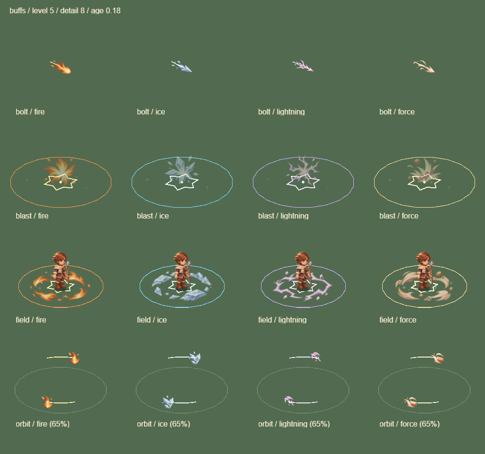

# 冰环接敌与雷印积累 · 0.15.16

## 规则

- 环绕轨道半径 90 → 150，接触半径仍为 38，保留双轨道扫掠、0.35 秒单目标冷却、3 秒寿命与原数量上限。中心和轨道外不造成接触伤害。所有元素的环绕共用该行为规则，图片与矢量两种绘制路径均读取同一半径。
- 自动试玩的冰环追敌距离同步为 150，避免仍追到原轨道内侧。回避危险和安全冲刺规则保留。此次对照包含这项自动操作策略变化，不能把整局差异全部归因于技能数值。
- 碎冰叠满三层对主目标也造成 70% 伤害，随后向附近 3/5 敌射冰片，各 70%。孤立精英或 Boss 不再白白消费叠层；主目标不占附近冰片名额。跨槽冲击提前碎裂沿用原规则。
- 雷弹速度 480 → 900，其他元素弹丸仍为 480；追踪转向速度、一次重新索敌、1.2 秒寿命和数量上限不变，碰撞查询按实际速度扫掠。
- 蓄雷每次直击叠两印，仍需五印引爆。无导冷时需三次直击；跨槽冰霜可额外加一印，每目标每秒一次。直击续存 9 秒、爆发锁和伤害倍率不变。
- 传印每个邻居由一印改为两印，仍限 3/5 敌，且不能越过邻居分支的引爆阈值。传播不刷新积累窗口、不直接引爆、不递归造成连锁。
- 配方说明、分支卡与成长面板同步新规则。进化仍只接受存活目标的实际接触，不对尸体叠印。

## 同条件逻辑样本

沿用上轮种子 1104、标准探索，三武器 × 四个受影响分支 × 普通/保命，共改前 24 局、改后 24 局。基于真实奖励、自动选片和有效扣血账本；保命防止死亡，战斗变化会分叉后续随机序列。不是真人胜率或真机性能测量。

保命样本全局两槽 Buff 有效伤害占比：

| 武器 | 碎冰 | 寒牢 | 传印 | 蓄雷 |
|---|---|---|---|---|
| 雷杖 | 1.4 → 3.0% | 1.7 → 5.5% | 6.9 → 7.6% | 5.9 → 7.6% |
| 炎炮 | 2.7 → 8.6% | 3.0 → 7.9% | 5.5 → 6.2% | 5.5 → 6.3% |
| 环刃 | 3.8 → 12.1% | 3.9 → 10.1% | 17.7 → 19.4% | 18.5 → 19.6% |

雷杖碎冰的冰环释放连接率 35/228 → 70/223，实际接触 102 → 293；环刃碎冰 123/215 → 187/223，实际接触 330 → 1224。雷杖传印雷弹连接率 83/229 → 125/229；炎炮传印 138/210 → 173/201。释放连接率是至少命中一次的释放数/总释放数，不能当成每发的全部效果或伤害占比。

保命 12/12 完成 Boss；普通由 0/12 通关变为雷杖寒牢一局通关（630.3 秒）。普通雷杖传印与蓄雷存活均降到 505.9 秒（原 558.5 / 531.6 秒），炎炮碎冰 522.1 → 499.4 秒，仍保留退步样本。单种子不支持整体难度显著改善的结论。

逐局伤害、接触次数、阶段伤害、Boss 来源和反应次数见 [原始对照](data/buff-contact-01516.json)。采样基于本次玩法代码，采样后更新版本号。

## 后续

普通样本雷系两分支仍没有引爆：普通怪经常在积累足够印记前被武器或雷弹击杀。保命样本的引爆也多集中在 Boss，尚未解决清怪阶段的分支兑现。下一步应设计死亡印记的有限继承或击杀收益，同时限制传播次数、保留有效伤害归属并防止递归，不能直接让尸体触发无限爆发。

寒牢仍需要另一槽冲击和安全冲刺，减速效用尚未单独量化。此次完成接敌与叠层首轮修正，未宣称全构筑平衡完成。

## 验证

367 项测试通过，包含 30/60/120Hz 轨道与雷弹、中心/轨道外不命中、Boss 减速上限、孤立目标碎冰收益、两次导冷直击蓄雷、传播锁及预算/容量限制。格式检查、H5 手机横竖屏与桌面触控回归、真实 Laya 引擎特效展示板及打包微信引擎配合模拟 SDK 回归均通过。

特效展示板保持单页 1 MiB 图集和 6 DC；微信固定 235 怪、208 弹、150 掉落场景仍为 28 DC。这些检查不能代表真机帧率或真人手感。`_wechat` 已重建至 0.15.16，4,030,755 字节，本地 AppID 已保留。

展示板为容纳扩大后的轨道，最后一行空间投影缩至 65% 并标注；实战使用完整世界半径 150。检查日志：`artifacts/buff-tests-final-01516.log`、`artifacts/buff-h5-browser-01516.log`、`artifacts/buff-wechat-browser-01516.log`。
