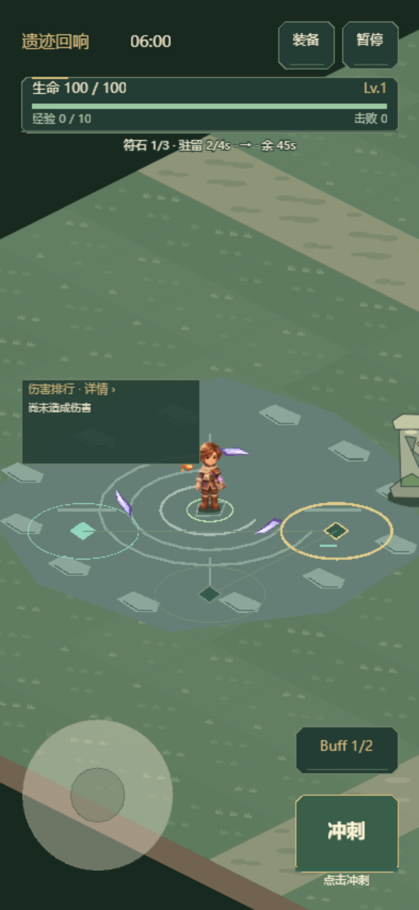
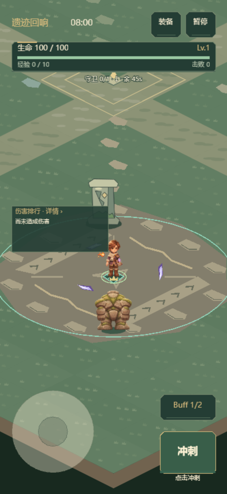

# 0.15.14 地图事件与分阶段怪潮

使用 level-design skill，先区分可玩的目标、路径与遭遇节奏，沿用已有四区域美术。仅修改 12 分钟「标准探索」，6 分钟「快速探索」的波次、环形怪潮、Boss 节点与时长保留原规则。没有新增碰撞地形、图片、粒子实体或纹理页。

## 四处封印

| 时间 / 区域 | 目标 | 判断与增援 |
|---|---|---|
| 75 秒 · 苔庭 | 圈内累计守护 18 秒 | 半径 160；出圈暂停进度。开启时补四只普通怪，作为入门事件。 |
| 210 秒 · 断柱 | 圈内击败 8 名敌人 | 玩家和死亡敌人均需在半径 260 内；只统计实际死亡，每个实体一次。开启时补六只普通/远程/冲锋混编，后续自然波次也可计数。站圈不会增长进度。 |
| 360 秒 · 回响 | 依次点亮三处符石 | 每点半径 65，累计驻留 4 秒；离开保留，完成一点才启用下一点。三点间约 210–300 世界单位，避开石柱、左侧排行和底部摇杆。开启时补四只普通怪。 |
| 480 秒 · 古门 | 击败指定封印守卫 | 一名精英带独立冠标，HUD 指向实际敌人；可离开原地追击，击杀普通精英不计数。补两名远程增援。若容量全为精英而无法新增，指定一个现存活守卫，避免缺失目标。 |

四事件都保留显现后 65 秒内接近中心 95 单位启动、启动后 45 秒关闭的规则。未参与可跳过，不阻挡 Boss；600 秒 Boss 到来时未完成事件关闭。完成沿用真实奖励事务：碎片＋最多 15% 治疗，或最多 45% 治疗；20 秒整备只减缓新怪、暂停怪潮，已有敌人继续攻击。

清剿与守卫的死亡计数由真实伤害结算入口提交，再由事件更新统一发放奖励；活怪、重复通知、超时与 Boss 死亡不计数。巡回一个大时间步最多填满当前符石，不能直接跨过下一点。重开清空事件与计数记录。

HUD 对守护/清剿显示真实数量与倒计时，对巡回显示完成点数、当前驻留、方向与倒计时，对指定守卫显示进度与实际方向。自动试玩使用相同目标，巡回接近圈内较小驻留半径，守卫追踪当前实体；避险、低血量和截止判断优先，不自动授予进度。

## 怪潮节奏

| 标准探索阶段 | 怪潮形式 | 取舍 |
|---|---|---|
| 0–90 秒 | 单侧弧形来袭 | 先学习向空侧移动，不在第一波四面封死。 |
| 90–240 秒 | 两翼夹击 | 两个窄弧对向靠近，侧向留空。 |
| 240–420 秒 | 侧翼远袭 | 两翼中至少每三名一名远程，观察施法线并选择突破侧。 |
| 420–600 秒 | 古门突围 | 三路窄弧混编，至少每四名一名冲锋，沿预警间隙移动。 |

普通持续波次仍按原曲线生成；新编队只影响怪潮的方向与组成，每波数量、出生距离、同屏上限、精英上限与基础攻防沿用。每 90 秒末 10 秒整备、完成封印后整备、570 秒决战准备继续抑制怪潮，恢复后不补刷多轮欠账。现有出生冷却与攻击预警保留，消息说明当前阵形及应对方向。

## 样张

回响巡回：当前金圈、已完成薄荷符石、后续暗圈与驻留条。

古门：精英头顶冠标，HUD 指向目标；地面圈为封印地标，追击不受此圈限制。

## 验证与边界

- 364 项完整测试通过；最终路线调整后 20 项事件/路径/编队检查通过。覆盖真实击杀与重复计数、圈内限制、指定守卫、三点顺序与大时间步、满容量守卫回退、路径净空、奖励单次事务、原快速模式、整备和怪物预算。GitHub Actions 继续执行完整测试。
- 自动试玩固定种子 1104、火径分支、三武器各正常/保命一局，共 6 局。事件完成数：守护 6/6、清剿 4/6、巡回 2/6、守卫 4/6；未出现所有目标自动完成或必过。三局正常分别存活 551.33/480.32/333.62 秒，均未到 Boss；三局保命分别在 628.02/618.35/667.38 秒击败 Boss，但触发了保命，不能视为正常通关。
- 样本只有单种子单分支，没有同种子旧版对照，也不是正常存活率或难度改善结论。巡回在高压力下会超时，清剿有 6/8 的失败样本，应由真人确认收益与风险，再扩大平衡样本。
- 真实 Laya WebGL 地图展示与微信真实引擎＋模拟 SDK 检查用于显示和回归；它们不能推断 iPhone Air 原生帧率。真机应确认四种说明是否直观、巡回三点能否持续操作、守卫冠标是否易找、事件收益是否值得绕路，以及持续 60 帧。
- 地图静态展示为桌面 18–19 DC、手机布局 22–23 DC（不同区域和目标），没有新增纹理页；微信精细固定 235 怪/208 弹/150 掉落仍为 28 DC，起止采样稳定。H5 横竖屏/桌面及微信触控回归通过。`_wechat` 为 0.15.14、4,028,762 字节，保留本机 AppID。

原始自动试玩及地图审计见[数据记录](data/map-encounters-audit-01514.json)。
