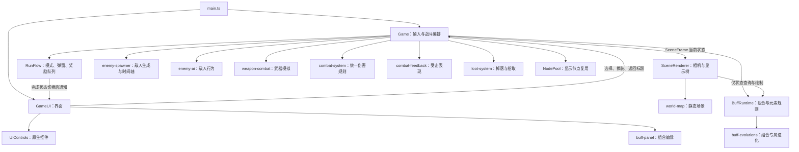

# 代码结构与维护说明 · 0.10.5

## UI 动效与平台复活边界

`ui/ui-effects.ts` 统一维护短时叠层和一条帧循环。无活动动画时立即返回，最多保留 12 个节点；`UIControls.clear` 在销毁子树前取消动画。叠层 mouseEnabled=false，只改变自己的透明度和图形，不改变按钮变换、命中或动作时机。BattleHUD 通过快照差值触发受伤、升级和冷却就绪，resize 清空采样基线。

`ui/system-dialogs.ts` 管理复活/性能详情的横竖屏共用布局。性能详情在暂停时截取采样，战斗只显示底部小条。`platform/revive-provider.ts` 隔离广告 SDK，提供请求互斥、取消与超时；Game 按局代号过滤过期结果，统一提交复活生命、次数和实体清理。RunFlow 新增 downed 状态，死亡当帧立即停止后续战斗逻辑，普通 close 不能跳过复活选择。平台返回成功才恢复 battle；广告引起的失焦必须继续通过暂停面板解除。

当前 176 项测试通过。以下 0.10.4 的行数和测试数量为当轮记录，不代表最新统计。

## 战斗 UI 的模块边界

| 模块 | 状态与职责 |
|---|---|
| `ui/ui.ts` | GameUI 组装、模态缓存、提示与诊断浮层，安全区内重排，不持有摇杆触点或 HUD 标签 |
| `ui/battle-hud.ts` | 桌面/手机 HUD 节点、条形进度、装备显示缓存；只查询 Snapshot，交互走 Game 动作 |
| `ui/touch-stick.ts` | 摇杆节点、首指 ID、原点、拖动/抬起；实例构造时注册一次舞台监听，build 只重建节点 |
| `ui/hud-layout.ts` | 触控区尺寸、按钮间隔与状态/连杀/提示的纯布局计算 |
| `platform/safe-area.ts` | 浏览器 CSS env 安全区读取，非 DOM 环境返回零边距；探针立即移除 |

GameUI.resize 先释放摇杆，再读取安全区并缩小 UI 可用区域，移动根节点后重建 HUD/当前弹窗。安全区只影响 UI，世界相机仍以整个 CSS 舞台居中；触摸原点从 localToGlobal 获取，包含安全区偏移。GameUI 的低频 update 更新已有节点和条形进度，不重建按钮或注册监听。

手机不创建桌面装备侧栏和头像节点。装备弹窗仍通过独立的 equipment 绘制入口使用正式 Game 状态。手机提示限制为两行，显示 1.7 秒，模态打开时不显示；Toast 始终不参与输入命中。性能指标默认 false，存档中显式 true 继续有效，只有用户开启才采样。

UI 测试新增安全区、短横屏按钮间距、反复旋转后的监听数量/节点唯一性和低频刷新节点稳定性；格式检查与全套 170 项测试通过，包含 Pages 根路径/仓库子路径资源验证。GameUI 当前为 127 行。自动节点检查和离线布局图不作为实际手机操作与 FPS 的证据。

## 手机视口坐标约定

`platform/viewport.ts` 在 Laya 初始化后绑定 CSS 视口尺寸，Stage 使用 fixedwidth，设计宽度随 window.innerWidth 更新，useRetinalCanvas 保留物理分辨率画布。舞台、UI、相机与鼠标坐标都用 CSS 逻辑像素，不能再改回 full 或用物理画布宽高判定布局断点。窗口 resize/orientationchange 和 visualViewport resize 会同步设计尺寸，重复相同尺寸不触发额外重排；重新计算与 RESIZE 事件仍由 Laya 自己处理。

Laya 2 的 full 模式会把 393 CSS px、DPR=3 的手机当成 1179px 宽屏。旧测试只模拟 stage.width=393，没有覆盖引擎物理像素换算。本次测试执行 vendor 中真实的 setScreenSize 方法，验证 DPR 1/2/3 下的舞台尺寸、高清缓冲区及 Stage/canvas 组合后的 CSS 按钮大小；另检查手机 HUD 的全宽状态条与触控区。

## 当前目录与状态归属

```text
src/
├─ main.ts          启动 Game 和原生 Laya UI
├─ game/            应用编排、固定步、暂停/奖励队列、节奏/难度/性能
├─ input/           键盘、鼠标、摇杆与输入仲裁
├─ combat/          伤害结算、武器攻击、命中反馈与装饰效果
├─ enemies/         刷怪、敌人 AI 与动作状态
├─ buffs/           碎片配置、配方、运行时、状态、升级/进化和绘制
├─ progression/     装备/升级配置、成长事务、掉落与碎片奖励
├─ rendering/       场景、相机、角色/怪物/技能/掉落的只读表现
├─ ui/              HUD、弹窗、通用控件、响应式布局与 Buff 面板
├─ platform/        本地存储、浏览器音频适配
└─ shared/          实体契约、属性/投影/空间网格等模型工具和节点池
```

配置跟随所属功能，例如 `buffs/buff-config.ts`、`game/game-config.ts`、`progression/config.ts` 和 `rendering/quality.ts`。不设统一收纳所有配置或杂项的目录。Buff 的视觉规则随 Buff 模块维护；通用场景绘制和武器表现放 rendering。

| 入口 | 状态与职责 |
|---|---|
| `game/game.ts` | 本局角色/装备/实体数组的所有权，控制器组装，开局重置，单步更新和系统状态写回 |
| `input/input-controller.ts` | 按键、摇杆、鼠标目标；过滤 UI 点击，转换屏幕输入，向 Game 请求冲刺/菜单等动作 |
| `game/game-loop.ts` | 帧时间、累积时间、FPS、低频 UI 时钟；固定步追赶、暂停清积累与 CPU 采样 |
| `progression/run-progression.ts` | 经验升级、候选生成、碎片领取、装备穿戴/分解；提交数据后推进奖励队列 |
| `combat/feedback-controller.ts` | 震屏/顿帧计时和带预算的线条、圆环、死亡效果；不结算伤害和奖励 |
| `game/run-flow.ts` | 暂停原因、弹窗和 FIFO 奖励队列；打开模态前调用输入 reset |

控制器的 Host/Hooks 显式列出依赖，不将 Game 强制转换成无类型对象。输入和成长每次读取当前局；反馈每次读取当前效果数组，因此重开替换对象后不会写回旧角色/旧数组。Game 的公开动作继续供 UI 使用，私有状态迁移后的测试断言跟随 input/loop/feedback 的所有权。

Game 保留单步顺序：计时/移动 → 刷怪与流程节点 → 武器攻击 → AI/弹道/区域/Buff → 拾取 → 死亡节点回收。顿帧只在显示帧扣除可模拟时间；顿帧冷却和震屏剩余时间仍在原固定步位置推进。连击、狂热、击杀奖励与开局事务仍属于 Game 的跨系统规则，没有为缩短文件而拆成一组互相写字段的工具函数。

目录迁移同时覆盖测试、bench 开发预览和 scripts 工具。编译保留 src 的相对目录层级，Pages 打包递归收集 dist 下的 JS 并去除 source map 引用；格式检查同样递归扫描 src。新增资源不能依赖旧的 `dist/game.js` 等平铺地址。新增测试验证主循环追赶/选卡暂停、反馈数组替换/预算/顿帧冷却，以及预览页模块依赖。

本轮全套 162 项测试通过；三武器整局 112 个状态样本及终局与 `artifacts/refactor5-before.json` 基线一致，结果为 `artifacts/refactor6-after.json`。Pages 根路径/仓库子路径及开发预览模块依赖检查通过；这些验证不代表真实浏览器画面或 FPS 验收。

下方第五轮及更早记录保留历史说明，当前文件位置和 Game 职责以本节为准。

## 第五轮整理：模块边界与配置入口

本轮将 Buff 的配置、查询、碰撞、元素状态、反馈和渲染从同一文件拆开；将弹窗绘制从 HUD 类抽出；将设置、战绩存储和程序音效从 Game 分离。现有公共动作/导出保持兼容，源码用统一格式展开压缩语句，并补齐生命周期、坐标单位、调用顺序和副作用约束。下方历史章节保留演进背景，当前模块职责以本节为准。

| 模块 | 当前职责 |
|---|---|
| `game.ts` | 应用编排、输入事件与固定步、跨系统状态写回、奖励结算 |
| `buffs.ts` | Buff 公共入口/兼容导出、状态所有权、触发与固定步编排 |
| `buff-config.ts` | 碎片静态目录、行为参数、容量、元素规则、反馈预算 |
| `buff-types.ts` | 配方、主效果、状态、反馈及外部 Host 接口 |
| `buff-recipes.ts` | 完整性校验、碎片查询、伤害计算与说明，无节点/状态写入 |
| `buff-effects.ts` | 释放原点、弹丸线段碰撞、区域/环绕命中与寿命 |
| `buff-status.ts` | 减速/灼烧、元素传导、击退和状态容量 |
| `buff-feedback.ts` | 装饰反馈的合并、上限与寿命，不结算伤害 |
| `buff-renderer.ts` | 只读状态视图与主效果/进化/状态/反馈的层序绘制 |
| `ui.ts` | HUD、触控、窗口重排、低频刷新与弹窗缓存 |
| `ui-dialogs.ts` | 标题/奖励/装备/暂停/结算的桌面及响应式布局，委托 Buff 面板 |
| `ui-config.ts` | 界面符号和时间/百分比展示格式 |
| `local-settings.ts` | 本地设置读写、最近战绩；存储失败不影响战斗 |
| `procedural-audio.ts` | 用户手势音频恢复、振荡器音效与无音频降级 |

### 配置去哪里修改

| 内容 | 配置文件 |
|---|---|
| 装备、武器、常规升级、基础战斗参数 | `config.ts` |
| 局时长、Boss/精英/奖励节奏 | `pace.ts`、`config.ts` 的 ELITE_TIMES |
| 后期难度曲线 | `difficulty.ts` |
| 画质和 FX 数量预算 | `quality.ts` |
| 固定步、追赶上限、界面刷新、世界边界/柱子、按键/存储键 | `game-config.ts` |
| Buff 触发、基础伤害、范围、寿命、频率、状态和反馈规则 | `buff-config.ts` |
| Buff 等级与进化规则 | `buff-upgrades.ts`、`buff-evolutions.ts` |

距离单位为世界坐标，模拟时间单位为秒，性能时间单位为毫秒。小符纹颜色、节点偏移等局部表现数据继续由对应 presentation/visuals 文件持有，避免将所有视觉常量塞入全局配置。

### 重构时必须保留的顺序

Buff 固定步：反馈寿命 → 槽位冷却 → 元素状态 → 进化 → 主效果；主效果仍反向遍历，命中后再回收。接触顺序：基础伤害 → 普通元素 → 进化叠层，状态容量满时保留原有提前返回语义。伤害与外观在释放时一起快照，排队中的奖励在实际显示时重新生成。初始化/练习的 grant 仅解锁，真实奖励走 receiveFragment。

UI 弹窗通过 DialogHooks 请求缓存失效/刷新，不持有 RunFlow 的队列或 PauseGate。HUD 仍控制低频更新，所有玩法写入仍走 Game 的动作入口。音效适配器仅增加对浏览器 resume 拒绝的处理，不改变战斗行为。

### 构建、发布与验证

依赖通过 package-lock 锁定 TypeScript 5.0.2。build 脚本使用本地编译器并清理固定 dist 目录；build:pages 生成独立 _site，工作流构建/测试通过后部署。详见[开发与发布](开发与发布.md)。format/format:check 保留中文注释、展开多语句函数和较大配置对象，并检查格式结果稳定。

本轮重构前后保存了三武器六分钟固定种子整局结果：112 个状态样本及终局全部一致，文件为 artifacts/refactor5-before.json 和 artifacts/refactor5-after.json。现有测试覆盖进化、强化、图元纯函数和手机弹窗；Pages 集成验证覆盖完整模块依赖、精确大小写、根/子路径和旧产物清理。以上均不作为真实浏览器 FPS 证据。

## Buff 等级视觉快照（0.9.4）

BuffEffect 在释放时同时保存 level 和 damage；BuffVisualEffect 接收可选 level，缺省按 Lv.1 绘制，既有预览仍可使用。`buffVisualTier` 统一映射 1—2/3—4/5 三档；只读绘图不能查当前配方等级，否则升级或换配方会使场上旧技能变形。

`buff-visuals.ts` 在原弹头内增加窄亮芯/冠状尾纹，环绕保留原双轨道并替换亮轨迹/添加小符纹，区域/爆炸在真实范围内部增加封印。局部封印四角与八角对应强化/满级；满级前 140ms 的闪纹复用主效果 age，不生成新对象或计时器。低画质减少细节但保持轮廓档位。新增绘制每个主效果最多 4 条，仍由原效果数量上限约束，不做每目标粒子爆发，不使用随机数。

EvolutionSource.level 随基础 Buff 命中传给已有 burst 钩子，Feedback 保存等级；雷印/冰裂爆发调用同一局部封印。火种保存等级，近点刷新取最高；火线创建时保存两端较低等级，和伤害一样不追溯重算。火种/火线通过替换原图元轮廓/颜色实现等级识别，宽度和数量限制不变。叠层标记仍只表示实际层数，不能因技能等级增加标记数量。

`bench/buff-levels.html` 使用正式绘图快照对比四行为三档等级，可切元素/细节，不运行战斗。`scripts/buff-level-preview.mjs` 输出离线图元，再由现有 render-skill-preview.ps1 重放 PNG；两者均不作为 GPU/FPS 实测。测试需验证三档差异、纯渲染/无 RNG、命令预算、封印半径、来源快照和低画质机制一致。

## 重复碎片强化 Buff（0.9.3）

`buff-upgrades.ts` 持有按 trigger/action/element 完整组合索引的等级 Map，最多 64 项。Lv.1 默认、上限 Lv.5，每级加 20% 基础 Buff 伤害。匹配当前完整配方时优先最低等级、同级最小槽序，一片只提升一个组合；相同配方双槽共享等级。目标查询只读，无 RNG、不改冷却，未完成配方不参与。清场/清空/换槽保留，BuffRuntime.reset 才重置本局等级。

`BuffRuntime.receiveFragment` 为真实碎片奖励唯一入口，返回 unlock/upgrade/xp/invalid 结果；`grant` 维持仅解锁语义，供练习和初始化调用，不能改成重复即强化。LootSystem 拾取和 Game.chooseFragment 都根据结果发经验、提示/刷新；经验可能产生升级选择，仍先入队再关闭奖励。面板用 levelOf 查询等级；首精英全解锁候选用 upgradePreview 优先可升级项，文案展示实际目标。

`recipeDamage` 先将行为基础伤害乘玩家伤害倍率和等级倍率，再统一四舍五入。触发时只算一次，普通效果与火种复用该伤害快照；雷印/冰裂/火线继续按原快照比例结算，已有弹丸/区域/连线不追溯改伤害。升级不增加运行时效果上限、范围、频率或每帧扫描。UI 缓存键包含当前配方等级，升级后说明能即时刷新；中文说明仍使用按内容估算的响应式高度。

测试覆盖满级、无匹配/不完整兜底、初始化无升级、换配方保留、同配方双槽共享、两个正式奖励入口及真实弹丸进化。新等级有意改变重复奖励与后续伤害，不能再用旧整局哈希基线断言玩法未变化。

## 局内性能指标（0.9.2）

`performance-monitor.ts` 维护 300 项环形记录，写入 O(1)，仅 HUD 低频查询时聚合均值并排序求最近秩 P95。真实帧间隔来自 Game 帧回调的 performance.now，不使用固定步长/截断 dt。FPS=1000/平均帧间隔，不能用 update+render 反推。CPU 更新计每个显示帧内所有追赶步，不是单步耗时；绘图仅测 Game.render，不包 Laya 私有循环、实际 GPU 提交或后续 HUD 更新。

采样仅在前台、战斗且未暂停时进入；帧内触发选择/终局也不记录。暂停保留最后结果但切断时间戳，恢复首帧重建窗口避免把等待计成慢帧。失焦直接切断时间戳，resize/start/toggle 清空窗口。开关属于本地设置，重开保留，关闭后不聚合性能数据。UI 诊断面板位于模态遮罩下，mouseEnabled=false，文本变化才写回节点。

实体计数在低频查询时取数组长度，包含离屏对象；effects 统计 fx/fields/buffs.effects，不代表细分装饰反馈、粒子总数或 DrawCall。自动测试只验证统计数学、采样生命周期和节点交互/布局，不作为浏览器性能报告。

## 首精英碎片选择（0.9.1）

`fragment-rewards.ts` 只负责候选排序与进化提示，不依赖 Game/Laya，不修改持有集合。优先补齐行为/元素，其次推进路线，同分时避开地上已有碎片，再随机排序；无足够未解锁碎片时缩减候选，全解锁允许重复领取转 5 经验。进化提示读取统一 EVOLUTIONS 元数据，不另设路线规则。

Game 使用独立 `firstEliteFragment` 标记本局首次精英击杀，不用刷怪时递增的 eliteIndex 判定，发奖前先置位以抵御连锁击杀重复发奖。重开重置。首精英只替换该次随机碎片掉落，装备与经验保留，后续掉落走 LootSystem。

`RunFlow` 新增 `fragment` 请求；真正激活时才依据最新 owned/drops 生成候选。`chooseFragment` 仅接受当前候选，解锁不会自动改配方；重复奖励经验导致的升级先排队再关闭。UI 仅调用这个入口，竖屏行排列、横屏列排列，共用遮罩和 PauseGate。终局可取消尚未领取的奖励。

自动整局模拟必须同时处理 fragment/upgrade/drop，否则会停在首精英选择。本次有意改变随机数调用与掉落行为，不能继续要求旧版整局哈希一致，也不能覆盖旧基线掩盖差异。Node UI stub 只验证布局边界与交互，不能代表浏览器画面或帧率。

## Buff 专属进化（0.9.0）

`buff-evolutions.ts` 定义三对行为/元素的进化规则与有界状态：雷电弹丸叠雷印、火焰区域连接火种、冰霜环绕叠冰层。触发碎片继续负责原有概率、冷却和生成位置，不额外增加槽位。完整配方自动启用；`evolutionOf` 同时供运行时之外的面板和说明查询，不能为 UI 维护另一套判断表。

### 命中与递归边界

BuffRuntime 先结算基础接触及原元素效果，再把该次接触交给 `evolutions.hit`。只有弹丸雷电/环绕冰霜的直接接触会叠层；基础雷电的邻近传导不叠雷印，灼烧/连线/进化爆发也不再次叠层。所有额外伤害继续使用 host.damage，Game 的 Buff 回调关闭 `triggerBuffs`，不能绕回 WeaponCombat 或调用基础 apply 造成递归。

雷印从第一层起 9 秒内叠满 3 层，引爆本次 Buff 快照伤害的 160%，传导 180 范围内最多 3 个其他目标各 80%；冰层从第一层起 3 秒内叠满 3 层，碎裂对 110 范围内最多 8 敌造成 120% 并应用原有 35% 减速 2 秒。窗口不随第二次命中刷新；爆发前先清零层数并锁定 1 秒。两配方共享同类目标叠层，最近触发叠满的 Buff 决定本次伤害快照。每种目标 Map 最多 200 项，死亡/时限结束后清理。

### 火种与范围

火焰区域成功生成后写入 6 秒火种，允许冷却 4 秒的受击配方同样连线。近于 32 的新火种只刷新原火种寿命/伤害，不制造零长度线；新点连接 260 范围内最近两点。种子最多 6 颗，容量满时移除最早种子及关联线；连线最多 8 条，端点过期时立即移除。

连线每 0.5 秒查询线段周围目标，伤害区域是半宽 24 的有限走廊；端点基础区域和中间燃烧带是独立机制。线伤害快照取连接时两端伤害较小值的 65%。同次脉冲通过目标 Map 去重，交叉时取接触线中的最高值，不按连线数量叠加，每次最多结算 200 个目标。刷新火种不重算已存在连线快照，防止换装追溯修改旧伤害。

### 表现与编辑

`buff-evolution-visuals.ts` 只读已完成模拟状态。层数以敌人旁 3 个菱形刻度表示，雷/冰符号区分材质；最多显示 detail×2 组。所有火种和燃烧带的真实范围轮廓都保留在 floor 层，危险预警仍后绘制。引爆/碎裂/实际传导复用 BuffRuntime 原反馈数组和画质预算，零粒子预算不改变伤害或减速；不增加节点、计时器、随机数或额外无上限粒子。

`BuffRuntime.update` 统一推进进化时钟；菜单暂停不调用 update，Boss 清场、重开或 clearTransient 会清除种子、连线、标记和调试计数。install 不重置冷却、不取消已生成效果，旧弹丸途中编辑配方仍保留原行为、元素和伤害。

`buff-panel.ts` 根据完整配方显示进化名称，说明包含组合路线、叠层窗口和伤害百分比。新增说明按保守字符宽度计算空间、缩减次级说明并适配横竖屏；不能恢复原先固定 +78 的次级文字位置，否则长说明会覆盖页脚。训练解锁仍通过正式面板入口，不能因显示进化而自动解锁碎片。

### 验证入口

136 项测试通过，新增 `tests/buff-evolutions.test.mjs` 覆盖独立规则、真实弹丸与环绕接触、伤害不依赖画质、渲染只读和裁剪、目标/连线预算、冷却较慢的受击配方，以及四种手机尺寸的说明、暂停和重开。`bench/evolutions.html` 使用真实运行时，但触发事件固定成功且靶子不死，只适合看机制。`scripts/evolution-preview.mjs` 生成正式状态与图元的离线图，不是浏览器截图。

进化专项 Node 压测：`node --expose-gc scripts/benchmark.mjs --evolutions artifacts/evolutions-performance-node.json`，三武器分别轮换两条进化，覆盖 240/600/1000 怪。浏览器专项入口是 `/bench/index.html?evolutions`，当前尚无自动浏览器实测结果。旧版整局基线只适用于未启用新进化的基础构筑，不能用它宣称新进化的平衡与伤害保持旧版。

## 奖励与敌弹辨识（0.8.13）

`projectile-presentation.ts` 的 `paintHostileShot` 在发射时按实际投影速度画四个多边形：暗尾迹、深色外缘、红色尖头、来源色内芯；速度为零时使用向右的稳定预览方向。轮廓以原弹头中心 `(0,-18)` 为基准，不修改发射挂载偏移、世界坐标、速度、寿命、伤害或碰撞。不得为了突出危险而把敌弹抬到全部怪物上层，当前仍使用原有 actors 深度排序。

`loot-presentation.ts` 使用形状而非只换颜色区分奖励：经验为绿色扁菱片，治疗为十字补给包，碎片为金边菱纹符牌，装备仍为宝箱。`lootPose` 只从局内时间和掉落状态计算浮动/缩放，经验最多离地约 1.4 像素；吸取时横向放大、略压扁，不改追踪速度或拾取半径。缓存图元只在创建时绘制，暂停不改变时间，因此自然定格。

`bench/readability.html` 复用正式绘图与奖励浮动，展示 120 份奖励与 48 枚循环弹道，可慢放、暂停或分别隐藏。它没有伤害/拾取逻辑，也不是性能测试。`scripts/readability-preview.mjs` 保留旧版图元仅用于离线并排对照；正式游戏必须调用 src 模块，不能引用旧版预览实现。重建图片：运行该脚本，再执行 `powershell -File scripts/render-skill-preview.ps1 -PreviewName readability-preview`。

`tests/readability.test.mjs` 检查有限图元、不消耗随机数、速度反向/零速度、奖励形状差异、经验浮动上界，以及真实弹道缓存和世界运动不变。

## 第四轮重构：伤害规则与表现（0.8.12）

`combat-system.ts` 是统一伤害规则入口，不依赖 Game、Laya 或对象池；只原地修改受击实体，并通过有限回调累计统计、通知表现、结算死亡和派发 Buff。`combat-feedback.ts` 接收伤害结果，负责白闪、武器反应、通用命中图形、暴击停顿和伤害数字；它不能扣血、击退或生成奖励。Game 保留奖励与对局流程的编排，通过回调连接两者。

### 具名伤害选项

`Game.hit(enemy, damage, options)`、`WeaponHooks.hit` 和 `EnemyAIHooks.hit` 共用 `DamageOptions`，不再接收连续的布尔位置参数。

| 字段 | 默认值 | 约束 |
|---|---|---|
| `canCrit` | `false` | 仅为 true 时抽样暴击随机数 |
| `impact` | `true` | 同时控制物理命中击退、命中表现和 hit Buff 派发；持续伤害设为 false |
| `round` | `true` | 直接命中四舍五入且至少 1 点；按秒累积伤害设为 false |
| `triggerBuffs` | `true` | 同时控制 kill/hit 派发；Buff 伤害和反伤设为 false，避免递归 |
| `quiet` | `false` | 压制白闪、图形和数字，保留原有击退与暴击停顿规则 |
| `feedback` | 无 | 实际武器命中快照，不参与伤害计算，不从当前装备倒推 |

例如，武器直接命中用 `{ canCrit: true, feedback }`，灼烧用 `{ impact: false, round: false }`，反伤用 `{ triggerBuffs: false }`。火焰区域仍按原规则逐次取整，用 `{ impact: false }`，不能误改为小数持续伤害。

### 顺序、递归与生命周期

敌人伤害严格保持：暴击抽样 → 扣血与累计伤害 → 物理击退和反馈 → 先标记 dead → 击杀统计/奖励 → hit Buff。普通敌人致死命中仍会派发 hit；Boss 致死命中由奖励回调返回终局标志，立刻停止后续派发。已死亡敌人直接返回，不再抽样随机数、不重复掉落。击杀奖励与随机掉落继续由 `Game.onEnemyKilled` 按原顺序执行，不能为了拆文件改变随机数调用次序。

玩家受击严格保持：战斗/无敌拦截 → 训练免伤 → 扣血与无敌窗口 → 表现 → 反伤 → 死亡或 hurt Buff。反伤冷却由 Game 在遍历敌人之前写入，且统一关闭 Buff 派发。即使本次玩家伤害致死，原有反伤仍先执行；存活后才派发 hurt。

所有 state 都在每次调用时读取当前玩家、属性、labels 数组和画质，hooks 只保存函数，不缓存重开前的玩家和数组。`presentEnemyHit` 不使用随机数；图形沿用 Game.effect 的 FX 上限，数字沿用 labels 上限。它允许写入 Enemy 的纯显示字段，不能改变 hp、kx/ky 或 dead。

### 回归与复查

`tests/combat-system.test.mjs` 不初始化 Laya，新增 7 项测试，独立覆盖暴击随机数、持续伤害、递归死亡、Boss 终局、静默反馈、玩家无敌/训练/反伤时序、数字预算。原有集成测试已迁移为具名选项，仍覆盖武器、Buff、掉落、死亡与重开；全套 123 项测试通过。

`scripts/combat-regression.mjs` 在固定种子和移动/冲刺输入下运行三种武器各 360 秒训练局，自动处理正式选卡与装备入口，每 10 秒及终局保存战斗和反馈状态摘要，共 111 个样本。第四轮重构前后样本与结算完全一致，基线和结果位于 `artifacts/refactor4-before.json`、`artifacts/refactor4-after.json`。此对照验证模拟行为，不代表浏览器画面、帧率或手机性能。

复查命令：`npm test`，再执行 `node scripts/combat-regression.mjs --compare artifacts/refactor4-before.json --output artifacts/refactor4-after.json`。只有确实修改规则、确认新行为后才更新基线，不得用覆盖基线的方法消除回归差异。

## 怪物出手与收招（0.8.10）

`enemy-actions.ts` 定义 cast/launch/brake/burst/slam 五种纯表现事件和时长。AI 在原来的发射、起冲、冲锋结束、弹幕与砸地分支调用 startEnemyAction；actionTime 在原状态更新阶段递减，不作为 AI 分支条件。不能用它延迟真实攻击、暂停怪物移动或修改原 wind/charge。死亡、暂停和重开的流程沿用原模拟规则，新生成的敌人没有旧动作状态。

`enemyArtPose` 将法杖/手臂动作离散为 8 阶段，返回部件变换与缓存键。voxel.Shape.part 明确标记 staff/leftArm/rightArm，enemyShapes 使用规范肩膀/握把坐标变换既有面片；持杖手末端直接连接动作后的握把。SceneRenderer 的 actionPaint 和 flashPaint/icePaint 一起决定是否重建图元；普通怪移动和橙色怪身体形变仍只更新节点，不逐帧重建造型。局部动作计算不使用随机数。

`enemyStaffSocket` 先应用法杖局部动作，再叠加敌人整体浮动、缩放、旋转，得到不含相机的投影坐标。AI shoot 回调可带 source 敌人，Game 将挂载点差值写入敌方弹道 launchX/launchY/launchLife=6；渲染时按初始 life 淡出 0.12 秒，避免误用玩家 1.2 秒寿命放大偏移。碰撞仍使用原 x/y 和速度，不受角色高度影响。

`drawChargeWarning` 固定画 3 个贴地图元：细暗中心线、阶段亮度的边界和前进箭头，不进入上层 effects。`drawEnemyRelease` 只画可见怪物的局部闪光/少量尘点/落点冲击圈，每只最多 3 个图元；不创建实体、子节点或尸体，不产生额外命中。动态沙盒和离线联系表共用正式姿态与绘图函数。

## 御刃动作与轨道（0.8.9）

环刃的手持造型是掌托和悬浮菱晶，挂载点规范坐标为 (23,-34)，与短剑时代不同。`castPose` 只让手掌抬起、向外引导和收回，不再横向挥剑；握把、手臂、品质标记与符纹继续共享武器变换。

`bladeOrbit(time,castTime,radius,spin)` 返回绘图轨道半径、相位、释放强度与角速度。待机半径是实际范围的 68%，释放瞬间为 100%，随收招回到待机；图形中心不会超出真实攻击半径。Game.update 只在使用环刃时累计 `Player.bladeSpin` 的额外相位；基础相位来自局内 time，重复攻击不重置 spin，因此不会倒跳。暂停不推进两者，重开随新玩家对象清空。

`drawBladeOrbit` 是正式场景与预览共用的绘图入口，最多 7 枚飞刃，每枚 3 个面片，释放时另加一根短尾迹。`bladePulse` 用三段空心轨迹替代旧实心扫切面；旧 `Effect.kind='slash'` 数据契约保留，但显示跟随当前玩家中心，换出环刃后停止画残留轨迹。`WeaponCombat.attack` 仍负责即时范围伤害和 bladeCd；禁止在图形碰撞或轨道移动时另行扣血，否则会重复伤害。

## 紫色远程怪预警修正

`drawRangedWarning` 位于 `enemy-presentation.ts`，接收上层聚能 Graphics 和地面瞄准 Graphics。瞄准方向只读 AI 蓄力时锁定的 dx/dy，固定 8 段虚线和末端空心箭头，蓄力结束即停止绘制，不读取玩家新位置。地面线受怪物遮挡，和实心飞行弹头区分；亮度随蓄力分三档，线宽最多 1.4，不生成连续激光或额外子节点。杖头聚能按照精细/简化两种造型的结晶中心，通过与敌人节点一致的浮动、缩放和旋转变换定位；调用方必须传局内 time，保证暂停与冰霜姿态一致。

## 玩家施放动作（0.8.8）

`Player.castTime/castWeapon` 是表现状态。WeaponCombat 确认存在目标后在即时结算的同一步启动动作，Game.update 按模拟秒数递减；它们不控制攻击冷却、伤害和弹道碰撞。暂停不推进模拟步，因此自然定格；重新攻击重置时长，putOn 换武器时取消，start 用新玩家对象清空。移动和施放可以同时发生。

`CAST_DURATION` 定义雷杖 0.28 秒、炎炮 0.30 秒、环刃 0.22 秒。动作从即时释放姿势进入随动、收招，未引入延迟伤害的蓄力阶段。`castFrame` 把进度离散到 12 段，`castPose` 生成各武器独立的旋转和握把偏移；`weaponPoint`、`weaponSocket`、品质标记与角色绘图都使用相同进度。修改动作不能在渲染器额外添加一套偏移，否则会破坏释放挂载点对齐。

手臂在施放期间通过肩膀、肘部和握把构成两段多边形；炎炮双手托持，雷杖与环刃驱动主手。动作手臂已经位于屏幕局部坐标，不再参与身体侧向压缩；武器仍按原规则处理前后遮挡。角色缓存键包含动作阶段，保持静止时也能推进施放，不增加显示节点或独立计时器。原有短时电弧和枪口特效依然保存释放瞬间的挂载点快照，不跟踪后续收招。

四轮重构已拆出局内流程、场景渲染、静态地图、敌人生成与 AI、武器模拟、掉落、节点池、公共 UI 控件、Buff 编辑面板，以及伤害规则与受击表现。第四轮保持既有战斗数值、六分钟时间轴、输入、装备与 Buff 行为。中文注释解释职责、调用顺序、单位和不能破坏的约束。

## 从哪里开始读

| 文件 | 职责 | 修改场景 |
|---|---|---|
| `src/main.ts` | 创建 Game 和 GameUI | 应用启动 |
| `src/game/game.ts` | 输入、固定步编排、伤害模块连接、成长结算 | 击杀奖励、成长、流程顺序 |
| `src/combat/combat-system.ts` | 敌人/玩家伤害规则、物理击退、死亡与 Buff 派发顺序 | 伤害来源、持续伤害、暴击、反伤时序 |
| `src/combat/combat-feedback.ts` | 受击结果转为有限的画面、停顿与伤害数字 | 反馈强度、静默规则、数字预算 |
| `src/rendering/projectile-presentation.ts` | 敌弹危险轮廓与发射时缓存绘制 | 尖头、尾迹、来源色与奖励区分 |
| `src/buffs/buff-evolutions.ts` | 雷印、火种连线、冰层碎裂的有界模拟 | 进化条件、叠层时限、额外伤害 |
| `src/buffs/buff-evolution-visuals.ts` | 进化标记、地面范围与爆发图元 | 叠层辨识、连线、爆发轮廓 |
| `src/rendering/loot-presentation.ts` | 奖励造型与只读浮动姿态 | 经验、治疗、碎片、宝箱辨识 |
| `src/enemies/enemy-spawner.ts` | 波次、怪潮、精英、容量、Boss 清场与援军 | 刷怪节奏、出生位置、Boss 登场 |
| `src/enemies/enemy-ai.ts` | 状态推进、追击、蓄力、冲锋、敌方攻击 | 敌人行为、Boss 阶段和攻击形态 |
| `src/rendering/enemy-presentation.ts` | 纯显示姿态、蓄力比例、死亡绘图 | 移动动作、碎裂与反馈节奏 |
| `src/rendering/skill-visuals.ts` | 电弧、定向火球、扫切、旋刃、爆炸、施放反馈 | 三武器技能造型 |
| `src/combat/weapon-combat.ts` | 三武器攻击、弹道碰撞、爆炸、火焰区域 | 攻击形态、弹道快照、区域命中 |
| `src/progression/loot-system.ts` | 掉落生成、容量、吸取、拾取分流 | 掉落优先级、拾取和自动分解 |
| `src/shared/node-pool.ts` | 图形/文字节点池 | 节点状态复位、缓存容量 |
| `src/game/run-flow.ts` | 当前弹窗、FIFO 奖励请求、模式、暂停原因 | 升级与装备选择衔接、结算和标题 |
| `src/rendering/scene-renderer.ts` | 相机、节点同步、状态染色、效果层序与预警 | 角色表现、遮挡、画质、场景效果 |
| `src/rendering/world-map.ts` | 一次性生成地面、装饰和柱子 | 静态场景造型 |
| `src/shared/entities.ts` | 玩家、敌人、弹道、掉落、地面区域、反馈的数据契约 | 跨战斗和渲染共享字段 |
| `src/ui/ui.ts` | HUD、响应式布局、菜单与点击交互 | 界面呈现 |
| `src/ui/ui-controls.ts` | 原生 Laya 公共控件、输入隔离、配色 | 按钮、标签、面板、角色预览 |
| `src/ui/buff-panel.ts` | 响应式 Buff 配方编辑 | 槽位切换、碎片选择、组合说明 |
| `src/buffs/buffs.ts` / `src/buffs/buff-visuals.ts` | 组合运行时、冷却、元素状态、独立效果绘制 | 自定义 Buff |
| `src/shared/model.ts` | 属性重算、投影、经验需求、空间查询和 PauseGate | 不依赖 Laya 的通用规则 |
| `src/progression/config.ts` / `src/game/pace.ts` / `src/game/difficulty.ts` | 装备强化配置、时间节点和难度曲线 | 数值调整 |



RunFlow 和 SceneRenderer 都不导入 Game。实体类型不导入 UI 或 Laya 运行时，因此可以在不创建游戏的情况下测试流程或渲染器。

## 选择、奖励与暂停

`Game.dialog`、`Game.mode`、`Game.gate` 是对流程模块的查询入口，不再由 UI 分别赋值。UI 调用 `chooseUpgrade`、`takeDrop`、`close` 或 `returnToTitle`，由 Game 结算规则，再由 RunFlow 更新流程。

奖励处理顺序：

1. 经验扣除、等级提升、装备更换等实际数据更新仍由 Game 执行。
2. `flow.open(request)` 请求显示选择；有其他弹窗时只排入 FIFO 队列。
3. `beforeOpen` 清理键盘、鼠标目的地与摇杆，避免玩家选完卡仍沿旧方向移动。
4. 请求真正显示时才调用 `prepare`；升级候选根据最新强化等级生成。排队期间保存的候选不能直接使用，否则可能再次提供已满级强化。
5. `close()` 原子地推进下一请求，最后只通知 UI 一次。不会先通知“战斗恢复”，再通知“还有下一次升级”。

装备穿戴或分解产生的经验可能再次升级。`takeDrop` 必须先完成穿戴/分解和新奖励入队，再关闭当前比较面板，不能反过来。

`PauseGate` 记录独立原因。关闭弹窗移除 `dialog`，并按原有“明确继续”规则移除 `focus`；不能顺手清除 `orientation` 等其他原因。`begin`、结算和返回标题属于完整流程切换，才清空旧队列与旧暂停原因。

`RunFlow.begin()` 特意不发 UI 通知。Game 必须先完成新玩家、Buff、实体与计时器初始化，再统一通知。`replace()` 是整体替换入口，用于结算、标题和开发时的布局预览；普通奖励必须使用 `open()`，避免覆盖待领取奖励。

## 逻辑步与实体生命周期

`frame()` 负责调度，战斗按 1/60 秒固定步更新，每帧最多追赶 6 步。选卡暂停时清掉累计时间，恢复后不会补算暂停期间的伤害。

单个逻辑步维持原顺序：计时与移动 → 刷怪和流程节点 → 玩家攻击 → 怪物 AI → 弹道 → 武器持续区域 → Buff → 拾取 → 死亡实体及短暂反馈清理。死亡、超时或胜利会中止后续战斗阶段。

实体的 `x/y`、半径和速度均使用世界坐标，`life`、冷却与状态时长使用秒。显示坐标在 SceneRenderer 内投影；鼠标通过 `screenToWorld()` 复用同一相机变换后再参与碰撞。

Game 统一编排实体生命周期，武器和掉落模块创建、推进对应实体，显示节点由 NodePool 借出和回收。敌人先标记 `dead`，逻辑步末再统一回收，避免在攻击遍历中删除数组元素。对象池归还时清空形状或文本，超过容量直接销毁。尚未引入独立实体管理器。

`start()` 会替换 player 和实体数组。Buff 使用 getter 代理读取最新 player，SceneRenderer 每帧读取新传入的 SceneFrame；两个模块都不能保留重开前的玩家引用。

## 渲染边界和层序

SceneFrame 中的数组只读且不复制。SceneRenderer 允许修改显示节点及 `flashPaint/icePaint` 绘图缓存，不能修改世界坐标、血量、AI 计时器或进行伤害结算。Buff 只向渲染器暴露 `render`、`speedMultiplier` 和配方查询，不暴露 `trigger/update`。

显示树顺序固定：

1. `ground`：只构建一次的地面和静态装饰。
2. `groundEffects`：脚下定位圈、燃烧区域、焦痕和 Buff 地面效果。
3. `actors`：角色、敌人、弹道、掉落及池化数字，按深度排序。
4. `effects`：攻击、命中和装置表现；血条与上层预警在此最后绘制。橙色冲锋怪的路线框、中心线、箭头属于 `groundEffects`，会被角色和怪物正常遮挡。
5. GameUI 独立覆盖场景，奖励提示条保持输入透传。

`render()` 再分为相机更新、实体显示同步、输入/掉落标记、地面效果、武器反馈、Buff、装备表现和危险预警。新增表现应放入对应步骤，不能追加在危险预警之后。

性能约束：屏幕外只隐藏，不停止 AI；深度按 8 世界单位分档；走路姿态、闪白或减速变化时才重建角色形状；地面不逐帧重画；普通血条、数字和装饰反馈受画质预算控制，危险预警不受装饰预算限制。

场景渲染器仍使用 `any` 连接旧版 LayaAir 2.0.2 节点，因为项目没有配套完整引擎类型。战斗实体和模块间状态接口已显式定义；本轮不引入新引擎、ECS 或平台适配层。

## 新增功能时的落点

- 新弹窗：在 run-flow 的 Dialog 联合类型添加描述，Game 提供语义入口，UI 负责呈现。不要直接改 UI 持有的流程字段。
- 新武器：真实碰撞、伤害和掉落由战斗逻辑处理；纯装饰放 SceneRenderer。不要让绘图次数影响命中次数。
- 新敌人：生成属性与容量规则进入 enemy-spawner，行为进入 enemy-ai，造型和预警进入 SceneRenderer；伤害仍走 Game 的统一入口。
- 新 Buff：行为和元素规则进入 BuffRuntime，轮廓和动画进入 buff-visuals；防止 Buff 伤害递归触发自身。
- 新地面：静态内容进入 world-map；动态区域进入对应效果层，碰撞仍使用世界坐标。
- 新画质限制：扩展 quality 的配置契约，不能减少真实伤害或隐藏必要预警。

## 验证结果与边界

- `npm test`：91 项通过，包含流程、渲染器、敌人系统、姿态/死亡绘图与技能轮廓独立测试，以及既有输入、选卡、装备、Buff、九种尺寸、后期压力和完整对局模拟。
- 三武器固定种子运行至结算，重构前后抽样的敌人位置/血量/类型、掉落、装备、升级和最终结果逐项相同。原始快照与摘要在 `artifacts/refactor-before.json`、`refactor-after.json`、`refactor-world-comparison.json`。
- 0.8.2 第一轮的三武器各 240 帧绘图命令序列与当轮重构前完全相同，包含初始化、静态地图和动态绘图。历史摘要在 `artifacts/refactor-render-comparison.json`。
- 上述均是 Node 逻辑和绘图命令验证，不代表浏览器 WebGL、GPU、实际 FPS 或真机验证。浏览器自动控制在当前环境仍不可用。

0.8.2 的快照与绘图比较仍保留作历史证据。第二轮使用新的固定种子基线，三武器各运行至结算，逐项比较定期抽样的敌人坐标/血量、掉落、装备、强化和最终结果，结果完全一致；见 `artifacts/refactor2-before.json`、`refactor2-after.json`、`refactor2-comparison.json`。

第三轮每 600 个逻辑步（10 秒）抽样，进一步记录玩家、完整敌人状态、弹道快照、火焰区域、掉落、装备、强化及刷怪时钟/标记。三武器均运行至结算，重构前后原始 JSON 的 SHA256 完全一致，见 `artifacts/refactor3-before.json`、`refactor3-after.json`、`refactor3-comparison.json`。这轮未重新执行绘图命令逐项比较。真实浏览器压测已尝试运行，但启动 Edge 时发生 `spawn EPERM`，未获得 FPS 或 GPU 数据；也尚未完成浏览器实际画面、交互与真机回归。

## 武器模块与状态写回

`WeaponState` 每次调用时从 Game 组装，引用当前玩家、装备、属性、空间索引及数组。模块不导入 Game，也不保留跨调用状态。数组和实体按引用传递，避免逐帧深拷贝；标量 `recoil` 由 `attack` 包装方法写回。`updateShots` 和 `updateFields` 使用筛选替换数组，Game 必须接回结果，不能只调用后丢弃。

调用顺序保持“玩家攻击 → 怪物 AI → 弹道 → 火焰区域”。所有伤害经过 `WeaponHooks.hit/hurt` 回到统一入口，暴击、击杀掉落、Buff 派发和死亡处理仍只有一份。第四轮后区域伤害传 `{ impact: false }`（原 `show=false`），保留原有持续伤害反馈规则。敌人死亡后先标记，后续查询跳过，不能为方便立即删除。

弹道生成保存伤害、燃烧、爆炸范围与区域时长，换装不能改变在途弹道。总弹道上限 240，敌方只能占 208，余下 32 留给玩家。高速弹道采用线段距离检测；火焰弹只爆炸一次。同一逻辑步的重叠火焰区域对同一敌人只结算一次。

## 掉落、成长与节点池

`LootState` 传入本局掉落、玩家、装备、属性与有限 Buff 接口。生成时原地追加或合并，拾取时筛选数组，Game 接回新数组。`LootHooks.addXP/show` 回到成长结算与弹窗队列：掉落模块判断“给什么”，Game 判断“如何升级、何时通知”。拾取音调与节流仍由 Game 管理。

普通正经验从 150 个掉落起尝试合并，硬上限 170。特殊掉落优先腾位；被移除的正经验合并到其他正经验，或立即结算，不能丢失。负经验为治疗，不能混入正经验。碎片优先从未解锁且地上没有的候选中抽取，容量确认后才消费随机数，保证随机调用顺序。

普通经验和碎片进入吸取范围后持续追踪，移动步长不超过剩余距离；装备近身再比较，同款且品质不高于当前装备时自动分解。拾取结算后归还节点，不得保留在显示树中。

`NodePool` 接收 actors 容器，完全不依赖 Game。图形/文字分别缓存，空闲上限为 500/40；容量不是活跃实体上限。借出重置可见性、透明度、缩放和旋转，归还先脱离父节点，再清形状或文字。每个节点只能归还一次。重开先回收全部活跃节点再替换数组；池本身跨局保留。

## UI 控件与编辑面板

`UIControls` 只接收解锁音频的回调。它负责创建 Laya 节点和隔离事件：文本禁用命中，面板拦截按下事件，按钮点击先阻止冒泡、启用音频，再执行动作。奖励提示条仍显式 `mouseEnabled=false`，避免盖住选卡按钮。UI 节点随容器销毁，不进入战斗节点池。

`buff-panel` 接收最小状态与动作回调，不引用 Game。`BuffEditorState` 只保存正在编辑的配方序号与碎片分类，实际配方、已解锁碎片和冷却属于 BuffRuntime。编辑后先更新数据，再使弹窗缓存失效并重绘；编辑不能重置冷却。窄屏/矮屏列数计算与 44px 点击高度沿用原布局。

统一伤害与受击表现已在第四轮拆出；成长结算、奖励编排和其他菜单面板仍在 Game/GameUI 中。后续按新玩法的实际需要拆分，结合浏览器与真机回归，不以文件数量作为重构目标。

## 刷怪时间轴与 Boss 登场

`enemy-spawner` 通过 `SpawnState` 接收当前局状态，不缓存玩家或实体数组。Game 已推进 time，本模块只扣 spawnTimer，并依次处理普通波次、怪潮、Boss 援军、定时精英与 Boss 登场。同一步的顺序不能互换，也不能擅自改成 while 补刷，否则会改变出生/清场与随机调用顺序。超时失败和首级经验保底仍在 Game 中，位于刷怪之后、攻击之前。

`spawnTimer` 是普通波次与援军共用的剩余秒数，`nextSurge` 是下次怪潮的绝对局内秒数。`eliteIndex` 记录已触发定时精英的数量，也影响首个精英装备奖励。每次生成或更新时间轴后，Game 通过 `applySpawnState` 写回数组、计时与标记，再继续后续战斗。不能只更新敌人列表而遗漏精英序号。

容量达到上限时拒绝普通怪；关键敌人可先回收一个普通怪再生成，若全为关键敌人则拒绝。距离和角度的默认随机值在容量判断前求值，生成冷却的随机值仅在成功生成时求值。包装方法不提供额外随机默认值，避免抽样次数改变。

Boss 登场清瞬态 Buff、旧敌人、弹道、火焰区域与空间索引，再生成核心。清场不动地上掉落、装备、配方、解锁状态和配方触发冷却。首次援军等待 3 秒，此后每 5 秒补 3 个远程/冲锋怪，360 秒封印时刻停止援军。显示/提示钩子在状态写回前执行，只能使用参数绘制或提示，不能重入重开或生成。

## AI 状态与伤害边界

`EnemyAIState` 仅借用玩家位置、敌人集合、柱子、时间和空间索引。集合只读，敌人字段原地更新；模块不创建、移除或回收敌人，不访问显示节点可见性。Game 在玩家攻击前重建索引，AI 查询跳过已标记死亡的目标。屏幕外依然追击，不能用隐藏节点来停掉模拟。

一步 AI 按“计时/灼烧 → 距离策略 → 蓄力/冲锋/攻击 → 移动/击退 → 柱子碰撞/邻居分离 → 接触伤害”推进。第四轮后灼烧使用 `hit(enemy, damage, { impact: false, round: false })`，按 dt 累积、不暴击、不产生普通命中反馈且不逐帧取整。灼烧致死后跳过该敌人的攻击，步末才回收。邻居分离每次最多查询 8 个对象，沿用密集场景预算。

远程蓄力保存方向，释放时不追踪新位置；冲锋蓄力结束的本步只进入冲锋状态，下一步才位移，冰霜减速继续生效。Boss 落点攻击保存蓄力开始时的玩家坐标，玩家移动可以躲开；另一分支释放环形弹幕，半血后缩短间隔并增加弹数。所有弹道通过已有 shoot 入口处理预算和快照，AI 不维护第二套弹道。

`EnemyAIHooks.isBattle` 必须实时读取 Game.mode：受伤可能结束对局，处理完当前敌人后立即停止后续敌人。不能把模式快照放入状态对象，否则玩家死亡后仍会推进后面的 AI。新模块测试独立覆盖容量/随机消费、Boss 清场与援军、怪潮/精英边界、锁定方向、冲锋减速、Boss 落点及半血弹幕、灼烧死亡和实时中止。

## 怪物表现与绘制预算

`enemy-presentation.enemyPose` 只读坐标、kind、闪白、蓄力和冲锋状态，返回缩放、抬升与旋转，不更新坐标或计时，不消费随机数。SceneRenderer 在可见性检查之后应用姿态，所以离屏怪不会为动画重画。相位来自局内 time 和坐标，暂停时定格；不用墙钟，避免选卡时怪物继续跳动。每帧完整写入 scale/rotation，冲锋结束或节点复用后不会残留上一次姿态。

造型依旧由 voxel.enemyShapes 生成并缓存。移动只变换节点，命中闪白、冰霜状态或画质变化才重画。普通怪在低/标准档保留简化身体，精英/Boss 保留完整轮廓，任意造型不超过 40 个图形。冰霜减速还会改变动作节拍，但不在渲染中影响真实移动速度。

蓄力比例只用于显示。法师结晶随蓄力变亮，野猪箭头沿投影后的冲锋方向前进，Boss 收束圈落在 AI 已保存的 dx/dy 坐标；外圈仍固定真实 145 世界单位危险半径。drawWarnings 接收上层与地面两个 Graphics：野猪冲锋路线整体写入地面层，其余提示写入上层；均不受装饰数量预算裁剪。调用时虽然位于 Buff/装备绘图之后，实际遮挡由显示树图层决定。

击杀提交 `Effect.kind='death'` 快照：tx 是散裂半径，ty 是怪物类型；不保存 Enemy 引用。普通怪 .32 秒、关键敌人 .52 秒，按画质最多绘制 3/5/10 块碎片，普通怪最多 5 块，另有一块短暂中心闪光。总反馈数量仍受 20/36/60 的已有粒子上限约束，回收与重开沿用 FX 生命周期，不新增尸体、池或定时器。

`bench/enemy-effects.html` 是隔离的动态表现沙盒，使用正式造型、姿态、预警与死亡代码，但不模拟伤害。`scripts/enemy-preview.mjs` 导出正式绘图数据，再用 Windows 的 `scripts/render-enemy-preview.ps1` 生成 `artifacts/enemy-preview.png`，用于离线检查轮廓与姿态，不能当作浏览器截图或 FPS 证据。PNG 已检查；预览脚本已用 Laya 测试替身播放 160 帧并切换暂停/画质，仍需真实浏览器查看动态表现。

本轮固定种子三武器完整对局与重构第三轮基线逐项一致，结果在 `artifacts/enemy-art-world-comparison.json`。世界状态与结算一致说明表现未改变这组场景的玩法结果，不代表所有性能和视觉场景均已验证。

## 技能表现的层次与约束

`skill-visuals` 是无状态 Graphics 绘图函数。电弧用暗边、主色和白芯共享一条路径，最多 10 段，并限制为一条短分叉。抖动来自效果时间，不调用随机数。连线起终点仍来自实际连锁目标，不为美术虚构伤害目标。

炎炮在 `shoot` 时用四个定向多边形缓存弹头/尾焰；渲染只平移现有节点，敌方弹道的危险色与造型沿用原样。爆炸的地面冲击圈绘制在 groundEffects，焰冠/热芯绘制在 effects。燃烧区域的火舌最多 5 处，不创建新粒子节点或滤镜。

环刃扫切用 16 段外边和逆序内边构成厚度渐变面片，外缘严格沿真实范围投影，不扩大命中范围。环绕刃沿轨道切线定向，刃身、背刃和亮脊共三层多边形。武器施放使用已有 FX 预算中的 .12 秒 cast 快照，tx 保存世界角度、ty 保存武器标记；不引入施法等待或延迟伤害。

`buff-visuals.drawBuffEffect` 接收无伤害能力的快照。行为决定弹丸/爆炸/区域/环绕运动，元素决定火焰、冰晶、电弧或气浪轮廓。区域主体只画 floor，环绕尾迹和弹头画 overlay。原有 BUFF_LIMITS、反馈聚合、状态附着数量、画质预算和离屏裁剪继续生效，不因图形被裁剪而跳过实际伤害。

新增检查覆盖极长电弧的段数/端点、火球反向与静态缓存图形、扫切逆投影半径、所有行为/元素轮廓差异及有限坐标。`bench/skill-effects.html` 可暂停和切画质，复用正式绘图函数；`scripts/skill-preview.mjs` 和 `render-skill-preview.ps1` 生成离线 PNG 供造型检查。预览脚本已在 Laya 测试替身下播放 80 帧并操作画质/暂停；实际浏览器动态和性能验收仍待完成。

技能表现更新后的三武器完整对局，按相同固定种子每 10 秒抽样，并与重构第三轮的修改前基线比较，世界状态和最终结算逐项一致；摘要在 `artifacts/skill-world-comparison.json`。此验证不包含真实浏览器渲染性能。
## 武器命中反馈（0.8.11）

`hit-feedback.ts` 定义命中快照、持续时长和最多六条图形的纯绘图函数。第四轮重构后，`WeaponHooks.hit` 和 `Game.hit` 均通过第三个参数 `DamageOptions.feedback` 传递表现快照，已移除旧版第五/第八个位置参数映射。普通弹道、持续燃烧、火焰区域和 Buff 仍使用原反馈路径。

雷杖从上一目标记录连锁来源，环刃使用玩家至目标半径的正向切线，炎炮爆炸使用爆心到受击点方向；爆心重合时退回原弹道速度。世界方向在渲染边界投影后保存为短切痕角度，不从当前装备倒推弹道类型。

`Enemy.hitReaction` 只在实际武器命中时写入，每个敌人只保留最新一份。EnemyAI 固定步衰减 life，`enemyPose` 只读并叠加旋转/伸缩，精英和 Boss 降低幅度，不改位置、kx/ky、wind、charge 或 cooldown。挂载点仍通过同一套姿态计算。死亡实体按原流程回收，重开替换实体，不能把反应状态存到复用节点上。

`Effect.kind='weaponHit'` 中 tx 为投影平面的受击角度、ty 为雷0/火1/刃2；复用原命中 FX 名额，不叠加通用 impact。FX 满时省略图形但保留身体变换，危险预警仍最后绘制。绘图不能调用 Math.random、创建节点或产生伤害。修改后须检查固定种子三武器开启/关闭反馈的模拟状态一致，以及暂停、换装、预算与过期姿态复原。

## 八向与掉落表现补充（0.8.7）

`player-pose.ts` 用投影后的屏幕方向划分右、右下、下、左下、左、左上、上、右上八个扇区。`Player.direction` 仅表示外观，`dx/dy` 是世界移动和冲刺向量；`face/back` 为旧预览兼容与后坐力符号。零输入不更新朝向，攻击朝向目标，重新开局显式恢复正面。

`appearance.ts` 的持械几何和 `weaponSocket` 共用 `weaponPoint`。修改武器形状时同时检查规范姿态的杖头/枪口坐标；局部挂载点再使用和角色节点一致的非均匀缩放与旋转。相机缩放不能重复计入挂载点。电弧首段和施放闪光保存投影平面快照，电弧连锁从敌人胸口出发；短寿命快照不会继续跟踪之后的移动。炎炮地面碰撞维持原规则，`launchX/launchY` 只在最初 0.12 秒影响显示节点，包含对弹头自身 -18 高度的补偿。环刃区域始终围绕玩家世界坐标。

`loot-presentation.ts` 只构造经验、治疗和宝箱的缓存图元。掉落浮动、呼吸使用局内时间更新节点变换，不增加计时器或子节点；暂停保持姿态。上层指示最多 24 组，超过时宝箱本体仍可见。怪物冲锋预警走廊宽度使用怪物半径加玩家接触半径，角点先在世界坐标计算再投影；路线框、中心线和箭头全部贴地，不能盖住其他怪物，不受装饰光柱预算限制。

