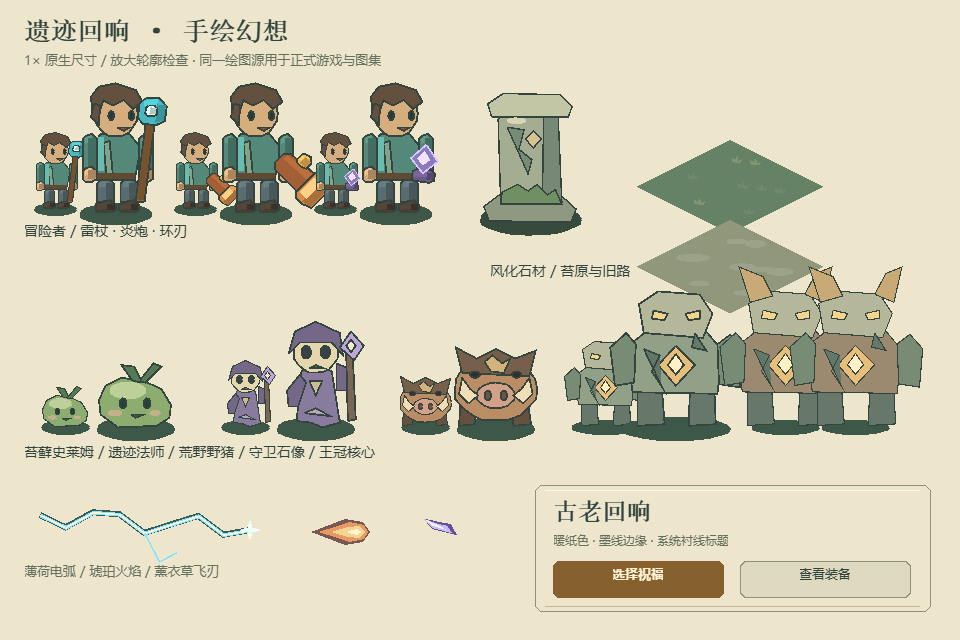

# 手绘幻想 · v0.12.0

用户选择“柔和材质、鲜明角色，技能与 UI 更有插画感”。本版以圆润脸部、非对称发束、植物形史莱姆、长袍法师、獠牙野猪及风化石像为代表，替换原来的方块外观。采用代码绘制的原创轮廓，再栅格化为共享纹理；未使用图片生成服务或外部图片素材。

## 视觉规则

- 等距 2.5D，角色脚底原点、原武器挂点与八向动作保留。玩家约 80 个逻辑像素高，普通怪约 35–65 像素；在原生尺寸及放大总览检查轮廓。
- 墨绿细轮廓、柔和明暗面和少量不对称边缘；草地降低细节对比，旧路采用扁平石斑，石柱用苔藓和裂痕区分材质。
- 雷电为薄荷亮色、火焰为琥珀色、飞刃为薰衣草色；敌方弹道保留红尖头及来源色。冰冻保留眼睛和核心识别。
- UI 使用暖纸色、切角边框与墨绿文字；大标题使用系统衬线字体，正文与操作文字保留系统黑体。不打包中文字体，不新增字体下载。
- Boss 落地预警保持真实 145 世界单位范围，并留在地面层；危险提示不受普通装饰预算限制。

## 渲染与资源预算

| 资源族 | 来源与覆盖 | 纹理策略 |
|---|---|---|
| 玩家及装备 | `appearance.ts`、`painted-art.ts`；8 朝向、4 走路姿势、12 施法姿势 | 当前装备 128 帧，一张 1024 宽、最高 2048 高的图集，最多 8 MiB；换装释放旧图集，姿势变化不上传 |
| 普通怪、石柱、掉落、常见弹道 | `voxel.ts`、`painted-world.ts`、`loot-presentation.ts`、`skill-visuals.ts` | 每档 128 帧共用一页；1.25 倍采样，1024² / 4 MiB；精细按需生成，合计最多 8 MiB |
| 地形 | `terrainShapes()`；3 种旧路、3 种草地 | 1.5 倍采样的小图集，2 MiB；重复铺设，不生成整幅世界位图 |
| 精英、Boss、未知弹色 | 同一美术源与原动作变换 | 有界矢量回退；不为了合批改变遮挡或技能判定 |
| 血条与危险提示 | `scene-renderer.ts`、`enemy-presentation.ts` | 血条背景/填充集中绘制，预警仍按危险状态更新；共用圆环采样点 |
| UI | `ui-controls.ts` 与原响应式布局 | 原生节点与系统字体，装饰不增加触控节点 |

资源均为透明背景，无 mipmap，沿用引擎默认双线性采样；图集边缘保留描边余量与间隔。上传后临时 Canvas 缩到 1×1，失败时回退相同绘图源。保持原深度排序，不按纹理重排实体。

默认装备场景纹理实测：标准约 10 MiB，同时创建标准和精细约 14 MiB；最坏预算 18 MiB。此数包含上述场景图集，不包含引擎、字形纹理、Canvas backing store 或进程总内存，不能用来排除微信退出问题。

## 验证与来源

`bench/art-board.html` 使用正式绘图函数生成美术总览；`node scripts/check-mobile-browser.mjs --art-board` 同时检查手机横竖屏、桌面和总览。微信构建配合模拟 SDK 检查多指摇杆、连续选卡、后台恢复、共享图集与冻结 DrawCall 拆分。原生 iPhone 的字体回退、温度、帧率和长时间稳定性仍需真机验收。

性能原始证据见 [render-results-0120.json](render-results-0120.json)。相同种子和数量的冻结场景由 243 降至 26 DC。另以新版美术进行两轮精细档矢量/图集开关对照，202 怪、206 初始弹道、103 掉落：矢量模式引擎 CPU 均值 22.83 / 20.18 ms，图集模式 1.62 / 1.61 ms。该开关实验使用的是新版美术，不能当作 v0.11.7 的 CPU 对比；开发机浏览器结果也不能转换为 iPhone FPS。

本版新增图形与排版由本项目代码原创绘制，无外部图片、外部字体或新增授权依赖；沿用项目代码的使用条件。LayaAir 引擎仍遵循 `vendor/LICENSE-LayaAir.txt`。资产清单见 [art-manifest.json](art-manifest.json)。
