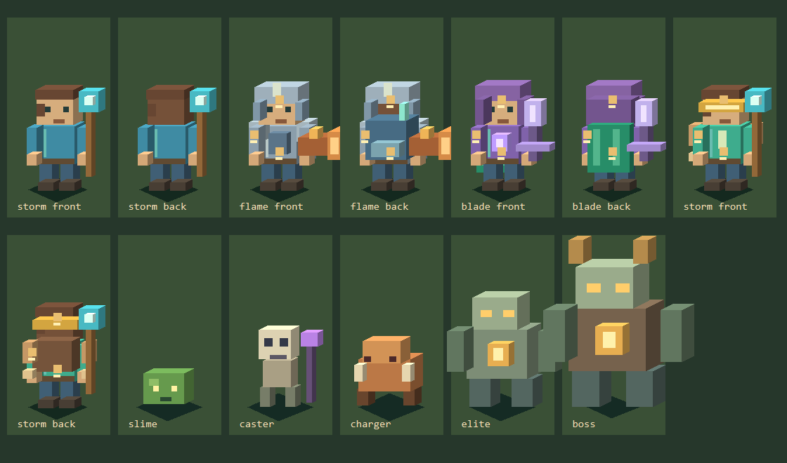

# 方块风格美术 0.6

本版使用纯 LayaAir 2.0.2 Graphics，以三面明暗的长方体拼接 2.5D 角色、装备和敌人。无需外部美术素材，也没有使用《我的世界》的纹理或角色资源。

该图由游戏相同的几何数据交给独立绘图器绘制，验证轮廓、配色与部件层次；它不是 WebGL 运行截图。正式游戏没有加载这张图片。

## 改动范围

- 主角有方块头、躯干、手臂、双腿、鞋和左右行走摆动。面部朝向、背面头发和背部装备区分前后视角。
- 雷杖使用青色方块晶体，炎炮使用橙色金属炮管，环刃采用紫色方块刃；头盔、兜帽、目镜、三种护甲和三种背饰可直接穿戴。
- 普通怪分别采用矮绿史莱姆、高瘦施法骷髅、横向展开的橙色冲锋野兽。精英和 Boss 用石像躯干与金色能量块区分。
- 地图使用低对比草地、十字石路、确定性色块、草簇、石块与三层方石柱。新增装饰不改变碰撞范围。
- 掉落采用经验小方块与装备箱，保留品质颜色和垂直指引。战斗特效改为方形弹道、阶梯状雷电、方块碎屑和十字飞刃；危险线与范围预警继续保留。
- UI 更新为苔绿、石色、金色主色，继续适配窄屏与横屏。

## 验证与限制

45 项自动化测试通过，包含全部 81 套装备组合 × 3 品质 × 四向绘图、输入与九种分辨率布局、战斗流程及十分钟模拟。

重跑 240 / 600 / 1000 只怪 × 三种武器的性能脚本。600 只下战斗计算平均 0.991—1.182 ms/步，绘图命令生成平均 0.163—0.212 ms/步。原始数据见 [performance-voxel.json](performance-voxel.json)。这次测试仍是无真实绘图的 Node 替身，不能衡量新增方块面数带来的 GPU 开销。真实 WebGL 压测入口仍为 http://localhost:8080/bench/index.html 。

实际浏览器渲染、真实 FPS 和手机验收尚未完成。场景和演员使用 2.5D 程序几何，不包含真实三维自由相机、地形编辑、挖掘与建造。
